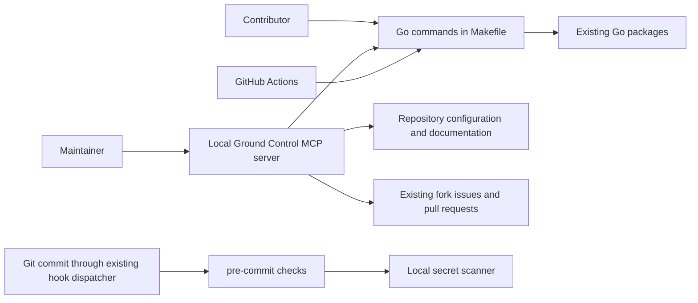
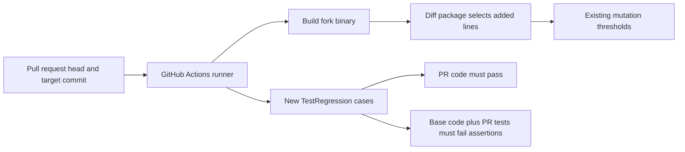

# ADR-001: Optional maintainer tooling

Status: Accepted

## Context

This fork uses the upstream Go module `github.com/go-gremlins/gremlins`.
Maintainers want Ground Control to work with the fork's GitHub issues and PRs
without changing the application or requiring contributors to install it.

## Decision

Keep the Go packages and their existing dependencies. The CLI in `cmd/`
coordinates configuration and the mutation engine in `internal/`. Coverage,
execution, mutation, diff, and report packages retain their existing roles.
The architecture vocabulary in `.ground-control.yaml` identifies the existing
implementation examples that agents should read; this decision applies
repository-wide. Use the schema supported by the installed release rather than
unreleased settings from another checkout.

Commit `.ground-control.yaml`, `.gc/plan-rules.md`, architecture references,
and setup documentation. Use the fork's `origin` identity and `main` base.
Keep `.env` and `.mcp.json` local and ignored. The MCP server runs locally;
review credentials and any source processing follow the user's approved
provider configuration. Onboarding provisions no service or credential.

Reuse pre-commit and Gitleaks rather than building a hook framework. Pin hook
repositories to commits. Commit checks cover staged files; CI also scans Git
history. The shared `core.hooksPath` dispatcher must continue to work.
Repository policy checks use the same hook configuration locally and in CI.
Full Go tests, race detection, and mutation testing remain CI responsibilities;
local implementation uses tests for the changed behavior.

The Gremlins workflow builds this fork rather than downloading an upstream
release. On pull requests it compares the PR head with the merge base of the
target commit and applies the existing mutation thresholds to changed lines.
The diff package remains responsible for identifying each added line, including
additions separated by context in one hunk. Main pushes retain the full mutation
run. The report skips threshold assessment when every mutant was skipped;
uncovered or surviving mutants still fail the configured thresholds.

All new Go test names must declare `TestRegression` for fixes or `TestFeature`
for new behavior; unclassified new names fail CI. Existing names are unchanged.
New regression tests use the `TestRegression` name prefix. The same workflow
requires each new case to pass on the PR head and fail an assertion on the merge
base with the PR's tests and test fixtures overlaid. Compile errors, skipped or
missing tests, and timeouts are failed proofs. A private Python standard-library
helper under `.github/scripts/` coordinates Git and `go test -json`; it adds no
application dependency. CI discovers dynamic subtests by running both revisions'
suites, and proves each new regression leaf independently. New subtests inherit
the classification of their parent; new names under an unclassified historical
parent fail CI. Feature and historical cases need no base-code proof. Full-suite
discovery remains a CI responsibility.

These jobs run through `pull_request` with read-only repository access and no
persisted checkout credentials. Test overlays and results stay on the runner;
no new service receives source or artifacts. The proof helper rejects test-file
symlinks before copying and never follows links while overlaying fixtures.

Generate Go coverage in the test matrix. Remove the inherited Codecov uploader
and its configuration because Codecov has no repository configured for this
fork. Do not grant CI an OIDC token permission for an unused integration.
Any future Codecov setup requires an explicit decision to enable the service
for the fork; test failures continue to fail CI independently of reporting.

Ground Control is optional. Native Git and Go commands remain supported.
Merging PRs and changes into `main` requires the user's approval.

## Consequences

The application gains no dependency. Maintainers install Ground Control
separately and register it locally. Contributors need pre-commit for the
repository checks but do not need Ground Control, Node.js, SonarCloud, or
review-provider credentials. Changes requiring features of a newer Ground
Control release need an explicit configuration upgrade after that release is
installed; onboarding does not upgrade host tooling or modify its source.
