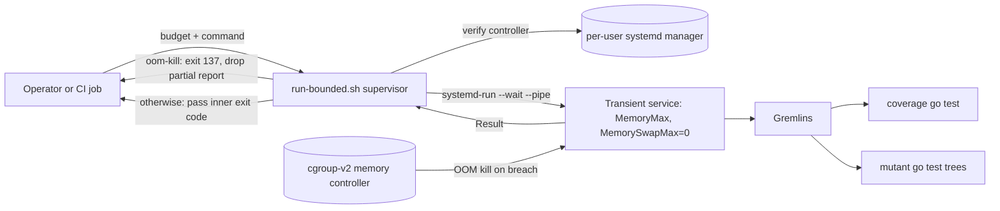

# ADR 0006: Bound the memory of a mutation run with a cgroup-v2 runner

Status: Accepted when #127 merges.

Design guidance: [memory-budget preflight](../development/memory-budget-preflight.md).
Operator guidance: [memory budget](../development/memory-budget.md).

## Context

Issue #127 reports that mutation runs apply a time limit but no memory limit.
A fast allocating mutant can exhaust the host before the time limit.
`internal/engine/executor.go` runs `go test` for each mutant.
`internal/coverage/coverage.go` runs `go test` for coverage.
`internal/engine/process_unix.go` and `process_windows.go` end a process tree.
A process group ends child processes; it does not cap their memory.

The issue asks for an established OS or runner resource limit, not a custom monitor.
It asks for a clear run result when the limit is reached.
It asks for a controlled allocator proof that does not exhaust the host.

## Decision

Bound one complete Gremlins invocation with a Linux cgroup-v2 memory controller.
Use the per-user systemd manager to run the invocation as a transient service.
Set these unit properties:

- `MemoryMax`: a finite, positive, operator-selected aggregate budget.
- `MemorySwapMax=0`: no swap for the workload.
- `OOMPolicy=kill`: end the whole unit when the kernel OOM killer fires.
- `KillMode=control-group`: end every remaining descendant when the unit stops.
- `Restart=no`: do not repeat the failing workload.

Run the unit synchronously with `systemd-run --wait --pipe`.
The budget covers Gremlins, coverage, module downloads, compilers, every mutant, and all descendants.
Containment starts at launch, so children created later stay inside the budget.
cgroup membership binds a child even when it starts a new process group.

A caller script owns the budget and stays outside the unit.
`scripts/run-bounded.sh` validates the budget and the controller, then starts the unit.
It reads the unit `Result` after the run.
On `Result=oom-kill` it prints a visible resource-exhaustion message, deletes any partial output, and exits with code 137.
On any other result it passes the inner exit code through unchanged.
So Gremlins threshold exits 10 and 11, and ordinary exit 1, stay intact.
The script never infers an OOM from a signal, exit 137, output text, or a time limit alone.

A signal to the script stops the unit first, so the workload does not keep running.
The script owns an isolated temporary root.
It passes the root to the unit as `TMPDIR` and `GOTMPDIR`, and removes it after the run.
So a group-wide OOM kill does not leave temporary files behind.
The script builds the workload environment from scratch with `env -i`.
It forwards the caller's non-secret allowlist, the `GREMLINS_*` configuration, and the non-secret Go settings, so a bounded run honors the same settings as a direct command.
So the per-user manager environment is not inherited by the workload.
It skips a value that carries URL credentials, and does not forward the manager bus address.
It escapes a dollar sign in the command line, so systemd treats the arguments as data.

The script uses only the per-user manager, so the command runs as the unprivileged invoking user.
It rejects an effective root caller, read from the shell's own effective user id, before any other action, so it never runs the command as root.
It verifies a finite memory limit and a zero swap limit before it runs target code.
It rejects a budget that is not smaller than the host total memory.
It fails with a clear message when no effective controller is available.
It never runs the workload without a budget, never uses sudo, and never runs the command as root.
The per-user manager is started with user-level `loginctl enable-linger`, which needs no sudo.

The budget lives in the runner configuration, not in a Viper key or a CLI flag.
The CLI flags, the configuration keys, the JSON report, and the exit codes do not change.
Native macOS and Windows invocations keep their current behavior; this guarantee is Linux only.

## Data flow

The supervisor and the kernel controller stay outside the bounded unit.
No data leaves the host; the proof and the run use local paths and existing CI only.

## Security and failure behavior

| Layer | Control | Verification |
| --- | --- | --- |
| Budget input | Reject a missing, zero, unlimited, malformed, or at-or-above-host-memory budget before launch. | Budget-parsing and excessive-budget cases in the acceptance check. |
| Controller capability | Verify a finite memory limit and a zero swap limit before target code runs; fail closed with no unbounded fallback. | Capability and swap-limit checks in the required CI job. |
| Privilege | Use only the per-user manager and reject an effective root caller, decided from the shell's readonly effective user id before any external command runs. The supervisor and target code run as the unprivileged user. No sudo, no root execution, and no system-manager path. | Root-rejection case under a real root context, and the fail-closed case, in the acceptance check. |
| Target environment | Build the workload environment from scratch with `env -i`, then forward the caller's allowlist, the `GREMLINS_*` configuration, and the non-secret Go settings, so the manager environment is not inherited and a bounded run matches a direct command. Skip a value that carries URL credentials. Do not forward tokens, the manager bus address, or the whole environment. | Caller-secret and manager-secret non-forwarding cases, and a safe-setting survival case, in the acceptance check. |
| Arguments | Pass the executable and arguments separately. Escape a dollar sign so systemd treats the command line as data. | Dollar-sign argument case in the acceptance check. |
| OS enforcement | The kernel enforces `MemoryMax` and `MemorySwapMax=0`; a child in a new process group stays bound. | Descendant-allocator case in the acceptance check. |
| Result and diagnostics | Read the unit `Result`; report the OOM result even under `--silent`; never infer OOM from a signal or a child exit 137. | OOM-result case and the non-OOM exit-137 negative control in the acceptance check. |
| Cancellation | A signal to the supervisor stops the unit before it returns, so `KillMode=control-group` ends the descendants. | Cancellation case in the acceptance check. |
| Cleanup and reports | Own an isolated temporary root and remove it after the run, including after an OOM. End the unit on OOM, drop partial output, and reset the failed unit. | Temporary-root and partial-report cases in the acceptance check. |

## Consequences

The mutation workflow runs through the bounded entry point.
A new required CI job proves the enforced limit with a small controlled allocator.
The job fails when the runner lacks an effective memory controller.
Per-mutant limits and continuation after one mutant exhausts memory need a separate decision.

## Non-goals

No new mutation type, CLI flag, configuration key, report field, or exit code.
No custom memory monitor, RSS poller, PID walker, per-process address-space limit, or `GOMEMLIMIT` enforcement.
No new Go package, dependency, architecture model rule, or baseline allowance.
No external service, daemon, privilege escalation, or image publication.
This boundary does not promise filesystem, network, disk, CPU, or hostile-code isolation.

## References

- [Linux cgroup-v2 memory controller](https://docs.kernel.org/admin-guide/cgroup-v2.html): hard limits, descendant accounting, and group OOM.
- [systemd resource control](https://www.freedesktop.org/software/systemd/man/systemd.resource-control.html): `MemoryMax` and `MemorySwapMax` need the unified hierarchy.
- [systemd service](https://www.freedesktop.org/software/systemd/man/systemd.service.html): `OOMPolicy=kill`, `KillMode=control-group`, and the `oom-kill` result.
- [systemd-run](https://www.freedesktop.org/software/systemd/man/systemd-run.html): a transient unit with synchronous waiting and exit propagation.

ADR 0002 governs the binary and distribution boundary.
ADR 0003 applies only if an implementation imports upstream changes.
ADR 0004 governs the architecture design evidence for this change.
