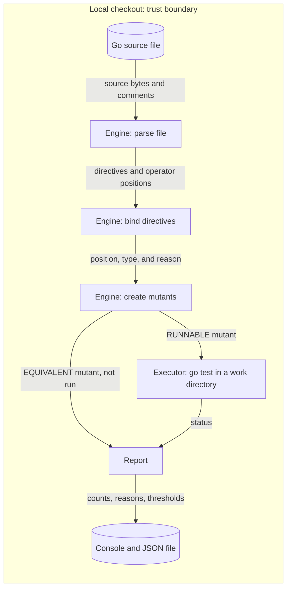

# ADR 0008: Annotate one equivalent mutant in the source

Status: Accepted when #201 merges.

Design guidance: [equivalent mutants preflight](../development/equivalent-mutants-preflight.md).
User guide: [equivalent mutants](../docs/usage/equivalent-mutants.md).

## Context

An equivalent mutant does not change the observable behavior, so no test can kill it.
Before #201, the only exception was `--exclude-files`, which removes every mutant of a file.
Issue #201 asks for an annotation that selects one mutant and records a review reason.
The other mutants on the same line and in the same file must stay active.

## Decision

A Go directive comment in the source file selects the mutant:

```go
//gremlins:equivalent TYPE[@COLUMN] REASON
```

- `TYPE` is a mutation type name from the report, for example `CONDITIONALS_BOUNDARY`.
- `COLUMN` is the 1-based byte column of the operator, as the report shows it.
- `REASON` is the review reason. It must contain text.

A directive after code on a line selects a mutant on that line.
A directive alone on its line selects a mutant on the next line.
Without `@COLUMN`, the line must have exactly one operator that can produce `TYPE`.

The engine binds every directive before it sends the mutants of the file.
It matches against all mutation types of each operator, enabled or not.
So a type that is disabled for a run does not make a directive stale.
It uses physical source positions. It rejects a target that a `//line` directive moves.

These directives stop the run with an error that names the file and line:

- A `//gremlins:` directive other than `equivalent`.
- A missing reason, an unknown type, or a column that is not a positive integer.
- A directive that matches no mutant, or more than one mutant.
- Two directives that match the same mutant.

A matched mutant gets the `EQUIVALENT` status, and the executor does not run it.
A matched mutant outside the diff, or that coverage cannot observe, stays `SKIPPED`.
In both cases, the JSON report keeps the reason in `equivalent_reason`.
The report adds the `mutants_equivalent` count.

Test efficacy and mutant coverage do not count `EQUIVALENT` mutants.
When every mutant is `SKIPPED` or `EQUIVALENT`, Gremlins does not assess the thresholds.
The `output-statuses` filter accepts `e` for `EQUIVALENT`.

## Reasons

- The directive stays next to the code. A code review sees the code and the reason together.
- The Go directive form `//tool:name` is the Go convention for tool comments. `gofmt` keeps it, and `go doc` hides it.
- Type and column identify one mutant. A line alone cannot, because one operator can produce two types.
- A stale, duplicate, or ambiguous directive is an error, so an exception cannot move to another mutant.
- [Other mutation testing tools](https://stryker-mutator.io/docs/stryker-js/disable-mutants/) use the same model: a source comment with a reason, and an ignored state outside the score.

## Data flow



No directive data leaves the checkout, and no directive value goes into a command or a path.

## Security

| Threat | Control | Verification |
| --- | --- | --- |
| An annotation hides a mutant that a test can kill. | Each directive selects exactly one mutant. Stale, ambiguous, and duplicate directives stop the run. Source review of the reason stays necessary. | Engine tests for adjacent mutants, the second type of one operator, and each error. |
| An `EQUIVALENT` mutant runs and changes the result. | The executor runs only `RUNNABLE` mutants. | Executor test: an `EQUIVALENT` mutant does not apply or run tests. |
| A `//line` directive points a selector at another file or line. | The engine matches physical positions and rejects a moved target. | Engine test with a `//line` directive. |
| A reason injects control characters into the console or the report. | Error messages quote input text. `encoding/json` escapes the reason. | Error and report tests. |
| A reason discloses confidential data. | The user guide tells authors to keep secrets out of reasons. | Documentation review. |

## Consequences

- The JSON report adds the `equivalent_reason` field and the `mutants_equivalent` count. Both are additive.
- The status set adds `EQUIVALENT`. A consumer with an exhaustive status switch must add it.
- `mutants_total` keeps its definition: killed, lived, and not viable.
- A directive with an error stops the run with exit code 1. The threshold exit codes do not change.
- An edit that moves the operator can make a directive stale. The run then fails, and the author must review the directive again.
