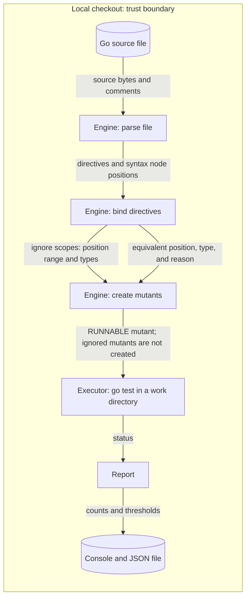

# ADR 0009: Ignore mutants with a source directive

Status: Accepted when #9 merges.

Design guidance: [ignore directive preflight](../development/ignore-directive-preflight.md).
User guide: [ignore mutants](../docs/usage/ignore-mutants.md).

## Context

Issue #9 asks for a source comment that disables mutants of an expression, a block, or a file.
It can disable all mutation types or a list of types.
The issue proposes `//nomutant` and `//nomutant:arithmetic-base,invert-bitwise`.
The issue dates from 2022. [ADR 0008](0008-equivalent-mutant-annotations.md) later added the `//gremlins:` directive family.

## Decision

A Go directive comment ignores mutants:

```go
//gremlins:ignore [TYPE[,TYPE...]]
```

- Without `TYPE`, the directive ignores all mutation types.
- `TYPE` is a mutation type name as the report prints it, for example `ARITHMETIC_BASE`.
- A comma separates the types. Space around a comma is permitted.

The directive position sets the scope:

| Position | Ignored mutants |
| --- | --- |
| After code on a line | The mutants on that physical line. |
| Alone on its line | The mutants in the code that starts on the line after the comment group. |
| Alone on its line, before the `package` clause | All the mutants of the file. |

"The code that starts on a line" is each syntax node that starts on that line, with its full extent.
Thus a directive before a function ignores the function. A directive before an `if` statement ignores all its branches.
The directive can be in a documentation comment, also after `gofmt` moves it to the end of the group.

The engine binds all the directives of a file before it sends the mutants of the file.
An ignored mutant is not created. It does not go to the workers, the report, the counts, or the thresholds.
A directive whose scope has no mutant is valid. A type that a run disables is also valid.
Scopes use physical positions, so a `//line` directive does not move a scope.

These directives stop the run with exit code 1 and an error that names the file and line:

- A `//gremlins:` directive other than `equivalent` or `ignore`.
- An unknown type, an empty type in the list, or a lowercase configuration name.
- A directive alone on its line with no code on the line after its comment group.

An `//gremlins:equivalent` directive in an ignored scope must stay valid.
The engine binds it against all the mutants before it removes the ignored mutants.

## Reasons

- The user chose `//gremlins:ignore` over `//nomutant`. It is in the same family as `//gremlins:equivalent`.
  [Go](https://go.dev/doc/comment) defines `//tool:name` as the tool directive form.
  `gofmt` keeps the directive as written, and `go doc` hides it.
  `gofmt` changes a bare `//nomutant` before a declaration to `// nomutant`.
- The user chose the report type names. Both directives then use one name form, the form of the console and JSON output.
- The user chose "not created" over a new `IGNORED` status.
  The JSON report, the status set, and the exit codes do not change. coldlight and env-packs read them.
- A scope from syntax nodes covers a multiline statement or function without a closing directive.
- A trailing directive uses the line scope of `//gremlins:equivalent`.
- [Stryker](https://stryker-mutator.io/docs/stryker-js/disable-mutants/) uses the same model: a comment, an optional mutator list, and line or block scope.
  Stryker reports disabled mutants as `ignored`. Gremlins does not, as the user chose.

## Data flow



No directive data leaves the checkout. No directive value goes into a command, a path, or the configuration.

## Security

| Threat | Control | Verification |
| --- | --- | --- |
| A directive hides mutants outside the intended scope. | The scope is one physical line, the syntax nodes that start on the next line, or the file. A misplaced standalone directive stops the run. | Engine tests for adjacent lines, sibling statements, functions, and files. |
| A type list hides other types. | The engine filters each operator position and type pair. | Engine test: ignore one type of an operator that has two types. |
| A typing error hides all types. | An empty or unknown list entry stops the run. Only a directive without arguments ignores all types. | Engine error tests. |
| A `//line` directive moves a scope to other code. | Scopes use physical token positions. | Engine test with a `//line` directive. |
| An ignore directive hides an invalid equivalent annotation. | Equivalent annotations bind before the ignore filter. | Engine test: an invalid annotation in an ignored file. |
| An ignore directive hides a mutant that a test can kill. | Gremlins does not prove the reason. Source review of each directive stays necessary. | Documentation review. |
| Input text injects control characters into the console. | Error messages quote the position. | Engine error tests. |

## Consequences

- No CLI flag, configuration key, JSON report field, status, or exit code changes.
- A `//gremlins:ignore` directive in a source file stopped the run before this change. It is now valid.
- The error of an unknown `//gremlins:` directive wraps a new error value, not the equivalent annotation error.
- When the directives ignore all mutants, the run has no results. The existing no-results path applies.
  It does not write or replace the JSON output file.
- A file that the directives ignore is still in the coverage run and in each work directory copy.
