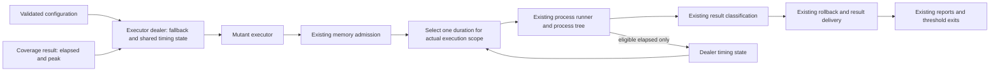

# Adaptive timeout boundaries for issue #19

> Current context (2026-11-24): This is a historical record of issue #19 at its reviewed revision.
> Current behavior: [unleash command](../docs/usage/commands/unleash/index.md) and [workers and timeouts](../docs/usage/commands/unleash/workers.md).
> The workers page now gives the default timeout coefficient of 5.

Issue #19 requires package-specific timing, concurrent access, documentation, measured speedup, and the existing coefficient fallback.
This preflight reviewed revision `f5a9bff06ffc73fa0f156347112b49eec9578cc4`.
The issue sketch is illustrative; recording every mutant duration would make early failures into unsafe timing estimates.
No runtime implementation or implementation sequence is included here.

## Design decision

Keep timeout policy inside `internal/engine`, owned by one `MutantExecutorDealer` and shared by its executors.
Use a private synchronized map of package import paths to elapsed durations.
Reuse standard-library time and synchronization primitives, existing executor options, and the established process runner.
No new package, public interface, dependency, persistence layer, or ADR is needed.
[Design 19](../../.architecture/designs/19.json) records the package and trust boundaries under ADR 0004.

The proposed policy has these invariants:

| Concern | Guardrail |
| --- | --- |
| Fallback | Preserve `max(coverage.Elapsed, 1s) × coefficient`; zero selects the existing default of five. |
| Eligible sample | Learn only from a positive-duration command that returns no error, exceeds no memory limit, and completes without context cancellation. This corresponds to `Lived`, not a failed mutant. |
| Sample retention | Retain the maximum eligible elapsed duration per package. A later fast completion cannot lower the estimate. |
| Adaptive duration | Use `min(fallback, max(1s, margin × retained elapsed))`. The margin is the timeout safety margin setting; zero selects the default of two. The one-second floor is a named internal constant. |
| Arithmetic | Check multiplication and the two-second Go timeout addition before overflow. Saturate at a positive representable limit with space for that addition. Preserve ordinary representable fallback values. |
| Execution identity | Use the import path already supplied by `Mutator.Pkg()` and `Engine.pkgName`. Never use a package declaration, basename, worker ID, or temporary directory. |
| Integration mode | Retain the global fallback. The command runs `./...`, not the mutated package alone, so its timing must not populate a package estimate. |
| Lifetime | Create state per dealer, which the CLI creates per invocation. Share a pointer to synchronized state; do not copy a mutex through value receivers or options. |
| Admission | Select the timeout after `memoryPlan.reserve` succeeds, immediately before command execution. Queued executors must see samples recorded since their creation. |
| Consistency | Select one immutable duration per command. Use it for both `context.WithTimeout` and `getTestArgs`, retaining the existing two-second inner Go timeout grace. |
| Concurrency | Protect reads and maximum updates together with the existing synchronization style. Never hold the cache lock during admission, subprocess execution, logging, or cleanup. |
| First concurrent runs | Several workers can legitimately use the fallback before an eligible sample exists. Do not serialize a package or add another scheduling queue to force exactly one first run. |

The one-second adaptive floor deliberately differs from the issue's illustrative 200ms timeout.
The deadline covers process startup, build, vet, tests, and runner cleanup; a bare test-body duration does not cover this work.
The floor reuses the repository's existing protection against very short deadlines.
The fallback cap keeps this optimization from increasing an operator's existing timeout budget.
These choices need explicit review as timeout behavior.

## Why the sketch needs guardrails

`getTestArgs` includes `-failfast`.
A killed mutant can fail its first assertion long before other tests would finish.
Build failures, setup failures, panics, timeouts, memory errors, and infrastructure errors are also unsuitable timing baselines.
Do not record their durations, use them to shrink the cache, or classify their errors differently to obtain samples.
In particular, `TimedOut` measures an imposed limit, not a completed workload.

Successful commands also remain heuristic samples: a mutation can remove work, and system load can change.
The maximum, floor, and margin reduce risk; they do not prove that a later mutation needs no more time.
Packages without a successful sample retain the fallback, including packages where every mutant is killed.
This limits the speedup; document it instead of promising adaptation after every first mutation.
Do not add clean calibration runs, automatic retries, or relaxed quality thresholds to conceal this limitation.

Before this change, the mutant command did not use `-count=1`; the coverage command already used it.
The installed Go 1.26.11 `go help test` confirms that package-list mode can reuse successful test results.
Both `-failfast` and `-timeout` are cacheable flags, and cached results do not rerun the test binary.
Use explicit `-count=1` for adaptive package commands so a fast cache hit cannot become an execution sample.
Keep Go's build cache; do not clear caches or add `-a`.
No output parser or JSON event stream is needed to collect wall-clock durations.

The issue's compatibility claim must distinguish stable interfaces from identical results.
Changing a deadline can change `Lived` or `Killed` to `TimedOut`, which changes report counts and threshold inputs.
Do not claim that a margin of two guarantees unchanged outcomes or zero false timeouts.

## Existing owners and data flow

| Concern | Canonical incumbent and reuse requirement |
| --- | --- |
| Composition and validation order | `cmd/unleash.go`: `runUnleash` validates configuration before coverage; `run` constructs one dealer from `coverage.Result`. |
| Coverage baseline | `internal/coverage/coverage.go`: retain aggregate `Elapsed`, separate module download, and existing coverage parsing. Do not create a second coverage schema. |
| Execution policy | `internal/engine/executor.go`: `NewExecutorDealer`, `NewExecutor`, `runTests`, and `getTestArgs` own timeout selection and execution. |
| Admission and scheduling | `internal/engine/memory.go` and `internal/engine/workerpool`: preserve slot limits, cancellation, result delivery, and worker concurrency. |
| Package routing | `Engine.pkgName`, `internal/engine/pkgrouting_test.go`, and executor working-directory rules already handle module roots and subdirectory invocation. |
| Source isolation | `internal/engine/workdir`: retain cached copies, `GOTMPDIR`, discard on uncertain source state, rollback, and final cleanup. Its cache stores directories, not timing observations. |
| Process ownership | `internal/process.RunBounded`: retain Unix process groups, Windows jobs, memory accounting, cancellation, descendant cleanup, and bounded pipe waits. |
| Classification and errors | Reuse `mutator.Status`, `markerWriter`, `getTestFailedStatus`, `%w`, `errors.Is`/`As`, and joined cleanup errors. Infrastructure failure remains an error. |
| Reports and observability | `internal/report` owns counts, report DTOs, filters, and threshold assessment. `internal/log` owns console output and silent mode. |

There is no controller, authentication service, database, or repository persistence layer in this local CLI flow.
The map is bounded by packages observed within one dealer and is discarded with that dealer.
Do not combine it with Viper's global state, work-directory storage, the Go test cache, or report persistence.
Do not add per-mutant output, a metrics service, or timing fields to the report for this optimization.
One run log line states the fallback timeout and the margin. Existing elapsed reports and measurement evidence give the rest.

## Cross-cutting security and validation

| Layer the design passes | Required treatment |
| --- | --- |
| Operator authority | Tests still execute with the caller's permissions. Temporary copies and time limits do not provide hostile-code isolation. No authentication or authorization surface is added. |
| CLI and environment shape | Reuse Cobra, `cmd/internal/flags`, and `configuration.Init` environment binding. Preserve `GREMLINS_UNLEASH_TIMEOUT_COEFFICIENT`, tags, CPU settings, and configuration precedence. |
| Runtime configuration gate | Keep `configuration.Validate`, `typedKeys`, and `boundedKeys`: coefficient values must convert to integers and be nonnegative. Duration arithmetic is contextual engine logic, not a duplicate configuration validator. |
| Editor schema and contract tests | `docs/docs/schema/configuration.json` and `cmd/schema*_test.go` remain canonical. The schema is editor guidance, not the runtime validator. Add the safety-margin key with the same treatment as the coefficient key. |
| Timing input | Accept only positive, eligible monotonic elapsed measurements using `time.Now` and `time.Since`. Exclude admission and work-directory copying; include the complete `process.RunBounded` call. |
| OS arguments | Keep `exec.CommandContext` and separate arguments. Only non-secret durations and the existing Go test options enter argv. No shell interpolation, launcher, PID walker, or timer-kill goroutine. |
| Environment and secrets | Preserve the current environment and `GOTMPDIR` behavior. Never dump environment values, commands, captured test output, or credentials to explain cache decisions. Do not read secret files. |
| Parent cancellation and resources | Preserve the original parent context separately from the child deadline. A cancelled invocation must not create a sample or report a mutant. Preserve memory-error precedence and all process cleanup. |
| Errors and output | Preserve wrapped Go errors and existing status classification. `RunBounded` can join cleanup failures with process errors; an exit error alone is not proof of an eligible sample. Add no error envelope or exception hierarchy. |
| Outer containment | Preserve `scripts/run-bounded.sh`, its allowlist, and the ADR 0006 cgroup boundary. Timeout adaptation neither replaces memory limits nor requires new environment forwarding. |
| Development policy | Use `.architecture/model.json` and `scripts/check-design.sh` unchanged. Keep the existing baseline, lint rules, shared hook dispatcher, secret scanning, and secret-free test jobs. No new service or data destination. |

The architecture checker validates package ownership, imports, contract declarations, and modeled development boundaries.
It does not prove runtime arithmetic, cache synchronization, classification, or privacy of arbitrary subprocess output.
Those remain code-review and targeted-test obligations.

`go.mod`, `mise.toml`, `.golangci.yml`, and `Makefile` remain the canonical toolchain, lint, and command owners.
`.pre-commit-config.yaml` and `.github/workflows/ci.yml` retain hook, platform, and security checks.
`.gremlins.yaml` and `.github/workflows/gremlins.yml` retain mutation-testing configuration and execution.
`.ground-control.yaml` and `.gc/plan-rules.md` retain workflow and contract guidance.

## Extension seam and public contracts

Keep duration selection and sample eligibility as small private engine operations with explicit inputs.
The selection inputs are execution scope, fallback, retained duration, floor, and margin; command construction consumes the selected result.
This permits later tuning without duplicating policy in argv construction or worker scheduling.
Do not introduce a generic policy interface or exported clock abstraction before a second implementation exists.

The dealer already fixes module, tags, CPU settings, and execution mode for its lifetime.
A package import path is sufficient within that scope; a future reusable dealer or persistent cache would require configuration-aware invalidation.
Future suite-level adaptation needs a suite scope distinct from a mutated package; keep integration mode conservative now.

The issue proposes an optional `timeout-safety-margin` setting. The implementation adds it.
Without it, an operator who sees false `TIMED OUT` results cannot restore the fallback timeout.
A large margin restores the fallback, because the fallback caps the adaptive duration.
The setting reuses the configuration constants, flag binding, typed and range validation, schema, schema tests, and usage documentation.

Update the timeout explanation in `docs/docs/usage/commands/unleash/index.md` and the related workers guidance with the eventual behavior.
Document eligible samples, the floor, the cap, integration fallback, coefficient semantics, and the absence of a speedup guarantee.
The workers page currently states a default of three; the executor default is five.
Correct that statement and its advice about increasing the coefficient: an increase of the fallback does not increase a learned timeout. The safety margin controls the learned timeout.

Update the existing schema property's description to identify fallback semantics, while retaining its type, default, bounds, and key.
Add the safety-margin property with the same type, default, and bounds as the coefficient property.
This compatible schema-description change is declared in design 19; it does not introduce another schema or runtime validator.
The existing CLI flags, configuration keys, JSON report fields, and exit-code meanings remain stable for downstream consumers. The new flag and key are compatible additions.
Ordinary failures remain exit 1; threshold exits remain 10 and 11 through `internal/execution.ExitError`.

## Evidence required from implementation

Use table-driven tests for fallback, coefficient zero, margin, floor, cap, saturation, package isolation, maximum retention, and ineligible results.
Exercise concurrent reads and updates through the shared dealer, including executors constructed before another command records a sample.
Prove that admission waits do not consume the command deadline and that the context and Go timeout use the same selection.
Retain coverage of integration routing, dry-run, skipped mutants, parent cancellation, memory errors, process-tree cleanup, and rollback failures.
Avoid broad timing tolerances such as the existing `TestMutatorRun` allowance of 100 seconds.

Reuse `WithExecContext`, executor stubs, helper processes, and bounded channel waits before adding test infrastructure.
Use temporary standard-library-only modules and controlled child environments for actual execution evidence.
Keep global Viper, environment, and Logger changes serial and restore them through existing cleanup conventions.
The outer race detector does not enable `-race` in nested target commands.

The speedup acceptance criterion needs measured elapsed time, not just a shorter configured deadline or a map benchmark.
Use a mixed fast/slow workload with eligible samples and later intentional hangs; compare the baseline and candidate under equivalent settings.
Record revision, platform, worker count, cache conditions, elapsed times, selected deadlines, and statuses, including a normally completing slow package.
Show that the shorter deadline stops the complete process tree and that build-cache differences do not explain the result.
Do not claim universal speedup: adaptation helps hanging mutants after learning and can offer no benefit when all runs finish or no sample qualifies.

Use targeted `go test -race ./internal/engine -run '<selected tests>'` for changed behavior.
CI owns full suites, platform execution, and mutation testing through the existing workflows.
Mutation assertions must detect missing sharing, wrong package keys, unsafe samples, and mismatched deadlines where practical.
Use `TestFeature` for new capability; reserve `TestRegression` for a demonstrated existing defect under the repository's regression-proof rules.
No runtime, race, mutation, or speedup claim follows from this documentation-only preflight.

### Preflight validation

`make architecture-design` passed ARCH001, ARCH002, ARCH003, and ARCH004 with the existing model and no baseline exception.
The model SHA256 was `c28bab810f1497d79aea1fcac11781ad83abf8d2e7b36cb8c78a8e7225243f6b`.
The command used the pinned Go 1.26.11 toolchain through `mise exec`, offline module settings, and `/tmp/gremlins-19-go-cache`.
Record this digest and result in the later implementation's design evidence; no issue plan is created by this preflight.

`bash scripts/doc-tools.sh lint docs/development/adaptive-timeout-preflight.md` passed with zero findings using the existing pinned tools.
`make policy` passed `pre-commit validate-config` but could not fetch its pinned hooks because the sandbox could not resolve `github.com`.
The hook cache was confined to `/tmp/gremlins-19-precommit-cache`; no hook was bypassed or reconfigured.
No Go test suite, runtime benchmark, or mutation run was needed for these guidance files.

## Binding guidance and non-goals

ADR 0004 governs design evidence; ADR 0006 governs the existing outer memory boundary.
ADR 0001 preserves the fork module identity. ADR 0003 applies only if upstream code is imported.
The contribution guide and maintenance plan own migrated-issue disposition and publication; this preflight does not infer or change triage state.
The user owns merges into `dev` and `main`.

No issue implementation, new Mutation type, calibration pass, retry strategy, scheduler, persistent cache, percentile estimator, or timing parser.
No CLI flag or configuration key other than the safety margin. No new schema, report field, exit code, service, credential path, model exception, or workflow fork.
Do not reformat byte-exact `testdata`, copy upstream code without its required provenance, or relax quality thresholds to demonstrate speedup.
