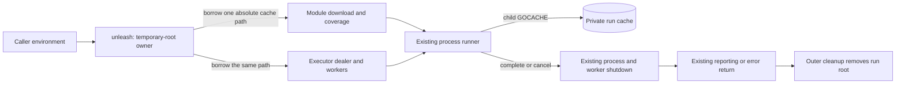
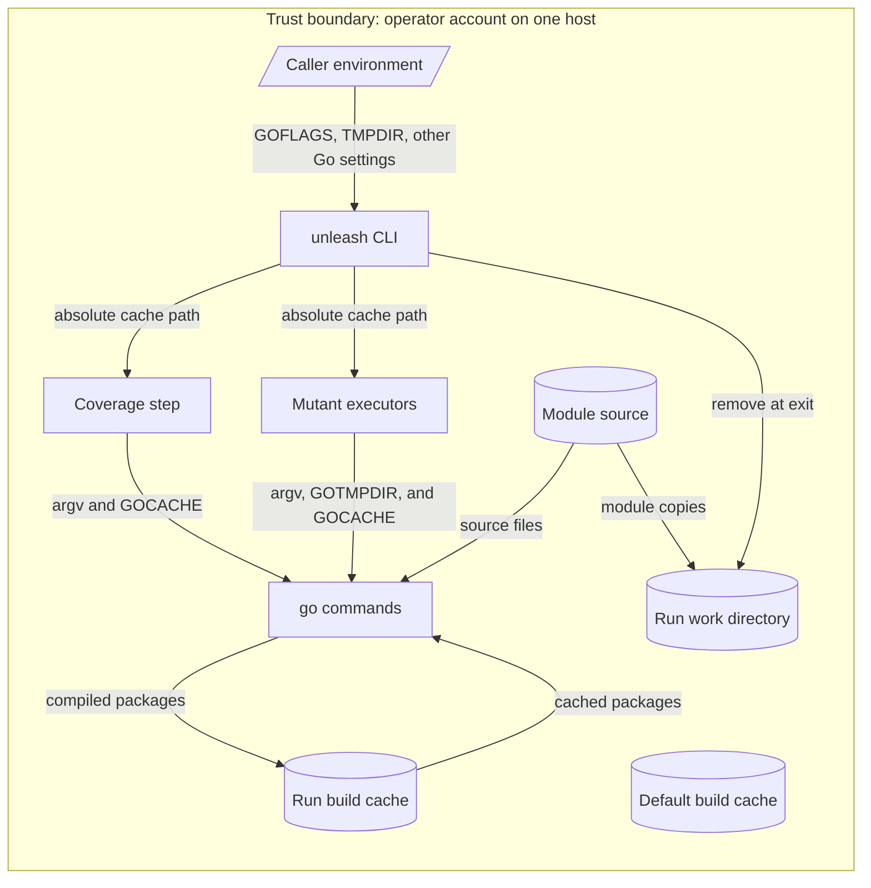

# Build-cache boundaries for issue #8

Issue #8 requires a separate temporary Go build cache, removed after each Gremlins run.
The supplied issue is the contract; it requests no public setting.
This review inspected revision `f5a9bff06ffc73fa0f156347112b49eec9578cc4`.
This preflight changes no runtime code or tests.

## Decision and ownership

Use one private build-cache directory beneath the temporary root already owned by `cmd/unleash.go`.
Create it before any Go child starts, resolve its absolute path, and share it throughout that invocation.
Keep it separate from coverage files, disposable build files, and worker source copies.
Each invocation gets a different directory, including concurrent invocations in the same module.

The CLI composes the path into coverage and the executor dealer through their existing construction and option seams.
Pass an immutable path explicitly; do not put resource ownership in Viper, context values, or package globals.
Coverage and executors borrow the directory; neither deletes it.
Keep `coverage.Result` focused on its profile and measurements, rather than using it to transport run-resource ownership.
The existing outer `cleanUp` removes the owning root after coverage, workers, processes, and reporting finish.
Its existing error logging remains the cleanup-failure policy; this issue adds no exit code or changed threshold behavior.

Set `GOCACHE` for every Go child: module download, cache preparation, baseline coverage, and every mutant test command.
When the `GOCACHE` environment variable has a value, the run uses that cache, and Gremlins makes no run cache.
The maintainer chose this rule after measurement. An empty cache added about 11 s to each run.
It also made the CLI test packages exceed the 60 s limit of the CI regression proof.

Preserve the caller's environment and Go configuration outside those children.
Do not write `go env -w` or temporarily change the process environment with `os.Setenv`.

Go requires an absolute `GOCACHE` and supports concurrent commands sharing it.
Use Go's existing cache implementation, locking, and eviction behavior; do not add a cache manager.
See the [Go command reference](https://pkg.go.dev/cmd/go#hdr-Build_and_test_caching).
[ADR 0009](../adr/0009-temporary-build-cache.md) records the decision.
The checkable proposal is [design 8](../../.architecture/designs/8.json), under [ADR 0004](../adr/0004-architecture-model-checks.md).

## Data flows

All flows stay in the operator account on one host. No flow crosses a network or privilege boundary.
The run build cache is inside the run work directory, so one removal deletes both.
The default build cache gets no data from a run.

## Canonical incumbents and whole-repository scope

| Concern | Existing owner and required reuse |
| --- | --- |
| Run composition and resources | `cmd/unleash.go`: `runUnleash`, `run`, and `cleanUp` own the temporary root and all handled returns. Register cleanup as soon as allocation succeeds. |
| Coverage commands | `internal/coverage/coverage.go`: `New`, `NewWithCmd`, `Option`, `downloadModules`, and `executeCoverage`. Both commands currently inherit the environment when `Cmd.Env` is nil. |
| Mutant commands | `internal/engine/executor.go`: `ExecutorDealerOption`, `WithExecContext`, dealer-to-executor construction, and `runTests`. Preserve package and integration working directories. |
| Source isolation | `internal/engine/workdir/workdir.go`: `CachedDealer` caches worker module copies. Its cache is not the Go build cache. `Discard` must not remove shared build artifacts. |
| Shutdown and resources | `internal/process.Run` and `RunBounded`, `Engine.Run`, and `workerpool.Pool.Stop` own child-tree control, memory admission, cancellation, timeouts, and worker completion. |
| Configuration | `cmd/internal/flags`, `configuration.Init`, `Get`, `Validate`, `typedKeys`, and `boundedKeys` own Cobra/Viper bindings and validation. The configuration JSON schema supplies editor guidance. |
| Failures and output | Ordinary wrapped Go errors, `errors.Is`/`As`, and existing joined errors remain canonical. Logger owns diagnostics; `ExitError` owns threshold codes; `internal/report` owns JSON. |
| Outer containment | `scripts/run-bounded.sh` and ADR 0006 own the supervisor's temporary root, `TMPDIR`, environment allowlist, cgroup, and OOM cleanup. A nested run cache remains beneath that root. |
| Development controls | `go.mod`, `mise.toml`, `.golangci.yml`, `.architecture/model.json`, `scripts/check-design.sh`, the Makefile, and shared hooks retain their current roles. |
| Hosted verification | `.github/workflows/ci.yml` owns the Linux, macOS, and Windows matrix. `gremlins.yml`, `.gremlins.yaml`, and the regression-proof helper own mutation and regression evidence. |

There is no HTTP controller, authentication service, DTO, database, or application error envelope in this flow.
No new schema, validator framework, exception hierarchy, service layer, persistence store, or workflow is needed.

Keep Go-specific cache policy out of the generic `internal/process` lifecycle API.
The internal extension seam is the borrowed cache path at construction, independent of worker identity and source-directory layout.
A future internal Go-command consumer can receive the same path without changing the public configuration or cache owner.
`internal/diff` launches Git, not Go; it needs no cache override.
`scripts/lint.py:analysis_env` isolates static tooling and deliberately removes runtime settings; it is not a runtime environment template.

## Security, validation, and host boundaries

| Layer | Required treatment |
| --- | --- |
| Operator authority | Run the same operator-selected tests with existing caller privileges. Temporary copies and cache directories are not a hostile-code sandbox. |
| CLI and configuration shape | Preserve Cobra argument checks and `configuration.Validate` before execution. `GOCACHE` belongs to Go's environment namespace; add no `GREMLINS_*` binding, YAML key, or schema entry. |
| Filesystem allocation | Reuse `os.MkdirTemp` and private directory permissions. Create only inside the owned root; never delete the caller's inherited cache. Resolve paths with `filepath`, including spaces and Windows volumes. |
| Source-tree placement | Keep the run cache outside the original module and worker copies. A `TMPDIR` inside the module exposes it to the whole-source copy walk. Reject this unsafe layout before Go execution; account for symlink aliases when checking ancestry. Do not add a general copy-exclusion framework or silently choose another filesystem. |
| Child environment | Preserve normal inherited variables and explicitly supplied command environments, including helper-process markers. Append the owned `GOCACHE` override after competing values. Respect Windows key semantics and Go's last-value rule. |
| OS execution | Retain `exec.CommandContext`, separate arguments, and existing process-tree control. The path is environment data, not shell syntax or a new argv value. Do not dump environments or add shell wrappers. |
| Credentials and module resolution | Preserve `GOFLAGS`, `GOMODCACHE`, `GOPATH`, `GOPROXY`, `GOPRIVATE`, `GOENV`, and toolchain behavior. Add no credential reads, network request, backend, upload, or broader runner allowlist. |
| Errors and observability | Cache allocation and path errors abort through `%w` before tests. Never fall back to the persistent cache. Keep diagnostics bounded to operation, path, and error; do not echo environment or cache contents. |
| Cleanup | Wait for existing process and worker shutdown before removal. Keep `cleanUp` error diagnostics visible under `--silent`; do not mask a primary failure or replace threshold exits. |
| Architecture and CI | Use the existing strict design decoder and ARCH001–ARCH004 rules. Preserve dependency directions, approved imports, baselines, secret scanning, and secret-free candidate jobs. |

For command environments, [`exec.Cmd.Environ`](https://pkg.go.dev/os/exec#Cmd.Environ) preserves an explicitly configured environment.
Set `Cmd.Dir` before taking that snapshot, so supported platforms receive the correct `PWD`.
The current executor appends `os.Environ()` after factory-provided values.
Consequently, a cache override supplied only by a command factory can lose to the inherited value.
Fix precedence at the final command boundary; do not blindly copy this merge into coverage or erase injected helper markers.
Small standard-library environment assignments are preferable to a new generic command or environment framework.

## Gotchas and limits

- `GOCACHE`, `GOTMPDIR`, and `GOMODCACHE` serve different purposes.
  Preserve the current mutant `GOTMPDIR` override and module-cache behavior.
  Do not reuse the coverage directory, a worker copy, or the whole run root as the build-cache directory.
- Share the cache across baseline and all workers; a cache per mutant or worker repeats compilation and loses useful reuse.
  Do not serialize Go cache access with a new application mutex.
  Preserve Go's test-result caching semantics and the existing coverage `-count=1` argument.
- `--dry-run` still downloads modules and executes coverage tests, so it also needs the temporary cache and cleanup.
  Package mode, integration mode, subdirectory invocation, cancellation, report-write failures, and threshold exits use the same ownership rule.
- A fresh cache adds compilation cost, including standard-library builds.
  Coverage elapsed time and peak memory feed mutant timeout and memory limits; their values can change with a cold cache.
  Before the timed coverage run, `go list -buildvcs=false -export -deps -test` compiles the packages, tests, and dependencies into the cache.
  The timed run then measures about the same work as a run with a full default cache.
  On this repository, one package took 10.7 s with an empty cache and 2.2 s after the preparation.
  The `go test` command does not stamp VCS information, so the preparation disables it too.
  Do not recalibrate those algorithms or promise faster runs under this issue.
- Existing process tests run several CLI invocations concurrently with a two-minute helper limit.
  Independent cold caches can increase CPU, disk, and memory pressure substantially, especially on Windows and macOS.
  Prefer small probe modules and bounded concurrency; do not hide failures with arbitrary global timeout increases.
- Temporary storage limits growth across completed runs; it does not cap disk usage during a run.
  A `tmpfs` cache can also consume the bounded runner's memory budget.
  Allocation failures must abort; later Go cache I/O failures must never trigger a fallback to the user cache.
  The existing mutant output classifier does not distinguish every disk failure from a failed test; do not claim otherwise.
- [`GOCACHEPROG`](https://pkg.go.dev/cmd/go#hdr-Environment_variables) selects an operator-managed external build-cache backend.
  The local-directory deletion guarantee does not delete that backend's storage.
  Preserve this separate operator policy; do not silently disable it, set `GOENV=off`, or claim universal artifact isolation.
  An empty environment assignment can still fall back to Go's persisted settings.
- Ordinary errors and handled SIGINT/SIGTERM permit deferred cleanup.
  SIGKILL, a crash, power loss, or filesystem deletion errors can leave files behind.
  Preserve the outer supervisor's cleanup where present; add no scavenger, daemon, retry service, or stronger crash-cleanup claim.
- Private temporary directories protect against other users under normal OS permissions, not malicious code running as the same user.
  Windows ACLs and open handles differ from Unix permission bits and unlink behavior; use the existing platform test matrix.

## Evidence required from implementation

Use the existing [test standard](test-standard.md), table-driven cases, command injection seams, and CLI process-test harness.
Do not add tests or run mutation testing for this documentation-only preflight.
Implementation evidence must establish these observable properties:

- Without a `GOCACHE` value, every Go command receives the same absolute run-owned cache. With a value, every Go command receives that value.
  Check the effective last value, not the first matching entry in `Cmd.Env`.
  Preserve explicit helper environments, unrelated Go settings, and `GOTMPDIR`.
- A real, dependency-free probe populates that cache, and the default cache directory stays empty.
  Verify that no build artifacts appear there; a command-holder assertion alone cannot establish actual Go behavior.
  Keep probe configuration explicit and network disabled, using temporary synthetic data.
- The owned cache disappears after success, failed coverage, cancellation, report failure, and threshold returns.
  Observe removal before test-fixture cleanup, so `t.TempDir` cannot conceal a leak.
  Verify ownership isolation between invocations and safe failure for invalid temporary placement or allocation.
- The regression fails on the original behavior and passes with the fix.
  Use targeted race tests locally and the existing hosted regression, mutation, and supported-platform jobs.
  Removing either the override or cleanup must be detectable; no new test framework or workflow is needed.

## Non-goals and implementation boundaries

No mutation type, status, flag, configuration key, JSON report field, exit code, dependency, or runtime package is added.
Do not run `go clean -cache`, seed from or delete the user's cache, persist a new cache, or change module downloads.
Do not rewrite work-directory copying, process control, error classification, memory budgeting, compiler flags, or CI caching.
The only added Go subprocess is the cache preparation before the timed coverage run.
Limit production changes to run-resource composition and child cache-path propagation in the existing owners.

ADRs 0001 and 0002 preserve module and binary identity; ADR 0003 applies only if upstream code is imported.
Copied-issue triage and user-owned merges remain governed by the contributor guide.

## Preflight verification

`mise exec -- make architecture-design` passed ARCH001, ARCH002, ARCH003, and ARCH004 on 2026-11-22.
The check used an isolated temporary compiler cache, `GOPROXY=off`, and `GOTOOLCHAIN=local`.
Model SHA-256: `c28bab810f1497d79aea1fcac11781ad83abf8d2e7b36cb8c78a8e7225243f6b`.
The package owners, compatible CLI declaration, and constrained evidence destinations require no model or baseline change.
The checker verifies declared relationships; source review establishes the lifecycle and environment assertions.

`bash scripts/doc-tools.sh lint docs/development/build-cache-preflight.md` passed with no findings.
JSON syntax, local documentation links, and diff whitespace checks passed.
No runtime test, full suite, or mutation run was performed; those results cannot be inferred from this preflight.
Concurrent coverage implementation edits appeared during review and were left untouched.
The assertions above describe the inspected starting revision, not approval of those in-progress edits.
