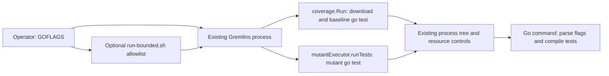

# Compiler flag boundaries for issue #14

Issue #14 asks to run target tests with `-gcflags=all=-l` for monkey patching.
It does not require a new Gremlins flag or configuration key.
This preflight reviewed revision `96a6e0a21291f501d051b6cb914df739000f2b16`.
No runtime code or tests were changed.

## Design decision

Use the existing Go environment boundary: `GOFLAGS='-gcflags=all=-l' gremlins unleash` in a POSIX shell.
The current command paths already preserve this setting.
Treat this as an existing capability to document and verify, unless characterization exposes a specific defect.
Do not add a compiler-option abstraction, argument forwarding framework, or special monkey-patching mode.
The issue supplies no evidence that a separate Gremlins option is necessary.

Go owns `GOFLAGS`, the package pattern `all`, and compiler argument parsing.
The compiler option `-l` disables inlining; it does not disable every optimization.
The `all` pattern includes dependencies, which a package-local `-gcflags=-l` does not guarantee.
See the official [Go command reference](https://pkg.go.dev/cmd/go) and [compiler reference](https://pkg.go.dev/cmd/compile).

No new ADR is needed. Existing ownership and trust boundaries cover this decision.
The architecture input is [design 14](../../.architecture/designs/14.json).
It permits characterization in the existing CLI process-test package without changing production imports or public contracts.

## Existing owners and data flow

| Concern | Canonical incumbent and boundary |
| --- | --- |
| Composition | `cmd/unleash.go`: `runUnleash` validates Gremlins settings; `run` composes coverage, work directories, execution, and reports. |
| Baseline compiler settings | `internal/coverage/coverage.go`: `downloadModules` and `executeCoverage` use `exec.CommandContext`; an unset `Cmd.Env` inherits the caller environment. |
| Mutant compiler settings | `internal/engine/executor.go`: `runTests` appends `os.Environ()` and its existing `GOTMPDIR` override; `getTestArgs` supplies no competing `-gcflags`. |
| Lifecycle and resources | `internal/process`: `Run` and `RunBounded` own process groups or Windows jobs, cancellation, pipe waits, and memory observations or limits. |
| Source copies and routing | `internal/engine/workdir` owns cached module copies and cleanup. The executor retains package routing and integration-mode working directories. |
| Optional outer containment | `scripts/run-bounded.sh` already forwards `GOFLAGS` through its environment allowlist. ADR 0006 governs the whole-invocation cgroup boundary. |
| Gremlins configuration | `configuration.Init`, `Get`, and `Validate`, plus `cmd/internal/flags`, own Viper settings. `docs/docs/schema/configuration.json` supplies editor guidance. |
| Output and failures | `internal/log` owns Logger output. Ordinary wrapped Go errors and `internal/execution.ExitError` retain their roles; reports stay in `internal/report`. |

There is no HTTP controller, authentication service, DTO, database, or repository persistence layer in this flow.
The existing configuration file, temporary module copies, Go caches, and optional JSON report are sufficient.
Do not introduce another schema, settings inventory, validator, error hierarchy, or persistent compiler configuration store.

## Cross-cutting security and validation

| Layer | Required treatment |
| --- | --- |
| Operator authority | This is a local CLI running operator-selected Go tests with the caller's permissions. Go settings can select executable tools, such as `-toolexec`. Treat the environment as trusted operator input. Temporary copies and resource limits are not a hostile-code sandbox. |
| CLI and environment shape | Cobra parses Gremlins options. Go parses `GOFLAGS`; it is not `GREMLINS_UNLEASH_GCFLAGS` or a YAML property. Keep these namespaces distinct. |
| Runtime configuration validation | Preserve `configuration.Validate` before coverage starts. Do not put Go compiler grammar into `typedKeys`, Viper conversions, or the JSON schema. |
| Go parser and precedence | Preserve Go's handling of recognized flags and explicit command arguments. Invalid settings must propagate through the existing download or coverage error path, without retrying with flags removed. |
| OS arguments | Retain `exec.CommandContext` and separate arguments. Never interpolate a flag string through a shell or use `strings.Fields` to reinterpret compiler options. |
| Environment and secrets | Forward the existing environment without dumping it. Do not read credentials, write `go env -w`, mutate the global environment during worker execution, or widen the bounded-runner allowlist. |
| Bounded-runner exposure | The runner constructs `env NAME=value` arguments for systemd; forwarded settings can appear in process arguments. `-gcflags=all=-l` is non-secret. Never put credentials in compiler settings. Preserve URL-credential rejection and dollar-sign escaping. |
| Execution and cleanup | Retain Unix process groups, Windows jobs, memory admission, timeouts, cancellation, rollback, and work-directory discard. No alternative process launcher is needed. |
| Errors and observability | Preserve `%w`, `errors.Is`/`As`, and joined cleanup errors. Keep infrastructure errors distinct from mutant statuses. Add no environment, argv, or configuration dumps. |
| CI and persistence | Keep evidence local or in existing CI. Preserve pinned actions, read-only test jobs, secret scanning, shared hook dispatch, and the separate Sonar credential boundary. No new service or upload is authorized. |

Coverage currently emits captured subprocess output through Logger information output on failure.
Module downloads currently attach stdout and stderr directly; mutant execution scans output for build-failure markers.
These paths are not general secret-redaction or structured error-envelope services.
Do not expand their diagnostic contents or route compiler settings into the mutation report.
Ordinary setup failures remain exit 1; threshold exits remain 10 and 11.

## Semantic guardrails and extension seam

- Apply the same compiler environment to baseline coverage and every mutant, including integration mode and subdirectory invocation.
  Coverage supplies the timing and memory baseline used by the executor; a mutant-only setting invalidates that comparison.
- `--dry-run` still downloads modules and runs baseline tests. It cannot prove mutant execution or provide a safe no-execution check.
- `GOFLAGS` is a Go default-setting mechanism, not arbitrary test-binary argument forwarding.
  Explicit Go command flags take precedence. Do not promise that every Go option is compatible with Gremlins.
  Use Go's documented `-flag=value` entries; do not infer compound-value quoting from this single-option example.
- Do not overwrite an operator's existing settings without explanation.
  Multiple compiler patterns use Go's matching and precedence rules; blindly appending a second `-gcflags` value can replace intended options.
- Keep build tags in the existing `--tags` path.
  `engine.hostBuilds` uses `go/build` and Gremlins tags; it does not interpret `GOFLAGS=-tags=...`.
  Do not generalize this issue into tag or cross-compilation parity.
- Use a process-scoped environment setting. A POSIX inline assignment is not PowerShell syntax.
  Any Windows example must scope and restore the process environment using that shell's conventions.
- Disabling inlining can change build cost, runtime, and resource use.
  Preserve existing timeout and memory controls; do not add automatic cache purges, `-a`, or relaxed thresholds.
- Supporting compiler flags does not guarantee every monkey-patching library works with every Go version, coverage instrumentation, or operating system.
  Do not add `gomonkey`, unsafe patching code, or a new test dependency to establish environment propagation.

The extension seam is Go's existing `GOFLAGS` value, supplied when Gremlins starts.
A future compatible compiler option should need no change to canonical Gremlins configuration or workflow scripts.
A future requirement for file-based compiler settings or test-binary arguments needs its own contract decision.
If that requirement adds a Gremlins option, reuse the flag table, configuration constants, `Get`, `Validate`, schema, and schema-contract tests together.
Do not pre-build that option now.

## Evidence boundaries and workflow

Characterization must observe baseline and real mutant child execution with a controlled, non-secret setting.
Checking the parent environment or generated argument strings alone does not prove that children received it.
Retain normal and integration routing, existing `GOTMPDIR`, cancellation, statuses, and default behavior.
Use the existing CLI subprocess seam in `cmd/gremlins/main_process_test.go` before inventing another test harness.
Its `helperEnv` deliberately appends `GOFLAGS=`; an explicit test value must replace that effective child setting.
Unit command seams already exist as `coverage.NewWithCmd` and `engine.WithExecContext` if a defect needs isolation.

Use table-driven tests, temporary modules, controlled child environments, and existing configuration cleanup conventions.
Tests that change global environment or Viper state must stay serial.
Use `TestFeature` for existing-capability characterization: it should pass on the base revision.
Reserve `TestRegression` for a demonstrated defect; CI requires its assertion to fail against base code.
Do not manufacture that failure with a compile error, missing dependency, timeout, or changed expected result.

Use targeted race tests for any later test or behavior change.
CI owns full suites and mutation testing; examine whether the new assertion detects removal of environment propagation.
For this guidance-only preflight, architecture and explicit-path Markdown checks are the relevant validation.
No claim of end-to-end flag or monkey-patching verification follows from a passing static design check.

ADRs 0004 and ADR-001 govern design evidence, package ownership, optional tooling, and test workflow.
ADR 0006 governs the existing bounded launcher; ADR 0003 applies only if upstream code is imported.
Issue #14 needs no module identity, branch-policy, or delivery change; preserve those artifacts.
The existing maintenance policy owns disposition of migrated issues; this preflight does not change that workflow or infer its current state.
Do not refetch the supplied issue or import upstream changes merely to resolve this request.

### Preflight validation

The explicit-file design check passed with the pinned Go 1.26.11 toolchain, offline module settings, and a writable `/tmp` build cache.
The model SHA256 was `c28bab810f1497d79aea1fcac11781ad83abf8d2e7b36cb8c78a8e7225243f6b`.
Rules ARCH001, ARCH002, ARCH003, and ARCH004 passed; no model or baseline exception was added.
The command was `mise exec -- bash scripts/check-design.sh .architecture/designs/14.json` with those environment settings.
Markdown validation uses `bash scripts/doc-tools.sh lint docs/development/compiler-flags-preflight.md`.

`make policy` could not initialize its pinned hooks because the sandbox could not resolve `github.com`.
No runtime, race, or mutation tests were run for this documentation-only preflight.

## Non-goals

No issue implementation, new Mutation type, Gremlins flag, configuration key, schema entry, report field, or exit code.
No generic argument passthrough, shell wrapper, compiler service, configuration registry, dependency, or runtime layering change.
No new isolation promise, service, publication, repository-wide cleanup, baseline allowance, or hook bypass.
No implementation sequence is prescribed by this preflight.
