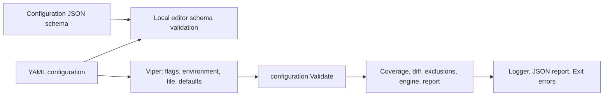
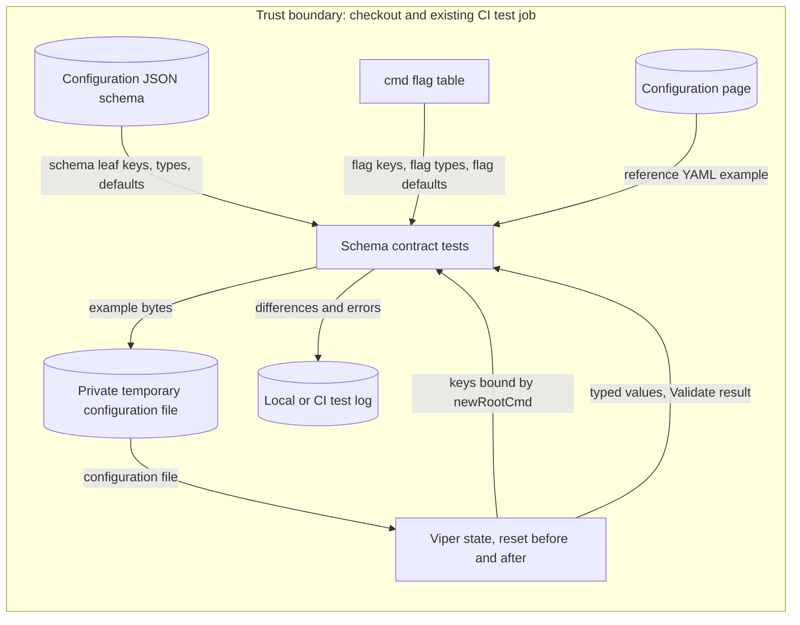

# Configuration schema boundaries for issue #123

Issue #123 corrects the published configuration reference against the existing runtime contract.
It does not change configuration behavior. ADR 0004 already establishes ownership; no new ADR is needed.
This review used revision `3810ca84d3163bcf8ee7dc248ff453df948cedf4`.

## Decision and ownership

Keep `docs/docs/schema/configuration.json` as the single configuration-file schema, using its existing Draft-07 dialect and identity.
The schema supplies editor guidance. Gremlins does not load it at runtime.

| Concern | Canonical owner |
| --- | --- |
| Configuration keys, conversion, numeric bounds, size parsing, environment names | `internal/configuration/configuration.go`: constants, `Get`, `Validate`, `ParseSize`, and `Init`. |
| Flags, bindings, and declared defaults | `cmd/gremlins.go`, `cmd/unleash.go`, and `cmd/internal/flags/flags.go`. |
| Mutation names and defaults | `internal/mutator/mutator.go`: `Types` and `String`; `internal/configuration`: `MutantTypeEnabledKey` and `IsDefaultEnabled`. |
| Effective defaults and execution semantics | `internal/engine/executor.go`, `internal/engine/workerpool/workerpool.go`, `internal/engine/memory.go`, and `internal/coverage/coverage.go`. |
| Configuration examples and command descriptions | `docs/docs/usage/configuration.md` and `docs/docs/usage/commands/unleash/`. |
| Status filters and exclusion expressions | `internal/report/logger.go`: `ParseFilter` and `ParseDiffFilter`; `internal/exclusion/rules.go`: Go `regexp.Compile`. |
| Console diagnostics, ordinary errors, and threshold exits | `internal/log/log.go`, ordinary Go error wrapping, and `internal/execution/execution.go`. |

Do not add a settings registry, generator, DTO, service, repository layer, or second inventory to the architecture model.
Retain existing dependency directions. Configuration must not import `cmd`, `report`, or `engine` to support a contract test.

Editor validation is a separate path. It cannot guarantee runtime success or safe execution of target tests.

## Contract test data flow

The test has no external entity. It reads no network input, runs no child process, and writes only the temporary file.
The flag table is the same data that `setFlagsOnCmd` and `newRootCmd` bind. It is not a second inventory.

## Observed drift and semantic guardrails

- `silent` belongs at the top level. It suppresses Logger information output; errors remain visible.
- The schema lacks `integration`, `diff`, `exclude-files`, `output-statuses`, and `output-diff-statuses` under `unleash`.
- `invert-logical` is missing from the schema. Its existing default is false; it is not a new Mutation type.
- Workers, test CPU, timeout coefficient, and memory budget already have schema definitions. Verify those definitions rather than add duplicates.
- The reference configuration omits `coverpkg` and `output-diff-statuses`, despite claiming completeness.
- Dry run skips mutant execution. `cmd.run` still gathers coverage, including module downloads and baseline test execution.
- Every setting is optional. An omitted mutation setting uses its bound default; an empty mutation object must not require `enabled`.

Use native configuration types: booleans, nonnegative integers, percentage numbers, strings, and arrays of exclusion strings.
Thresholds accept fractional numbers from 0 through 100; zero disables their gate.
Do not confuse CLI threshold names with their nested configuration keys.
Mutation keys come from `MutantTypeEnabledKey`, including the existing `invert-bwassign` spelling.
CLI normalization of dots and underscores does not define YAML key aliases.

Viper also accepts converted values, including boolean strings and scalar forms of string lists.
Describe the schema as the canonical typed file format, not an exhaustive grammar for Viper conversions or environment values.
Do not tighten runtime conversion to match editor types, or expand every schema property into coercion alternatives.
JSON Schema defaults are annotations; the schema does not populate missing runtime values.

Keep configured sentinel defaults separate from effective values:

- Workers default to zero, selecting `runtime.NumCPU`. Integration mode halves a count greater than one, including an explicit count.
- Test CPU defaults to zero, omitting the Go test `-cpu` option. This option is not an OS CPU quota.
- In integration mode, the executor currently turns any nonzero test CPU value into one. Do not describe it as halving that value.
- Timeout coefficient defaults to zero, selecting `DefaultTimeoutCoefficient`, currently five. The baseline duration has a one-second minimum.
- Memory budget defaults to an empty string, selecting the smaller of 1 GiB and half the available memory.

The schema must not promise that worker count equals simultaneous test count; memory admission also limits concurrency.
Memory sizes use `ParseSize`, including binary K, M, G, and T suffixes and overflow rejection.
The old pattern rejected leading-zero positive sizes that `ParseSize` accepts; any pattern permits values that overflow uint64.
Do not exclude valid native string spellings or claim that a pattern establishes uint64 bounds.
Keep the runtime size parser authoritative. Do not conflate this setting with the whole-invocation cgroup budget in ADR 0006.

Status filters select console mutant lines and diffs, not mutation execution, JSON report contents, or aggregate metrics.
Empty `output-statuses` shows all statuses; empty `output-diff-statuses` shows no diffs.
The latter filter applies only after the former permits the mutant line.
Reuse the existing allowed letters, including `m` for memory errors; repeated letters are accepted.
Invalid filters currently produce an informational warning and a fallback, not a configuration-validation error.
Any schema pattern describes valid filter syntax; it must not imply that runtime rejects invalid filters before execution.

Exclusions are Go regular expressions on file paths, not globs or JSON Schema regular expressions.
Do not use JSON Schema `format: regex` to validate their contents.
The existing exclusion parser remains responsible for compilation errors.
Diff is a Git reference used by the existing merge-base comparison, not a patch file or an arbitrary command.

The workers page contains conflicting timeout and integration guidance, already recorded in the documentation review under D07.
Do not copy that guidance into the schema or silently change runtime behavior to match it.
Configuration discovery discrepancies recorded under D05 are a separate concern; tests must avoid discovery.

## Validation, security, and repository boundaries

| Layer | Required boundary |
| --- | --- |
| JSON and YAML syntax | Reuse `check-json` and `check-yaml` in `.pre-commit-config.yaml`. Syntax success does not establish schema completeness or semantic correctness. |
| Editor schema | Preserve the existing permissive unknown-property policy. Moving `silent` removes the wrong definition; it does not make unknown `unleash.silent` fail validation. Do not add blanket `additionalProperties: false`. |
| Runtime shapes and precedence | Reuse Viper binding, `Get`, and `Validate`. Flags override environment, which overrides the file and bound defaults. No runtime JSON Schema validator is needed. |
| Semantic consumers | Leave filter parsing, Go regex compilation, Git execution, size parsing, resource admission, and output-file handling with their existing owners. Schema validation cannot prove a Git ref exists or an output path is writable. |
| Filesystem and environment | Contract checks read explicit checkout files. Runtime example checks use a private temporary config path, reset Viper, and isolate `GREMLINS_*`. Never load host configuration or dump the environment. |
| OS execution and secrets | Schema checks must not execute a Gremlins dry run as a validation shortcut: baseline tests execute target code. Keep arguments separate, use synthetic values, and never place credentials in examples, argv, or diagnostics. |
| Errors and observability | Preserve ordinary wrapped errors, `errors.Join`, Logger information/error separation, and `execution.ExitError`. No exception hierarchy, HTTP envelope, or schema diagnostics in the mutation report. |
| Authorization and persistence | No application auth layer or credential is needed. Artifacts stay in the checkout, temporary local files, or existing CI. No hosted validator, upload, database, or new persistence format. |
| Architecture and CI | Use `.architecture/designs/123.json`, the existing strict decoder, and ARCH001–ARCH004. Preserve the model, shrink-only baselines, shared hook dispatcher, read-only test jobs, and separate Sonar credential boundary. |

The modeled development-check restriction applies to static architecture analysis, which must not execute scanned source.
Ordinary Go tests execute candidate code in the existing test jobs; this design does not extend either boundary.

ADRs 0001 and 0004 govern module ownership and design verification.
Supplied AGENTS guidance conflicts with the tracked module identity and integration-branch guidance.
This issue requires neither an identity change nor a delivery-policy change. Preserve those files; follow explicit user delivery instructions.
Keep schema identity and publication settings unchanged; correcting local documentation does not authorize deployment to `gremlins.dev`.

## Contract evidence and extension seam

A small test should compare schema leaf definitions against actual bound configuration keys, native types, and defaults.
The `cmd` test package can construct the real root and unleash commands without executing them.
Use the binding data and mutation helpers rather than parse Go source or copy another complete settings table.
Use standard-library JSON decoding for this metadata check; it does not need a general schema engine.
Compare both directions so missing and obsolete definitions fail, including a misplaced `silent` definition.
Derive mutation coverage from `mutator.Types` and defaults from `IsDefaultEnabled`.

The extension seam is iteration over those existing bindings and mutation types.
A future supported setting must require its schema definition, without another manually synchronized inventory or a new generator.
Keep explicit contract cases for numeric bounds and optional values; the one-off validation covers nondefault examples.
Use the existing table-driven test style and configuration isolation conventions; keep global-state tests serial.
Check example values through `configuration.Validate` and typed reads without running coverage, Git, or mutant tests.

Passing an example alone cannot detect omitted properties because unknown properties remain allowed.
Metadata comparison and example validation supply different evidence; neither replaces the other.

A regression test loads the complete reference example through `configuration.Init` and `Validate`.
It compares the example keys and values with the schema keys and defaults.
A feature test compares the schema types and defaults with the bound flags, so the example also agrees with the flags.
The regression tests use only base APIs, so the regression proof can run them on base code.

The change adds no permanent Draft-07 validator dependency.
A pinned local `check-jsonschema` run validates the documented examples once, without remote references.
Do not write a partial validator; use the documented YAML examples as inputs, not a separate copy.

Reuse `docs/development/test-standard.md` and the existing regression-proof naming rules.
Demonstrate a schema assertion failing against the old schema and passing against the corrected schema.
An added test dependency missing from the base module can break regression proof; a compilation failure proves no schema defect.
CI owns full race, coverage, and mutation runs; local checks target only changed behavior.
Go mutation testing does not mutate JSON schema data. Do not present its result as proof that schema omissions are detected.

The architecture checker checks declarations and boundaries, not the truth of descriptions or contract compatibility.

## Preflight verification

`make architecture-design` passed ARCH001, ARCH002, ARCH003, and ARCH004 on Linux with the pinned Go 1.26.11 toolchain.
The invocation used `mise exec`, disabled module network access, and placed build output in a temporary cache.
The model SHA-256 was `22337dd5b0fb2bc612c0db132f9807dbbd53055daec6c7ee5ddfd2c60ccf31f1`.
JSON syntax and the explicit-path documentation check passed.
No implementation tests, full suites, mutation runs, or example-schema validation were performed during this design-only preflight.

## Non-goals

No new mutation type, flag, configuration key, report field, exit code, or runtime validation behavior.
No configuration discovery repair, CPU scheduling repair, filter error-policy change, or resource-enforcement redesign.
No schema generation framework, production abstraction, remote validation service, or new workflow.
No unrelated formatting, testdata rewrite, baseline growth, hook bypass, upstream import, commit, publication, or merge.
