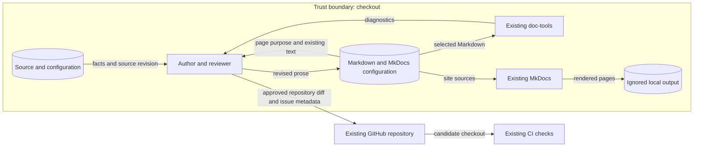

# Diataxis adoption design

This explanation defines the documentation structure for issue #133.
Milestone [Diataxis documentation adoption](https://github.com/OpenRAE/go-rae-gremlins/milestone/8) owns the implementation issues.
The design uses the existing documentation skill, doc-tools, and MkDocs.
It requires no custom tool or skill.

## Reader needs and structure

Each maintained page has one primary reader need.
Use the [Diataxis compass](https://diataxis.fr/compass/) to select its form.
Separate mixed sections when they obscure that need.

| Form | Reader need | Repository example and proposed treatment |
| --- | --- | --- |
| Tutorial | Learn through a guided exercise | Make `docs/docs/quick-start.md` a small, reproducible first mutation run with expected results. |
| How-to guide | Complete a known task | Keep installation, CI setup, release, and recovery procedures at their current paths. |
| Reference | Find exact facts | Keep command flags, configuration, mutation definitions, and coding rules with their existing owners. |
| Explanation | Understand reasons and relationships | Keep architecture, mutation concepts, and decision rationale separate from operating procedures. |

The four forms are navigation labels, not four mandatory directory trees.
Keep `docs/docs` as the user site source.
Keep contributor and maintainer documents under `docs`.
Use native MkDocs navigation and ordinary Markdown links.

Create a new page only when a mixed page needs separation or an existing reader need lacks coverage.
Preserve existing paths and useful heading links.
If a section moves, retain a short link at its former location.
Do not copy a canonical procedure into another guide.

`README.md`, `docs/docs/index.md`, and contributor entry points route readers to the relevant forms.
Entry pages need short descriptions and links, rather than four forced sections.
Keep machine-read agent filenames and GitHub template paths stable.

## Complete scope and ownership

The source inventory for #224 is `git ls-files '*.md' '*.rst' '*.mdx'` at
`c47239bff4e85c0c8b317bccaff73af5df7a3163`.
It includes 88 Markdown paths and no reStructuredText or MDX paths.
The [first inventory](https://github.com/OpenRAE/go-rae-gremlins/blob/5f0a929/docs/development/diataxis-adoption.md#complete-scope-and-ownership)
records the 75 paths at the design revision.

### User pages

| Paths under `docs/docs` | Form and canonical destination |
| --- | --- |
| `index.md` | [Entry point](../docs/index.md) for the four forms. |
| `quick-start.md` | [Tutorial](../docs/quick-start.md) for the first mutation test. |
| `install.md`, `usage/ci/*.md` | Installation and CI how-to guides in the MkDocs navigation. |
| `usage/commands/unleash/workers.md`, `usage/equivalent-mutants.md`, `usage/ignore-mutants.md` | How-to guides for workers and source directives. Keep the conditions and syntax with each task. |
| `usage/commands/index.md`, `usage/commands/unleash/index.md`, `usage/configuration.md`, `usage/mutations/*.md` | Command, configuration, and mutation reference in the MkDocs navigation. |
| `usage/coverage.md` | [Explanation](../docs/usage/coverage.md) of how coverage affects the mutation test. |

### Repository guidance

| Paths | Form and canonical destination |
| --- | --- |
| `README.md` | [Entry point](../../README.md) for users and contributors. |
| `SECURITY.md` | [How-to guide](../../SECURITY.md) for private vulnerability reports. |
| `.github/ISSUE_TEMPLATE/*.md`, `.github/PULL_REQUEST_TEMPLATE.md` | Forms for GitHub tasks. Keep their paths and template metadata. |
| `AGENTS.md`, `CLAUDE.md`, `.gc/plan-rules.md` | Agent instructions and architecture reference. Keep the entry paths and binding rules. |
| `docs/CONTRIBUTING.md`, `docs/MAINTAINER_SETUP.md` | [Contributor tasks](../CONTRIBUTING.md) and [maintainer setup](../MAINTAINER_SETUP.md). |
| `docs/adr/README.md` | [Reference index](../adr/README.md) for both ADR directories. |
| `docs/adr/0*.md`, `architecture/adrs/*.md` | Decision explanations. Keep the original decisions and their reasons. Use the index for current status. |
| `checks.md`, `coding-standards.md`, `test-standard.md` | Reference for [checks](checks.md), [coding rules](coding-standards.md), and [test rules](test-standard.md). |
| `release.md`, `phase-e.md`, `memory-budget.md` | How-to guides for [release](release.md), [delivery finalization](phase-e.md), and [memory limits](memory-budget.md). |
| `architecture.md`, `lint-design.md`, `mutation-registry.md`, `phase-e-design.md`, `diataxis-adoption.md` | Explanations of [architecture checks](architecture.md), [lint](lint-design.md), the [mutation registry](mutation-registry.md), [delivery finalization](phase-e-design.md), and this documentation design. |
| `maintenance-plan.md` | [Maintenance process](maintenance-plan.md) with its initial plans and issue links. |
| `*-preflight.md`, `documentation-review.md`, `process-review.md`, `test-assessment.md`, `upstream-release.md` | Source records. See [historical records](#historical-records). |

The unqualified filenames in the last five rows are under `docs/development`.

### Historical records

Use these records to find the evidence for a decision at its source revision.
For current instructions, follow the [contributor guide](../CONTRIBUTING.md) and the [user pages](../docs/index.md).

- Documentation reviews: [documentation](documentation-review.md), [adoption](diataxis-preflight.md),
  [destinations](documentation-destinations-preflight.md), [contributor pages](contributor-documentation-preflight.md),
  and [user pages](user-docs-preflight.md).
- Execution reviews: [adaptive timeout](adaptive-timeout-preflight.md), [build cache](build-cache-preflight.md),
  [compiler flags](compiler-flags-preflight.md), [module declarations](module-declaration-preflight.md),
  [nested module diff](nested-module-diff-preflight.md), and [memory budget](memory-budget-preflight.md).
- Mutation reviews: [equivalent mutants](equivalent-mutants-preflight.md), [ignore directives](ignore-directive-preflight.md),
  [logical negation](invert-logical-not-preflight.md), and [mutation registry](mutation-registry-preflight.md).
- Verification reviews: [configuration schema](configuration-schema-preflight.md), [field alignment](fieldalignment-preflight.md),
  [lint](lint-preflight.md), [process tests](process-tests-preflight.md), [test standard](test-standard-preflight.md),
  and [test assessment](test-assessment.md).
- Maintainer reviews: [process](process-review.md), [optional tooling](optional-maintainer-tooling-preflight.md),
  [release](release-preflight.md), [transport regression](transport-regression-preflight.md), and
  [upstream release](upstream-release.md). The [finalization design](phase-e-design.md#pre-merge-transport-verification)
  gives the context for the JSON and TAP evidence under `docs/development/evidence`.

### Other documentation surfaces

| Surface | Form or treatment |
| --- | --- |
| CLI help and flag descriptions in `cmd/` and `cmd/internal/flags/` | Runtime reference. The command pages give the exact syntax and conditions. Keep help behavior and tokens. |
| Help and usage text in `Makefile`, `scripts/`, `tools/`, and `.github/scripts/` | Maintainer reference at the command source. Link to the supported procedures in the contributor and maintainer guides. |
| Go package, declaration, and implementation comments under `cmd/`, `internal/`, and `tools/` | Developer reference and explanation at the code. Use the architecture and coding guides for project-wide rules. Keep license headers and compiler directives. |
| Comments and descriptions in workflows, build files, and repository configuration | Reference at the file that defines the setting. Use the checks and setup guides for procedures. Preserve machine-read values. |
| `docs/docs/schema/configuration.json` | Configuration reference for tools. Keep descriptions with the schema and verify them against `internal/configuration/` and `cmd/`. |
| Examples in the tutorial, how-to guides, reference, and contributor pages | Keep each example with its task or contract. For configuration examples, use the [configuration reference](../docs/usage/configuration.md#reference) and schema. The repository configuration and workflow files give working examples of their own settings. |
| `CHANGELOG.md`, `CODE_OF_CONDUCT.md`, `LICENSE` | Generated release history, adopted policy, and legal text. The [repository entry point](../../README.md) gives the context for each. |
| Quotations, copyright, asset files, and test inputs and outputs | Keep the original records. The pages that show them give context. Keep test fixtures byte-exact. |

The inventory assigns a reader purpose or record treatment to each surface.
The original wording of protected records has no STE conformance claim.

## Existing tools and review

The first implementation issue is [#145](https://github.com/OpenRAE/go-rae-gremlins/issues/145), already delivered through PR #167.
Its merge commit is `f337c8ca06cc664da9e43c28469ce6edf5452ce2`.
Associate that issue with milestone 8 instead of creating duplicate tooling work.
It added the shared `documentation` skill setup, pinned checks, CI integration, and sample verification.

Use the doc-tools v0.1.0 skill and its documented installation route in `docs/CONTRIBUTING.md`.
Do not copy the skill into this repository or create a second writing standard.
Verify the installed skill covers Diataxis, STE, source verification, and preservation of technical meaning.

Reuse `scripts/doc-tools.sh`, `make docs-changed`, and `make docs-samples`.
The wrapper verifies the pinned package archive before installation.
The existing CI Docs job runs the writing checks and sample checks.
Keep the shared Git hook dispatcher and secret scanning.
Use a local MkDocs build for site changes; never deploy the output for validation.

Checkers find only some writing defects.
A reviewer checks the page purpose, terminology, technical meaning, and STE sentence rules.
The official STE site returned HTTP 403 during this design review.
Do not claim complete dictionary verification from the automated check.
Use an authorized copy of the standard for the implementation's full terminology review.
Record any remaining access limit explicitly.

Each rewrite PR records the source revision, source paths, commands checked, corrected differences, and remaining limits.
Verify claims against code and configuration before rewriting them.
For historical claims, use the recorded source revision.
Do not change program behavior to match prose.
If behavior is unclear, retain the accurate qualification and resolve the question before claiming agreement.

## Code owners for accuracy checks

| Subject | Ground truth |
| --- | --- |
| Go requirements and installation | `go.mod`, `Makefile`, `.goreleaser.yaml`, release workflows |
| Commands, flags, configuration | `cmd/`, `internal/configuration/`, `cmd/internal/flags/`, `docs/docs/schema/configuration.json` |
| Mutation definitions and execution | `internal/mutator/`, `internal/engine/`, `internal/coverage/`, `internal/diff/` |
| Reports and exit behavior | `internal/report/`, `internal/execution/` |
| Contributor checks and architecture | `Makefile`, `scripts/`, `.architecture/model.json`, `.pre-commit-config.yaml`, `.golangci.yml` |
| Maintainer delivery and release | `.ground-control.yaml`, `.github/workflows/`, `.github/ground-control/`, release configuration |
| Navigation and source links | `docs/mkdocs.yml` and actual tracked paths and heading anchors |

This design was checked against the current contributor guide, wrapper, CI Docs job, MkDocs configuration, and architecture model.
It changes no CLI, configuration key, report, exit code, package relationship, or runtime interface.
The existing architecture ADRs remain valid; no new ADR is needed.
`.architecture/designs/133.json` declares this documentation-only scope.
No policy code or architecture rule changes are needed.

The schema regression test reads `docs/docs/usage/configuration.md` after the exact heading `### Reference`.
Preserve this path and heading, or update `cmd/schema_regression_test.go` and affected links in the same rewrite.
Run the targeted schema tests when that example or extraction boundary changes.

## Data flow and protection

| Threat and boundary | Control | Verification |
| --- | --- | --- |
| Incorrect instructions enter maintained prose | Compare each claim with its source owner. Preserve qualifiers and literal syntax. | Source evidence in each rewrite PR. |
| Copied pages diverge | Keep one canonical page and link to it. | Review navigation and duplicate procedures. |
| A move breaks readers' links | Preserve paths and former section links. | Check Markdown targets, fragments, and rendered navigation. |
| Documentation leaves approved destinations | Build locally and use existing GitHub and CI only. | Review workflow changes and confirm no deployment or new service. |
| Examples expose credentials or execute unwanted commands | Use placeholders and inspect examples before execution. Keep secret scanning. | Review examples and run existing publication hooks. |
| A checker pass hides weak writing | Review reader need, STE terminology, and source agreement manually. | Record reviewer evidence and access limits. |

GitHub issue descriptions and dependency metadata use the existing repository API boundary.
The diagram describes local validation and existing delivery, not permission to publish a documentation site.
No new authentication, tenant, storage, telemetry, or application error boundary is introduced.
The remaining risk is editorial judgment; automated writing checks cannot prove factual accuracy or Diataxis quality.

## Delivery sequence and acceptance

Use four implementation issues, each with one PR, in milestone 8:

1. Reuse completed issue #145 for the existing documentation skill and checks.
2. [#222](https://github.com/OpenRAE/go-rae-gremlins/issues/222): rewrite user pages, with code verification, in their Diataxis forms.
3. [#223](https://github.com/OpenRAE/go-rae-gremlins/issues/223): rewrite contributor and maintainer pages, with source verification and preserved historical records.
4. [#224](https://github.com/OpenRAE/go-rae-gremlins/issues/224): complete entry points and native navigation, then reconcile the full inventory and link checks.

Issue 1 is already merged and has no new dependency on this design.
Issues 2 and 3 depend on this design and issue 1; they can proceed independently.
Issue 4 depends on issues 2 and 3.
Set each edge through the GitHub issue blocking API and read it back.
Do not use prose dependency lists as a substitute.
The six declared edges were created with `gh api` and read back on 2026-11-22.

Every implementation issue requires ASD-STE100 rewriting for its changed prose.
Every issue that rewrites pages requires comparison with the code and configuration owners above.
Use explicit-path doc-tools checks for changed Markdown and review technical meaning manually.
Site changes require a local strict MkDocs build and inspection of affected fragments and navigation.
No Go behavior changes occur, so Go regression tests and mutation tests add no evidence for this design.
The existing CI remains responsible for full repository checks.

The final issue accounts for every current documentation path and records its form, canonical destination, or protected-record treatment.
It verifies that all maintained content is reachable and that every preserved record has clear context.
It records source checks, writing checks, rendered-link results, and unresolved limits.
Completion requires the delivered tooling PR and all three remaining implementation PRs.
Merging this design alone does not establish repository-wide conformance.

## References

- [Diataxis compass](https://diataxis.fr/compass/): forms and reader needs; unversioned guidance read on 2026-11-22.
- [Applying Diataxis](https://diataxis.fr/how-to-use-diataxis/): small changes and structure driven by content; read on 2026-11-22.
- [MkDocs configuration](https://www.mkdocs.org/user-guide/configuration/): native navigation and document root; unversioned documentation read on 2026-11-22.
- [ASD-STE100](https://www.asd-ste100.org/): authoritative writing rules and dictionary; automated access denied during this review.
- [Contributor documentation guidance](../CONTRIBUTING.md#documentation): existing tools, installation, checks, and protected records.
