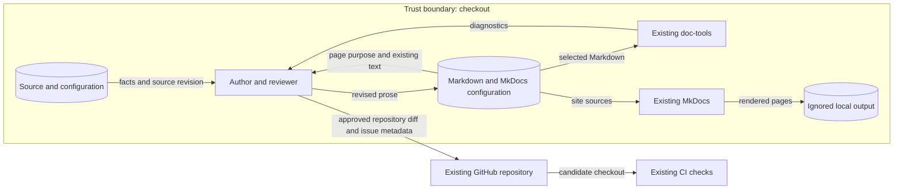

# Diataxis adoption design

This explanation defines the documentation structure for issue #133.
Milestone [Diataxis documentation adoption](https://github.com/OpenRAE/go-rae-gremlins/milestone/8) owns the implementation issues.
The design uses the existing documentation skill, doc-tools, and MkDocs.
It requires no custom tool or skill.

## Reader needs and structure

Each maintained page has one primary reader need.
Use the [Diataxis compass](https://diataxis.fr/compass/) to select its form.
Separate mixed sections when they obscure that need.

| Form | Reader need | Repository example and proposed treatment |
| --- | --- | --- |
| Tutorial | Learn through a guided exercise | Make `docs/docs/quick-start.md` a small, reproducible first mutation run with expected results. |
| How-to guide | Complete a known task | Keep installation, CI setup, release, and recovery procedures at their current paths. |
| Reference | Find exact facts | Keep command flags, configuration, mutation definitions, and coding rules with their existing owners. |
| Explanation | Understand reasons and relationships | Keep architecture, mutation concepts, and decision rationale separate from operating procedures. |

The four forms are navigation labels, not four mandatory directory trees.
Keep `docs/docs` as the user site source.
Keep contributor and maintainer documents under `docs`.
Use native MkDocs navigation and ordinary Markdown links.

Create a new page only when a mixed page needs separation or an existing reader need lacks coverage.
Preserve existing paths and useful heading links.
If a section moves, retain a short link at its former location.
Do not copy a canonical procedure into another guide.

`README.md`, `docs/docs/index.md`, and contributor entry points route readers to the relevant forms.
Entry pages need short descriptions and links, rather than four forced sections.
Keep machine-read agent filenames and GitHub template paths stable.

## Complete scope and ownership

The source inventory is `git ls-files '*.md' '*.rst' '*.mdx'` at revision `8a37862b6d73d229de4930ba90460d0894b70401`.
It contains 75 Markdown paths and no tracked reStructuredText or MDX paths.
The following groups cover that inventory.
Implementation issues refresh it to include pages added after this revision, including this design and its preflight.

| Scope | Treatment | Implementation owner |
| --- | --- | --- |
| `docs/CONTRIBUTING.md`, `CLAUDE.md`, `AGENTS.md`, `.gc/plan-rules.md` | Reuse the delivered skill and checks. Separate task guidance from exact rules and architecture explanations. | Delivered tools; contributor pages. |
| `docs/docs/quick-start.md`, `install.md`, `usage/ci/*.md` | Tutorial and task guides. State prerequisites and expected outcomes. | User pages. |
| `docs/docs/usage/commands/**/*.md`, `usage/configuration.md`, `usage/mutations/*.md`, `usage/equivalent-mutants.md`, `usage/ignore-mutants.md` | Reference owns exact syntax and behavior. Separate task steps and conceptual explanations where needed. | User pages. |
| `docs/MAINTAINER_SETUP.md`, active `docs/development/*.md` | Task guides for setup, release, checks, and recovery. Reference for standards. Explanation for architecture and design. | Contributor pages. |
| `docs/adr/*.md`, `architecture/adrs/*.md` | Reference indexes link to explanation records. Preserve decisions, status, history, and rationale. | Contributor pages. |
| `docs/development/*-preflight.md`, review and assessment records, `upstream-release.md` | Retain evidence and source revisions. Explain historical scope and link to current guidance. | Contributor pages. |
| `README.md`, `docs/docs/index.md`, `SECURITY.md`, `.github/**/*.md` | Route readers to the correct form. Keep security reporting and template metadata accurate. | Entry points and final navigation. |
| `CHANGELOG.md`, `CODE_OF_CONDUCT.md` | Preserve generated history and adopted policy text. Explain their status through links from maintained entry pages. | Entry points and final navigation. |

All maintained prose must serve its selected reader need and conform to ASD-STE100 Simplified Technical English.
Do not rewrite quotations, historical evidence, adopted policy, copyright, or legal terms to obtain a checker pass.
Classify these records and add current explanatory context where needed.
Their preservation does not establish STE conformance of their original text.

The JSON schema remains exact configuration reference, owned by configuration code.
Check its links and factual agreement during the user-page work.
Include maintained source comments, CLI help, schema descriptions, and examples in the owning section review.
Preserve public help behavior, machine tokens, byte-exact fixtures, binary assets, and license notices.
Do not change a protected runtime contract for an editorial rewrite.

## Existing tools and review

The first implementation issue is [#145](https://github.com/OpenRAE/go-rae-gremlins/issues/145), already delivered through PR #167.
Its merge commit is `f337c8ca06cc664da9e43c28469ce6edf5452ce2`.
Associate that issue with milestone 8 instead of creating duplicate tooling work.
It added the shared `documentation` skill setup, pinned checks, CI integration, and sample verification.

Use the doc-tools v0.1.0 skill and its documented installation route in `docs/CONTRIBUTING.md`.
Do not copy the skill into this repository or create a second writing standard.
Verify the installed skill covers Diataxis, STE, source verification, and preservation of technical meaning.

Reuse `scripts/doc-tools.sh`, `make docs-changed`, and `make docs-samples`.
The wrapper verifies the pinned package archive before installation.
The existing CI Docs job runs the writing checks and sample checks.
Keep the shared Git hook dispatcher and secret scanning.
Use a local MkDocs build for site changes; never deploy the output for validation.

Checkers find only some writing defects.
A reviewer checks the page purpose, terminology, technical meaning, and STE sentence rules.
The official STE site returned HTTP 403 during this design review.
Do not claim complete dictionary verification from the automated check.
Use an authorized copy of the standard for the implementation's full terminology review.
Record any remaining access limit explicitly.

Each rewrite PR records the source revision, source paths, commands checked, corrected differences, and remaining limits.
Verify claims against code and configuration before rewriting them.
For historical claims, use the recorded source revision.
Do not change program behavior to match prose.
If behavior is unclear, retain the accurate qualification and resolve the question before claiming agreement.

## Code owners for accuracy checks

| Subject | Ground truth |
| --- | --- |
| Go requirements and installation | `go.mod`, `Makefile`, `.goreleaser.yaml`, release workflows |
| Commands, flags, configuration | `cmd/`, `internal/configuration/`, `cmd/internal/flags/`, `docs/docs/schema/configuration.json` |
| Mutation definitions and execution | `internal/mutator/`, `internal/engine/`, `internal/coverage/`, `internal/diff/` |
| Reports and exit behavior | `internal/report/`, `internal/execution/` |
| Contributor checks and architecture | `Makefile`, `scripts/`, `.architecture/model.json`, `.pre-commit-config.yaml`, `.golangci.yml` |
| Maintainer delivery and release | `.ground-control.yaml`, `.github/workflows/`, `.github/ground-control/`, release configuration |
| Navigation and source links | `docs/mkdocs.yml` and actual tracked paths and heading anchors |

This design was checked against the current contributor guide, wrapper, CI Docs job, MkDocs configuration, and architecture model.
It changes no CLI, configuration key, report, exit code, package relationship, or runtime interface.
The existing architecture ADRs remain valid; no new ADR is needed.
`.architecture/designs/133.json` declares this documentation-only scope.
No policy code or architecture rule changes are needed.

The schema regression test reads `docs/docs/usage/configuration.md` after the exact heading `### Reference`.
Preserve this path and heading, or update `cmd/schema_regression_test.go` and affected links in the same rewrite.
Run the targeted schema tests when that example or extraction boundary changes.

## Data flow and protection

| Threat and boundary | Control | Verification |
| --- | --- | --- |
| Incorrect instructions enter maintained prose | Compare each claim with its source owner. Preserve qualifiers and literal syntax. | Source evidence in each rewrite PR. |
| Copied pages diverge | Keep one canonical page and link to it. | Review navigation and duplicate procedures. |
| A move breaks readers' links | Preserve paths and former section links. | Check Markdown targets, fragments, and rendered navigation. |
| Documentation leaves approved destinations | Build locally and use existing GitHub and CI only. | Review workflow changes and confirm no deployment or new service. |
| Examples expose credentials or execute unwanted commands | Use placeholders and inspect examples before execution. Keep secret scanning. | Review examples and run existing publication hooks. |
| A checker pass hides weak writing | Review reader need, STE terminology, and source agreement manually. | Record reviewer evidence and access limits. |

GitHub issue descriptions and dependency metadata use the existing repository API boundary.
The diagram describes local validation and existing delivery, not permission to publish a documentation site.
No new authentication, tenant, storage, telemetry, or application error boundary is introduced.
The remaining risk is editorial judgment; automated writing checks cannot prove factual accuracy or Diataxis quality.

## Delivery sequence and acceptance

Use four implementation issues, each with one PR, in milestone 8:

1. Reuse completed issue #145 for the existing documentation skill and checks.
2. [#222](https://github.com/OpenRAE/go-rae-gremlins/issues/222): rewrite user pages, with code verification, in their Diataxis forms.
3. [#223](https://github.com/OpenRAE/go-rae-gremlins/issues/223): rewrite contributor and maintainer pages, with source verification and preserved historical records.
4. [#224](https://github.com/OpenRAE/go-rae-gremlins/issues/224): complete entry points and native navigation, then reconcile the full inventory and link checks.

Issue 1 is already merged and has no new dependency on this design.
Issues 2 and 3 depend on this design and issue 1; they can proceed independently.
Issue 4 depends on issues 2 and 3.
Set each edge through the GitHub issue blocking API and read it back.
Do not use prose dependency lists as a substitute.
The six declared edges were created with `gh api` and read back on 2026-11-22.

Every implementation issue requires ASD-STE100 rewriting for its changed prose.
Every issue that rewrites pages requires comparison with the code and configuration owners above.
Use explicit-path doc-tools checks for changed Markdown and review technical meaning manually.
Site changes require a local strict MkDocs build and inspection of affected fragments and navigation.
No Go behavior changes occur, so Go regression tests and mutation tests add no evidence for this design.
The existing CI remains responsible for full repository checks.

The final issue accounts for every current documentation path and records its form, canonical destination, or protected-record treatment.
It verifies that all maintained content is reachable and that every preserved record has clear context.
It records source checks, writing checks, rendered-link results, and unresolved limits.
Completion requires the delivered tooling PR and all three remaining implementation PRs.
Merging this design alone does not establish repository-wide conformance.

## References

- [Diataxis compass](https://diataxis.fr/compass/): forms and reader needs; unversioned guidance read on 2026-11-22.
- [Applying Diataxis](https://diataxis.fr/how-to-use-diataxis/): small changes and structure driven by content; read on 2026-11-22.
- [MkDocs configuration](https://www.mkdocs.org/user-guide/configuration/): native navigation and document root; unversioned documentation read on 2026-11-22.
- [ASD-STE100](https://www.asd-ste100.org/): authoritative writing rules and dictionary; automated access denied during this review.
- [Contributor documentation guidance](../CONTRIBUTING.md#documentation): existing tools, installation, checks, and protected records.
