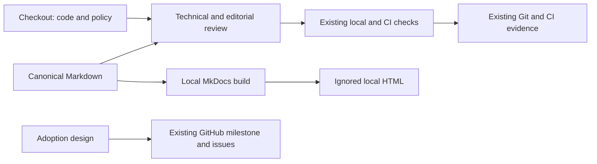

# Diataxis adoption boundaries for issue #133

> Current context (2026-11-24): This is a historical record of issue #133 at its reviewed revision.
> Current design: [Diataxis adoption design](diataxis-adoption.md).

This preflight reviews revision `8a37862b6d73d229de4930ba90460d0894b70401` against the supplied issue contract.
It records design constraints, not an implementation plan or a claim that adoption is complete.
Issue #133 delivers a small design and implementation issues in a milestone.
It does not authorize those issues' documentation rewrites, runtime changes, or publication.

## Reuse and authority

The tooling foundation already exists in this checkout.
Commit `f337c8c` introduced the pinned documentation checks through PR #167.
The corresponding design is [`.architecture/designs/145.json`](../../.architecture/designs/145.json).
Reuse `scripts/doc-tools.sh`, its Makefile targets, the shared `documentation` skill, and CI's required `Docs` job.
Do not propose a second checker, local skill fork, content schema, or documentation workflow.

The issue requires the first implementation issue to add proven tools, skills, or both.
Before creating backlog entries, check whether existing issue #145 satisfies that role and associate it with the adoption milestone where appropriate.
Verify its actual scope and delivery state; the presence of a design record alone does not prove issue completion.
Do not duplicate delivered work or describe a verification-only issue as adding tools.
Any remaining tooling gap must use an existing solution.
A custom tool or skill requires the user's permission before inclusion in the design.

The [contributor guide](../CONTRIBUTING.md#documentation) owns writing and validation instructions.
Agent entry points should refer to it and the shared skill instead of copying their rules.
ADRs [0001](../adr/0001-module-path.md), [0002](../adr/0002-binary-name-and-versions.md), and [0004](../adr/0004-architecture-model-checks.md) govern identity, publication, and architecture checks.
No new ADR is needed for this preflight.
The older [optional-tooling ADR](../../architecture/adrs/001-optional-maintainer-tooling.md) contains historical module and branch statements.
Do not copy those statements into current instructions or silently change their historical context.

## Content boundaries

Use the [Diataxis compass](https://diataxis.fr/compass/) to select the reader's need for each maintained section.
Tutorials teach through a controlled exercise. How-to guides complete an operating task.
Reference states exact facts. Explanation gives reasons and relationships.

Audience and document form are separate: contributor documentation also uses these four forms.
An ADR is a decision record; its rationale serves explanation, while its binding decisions retain their authority.

Keep existing source paths by default. Use ordinary links and native MkDocs navigation to expose the four forms where content exists.
The [Diataxis application guidance](https://diataxis.fr/how-to-use-diataxis/) does not require four directories or empty categories.
Split mixed content only when this improves a reader's task. Link to the canonical fact or procedure instead of repeating it.

The current quick start mixes a run command, coverage explanation, and status reference.
Calling it a tutorial does not supply a guided exercise, prerequisites, or an observable learning result.
The workers and annotation pages also mix operating instructions with exact semantics.
Their rewrites must distinguish these purposes without losing conditions or supported behavior.

The adoption design must account for every tracked documentation surface, not only the MkDocs navigation.
The inspected revision has 75 tracked Markdown files, including hidden guidance and templates.
Use a small human-readable coverage record in the design or milestone issues; no generated catalog or classification schema is needed.
Account for these surfaces explicitly:

| Surface | Treatment and boundary |
| --- | --- |
| `README.md` and `docs/docs/index.md` | Reader entry points can route to several forms. Keep orientation brief and link to canonical content. |
| `docs/docs/` guides and mutation pages | Apply the four forms to maintained sections. Preserve schema assets, examples, images, and reader links. |
| `docs/CONTRIBUTING.md`, `docs/MAINTAINER_SETUP.md`, and `docs/development/` | Separate operating tasks, standards/reference, and architecture explanation where useful. Preserve current workflow authority. |
| `docs/adr/` and `architecture/adrs/` | Account for both trees. Preserve decision identifiers, status evidence, historical rationale, and incoming links. Do not create a third ADR tree. |
| `AGENTS.md`, `CLAUDE.md`, and `.gc/plan-rules.md` | Preserve recognized entry paths and binding instructions. Reorganizing prose must not weaken obligations or copy shared skill content. |
| `SECURITY.md` and `.github/` templates | Preserve private vulnerability reporting and template behavior. GitHub front matter, labels, and routing are configuration, not editorial prose. |
| `CHANGELOG.md`, licenses, adopted policy, quotations, and evidence | Account for their owner and purpose. Preserve generated, legal, attributed, and historical text; improve maintained context or generator prose at its source. |
| Source comments, help strings, schema descriptions, and examples | Include their maintained documentation role in coverage. Preserve machine tokens, public help behavior, copyright, and byte-exact fixtures. |

This treatment does not declare retained material STE-compliant.
The existing [documentation review](documentation-review.md#d20-historical-and-adopted-text-needs-explicit-treatment--low) records the preservation boundary.
Distinguish current guidance from evidence about an earlier revision.
Do not rewrite an old assessment to make it describe today's code.
If a proposed issue requires changes to adopted policy or protected contracts, resolve that scope separately before rewriting it.

## Technical truth and existing contracts

Every issue that rewrites a section must check that section against its actual code or configuration owner.
Record the reviewed revision, source paths, corrected differences, checks, and remaining limits in the delivery evidence.
Use historical revisions for historical claims. A link to another guide is not verification against code.

| Documentation subject | Canonical source to reuse |
| --- | --- |
| Flags, aliases, defaults, and environment values | `cmd/gremlins.go`, `cmd/unleash.go`, `cmd/internal/flags/flags.go`, and `internal/configuration/configuration.go`. Check Viper binding, type/range validation, and precedence. |
| Configuration reference | `docs/docs/schema/configuration.json` and `cmd/schema*_test.go`. Preserve one schema; do not turn documentation classification into configuration validation. |
| Mutation semantics and defaults | `internal/mutator/`, `internal/engine/mappings.go`, `internal/engine/tokenmutator.go`, coverage, and configuration code. An example must match the supported Mutation type. |
| Reports, statuses, thresholds, and exit behavior | `internal/report/`, `internal/report/internal/structure.go`, `internal/execution/execution.go`, and the CLI entry point. Logger owns output destinations and silent mode. |
| Workers, timeouts, memory, and isolation | Engine scheduling/execution, `internal/process/`, and Work directory copy. Check OS-specific behavior and requested versus effective defaults. |
| Development and release instructions | `Makefile`, scripts, workflows, `go.mod`, `mise.toml`, `.pre-commit-config.yaml`, `.ground-control.yaml`, and binding ADRs. Check capabilities separately from required daily practice. |

There is a concrete documentation/test coupling.
`cmd/schema_regression_test.go` reads `docs/docs/usage/configuration.md` and selects the YAML block after the exact heading `### Reference`.
Keep that path and heading unless the owning rewrite also updates this existing test and every affected link.
Run the targeted schema checks when changing that example or its extraction boundary.
Do not remove the test, duplicate the example, or add a second extraction framework to accommodate a move.
The JSON schema is a documented editor interface; runtime validation remains `configuration.Validate`.

## Cross-cutting layers and trust

| Layer | Required guardrail |
| --- | --- |
| Writing validation | Use `scripts/doc-tools.sh` on explicit changed paths. The pinned package enables STE-4.2, STE-5.1, and STE-6.6, with dictionary and analyzer disabled. Human review must cover structure, meaning, terminology, and the other applicable STE rules. |
| Tool supply chain | Keep release/version and SHA-256 pins, checksum failure behavior, ignored `.tools/` installs, and existing platform support. Tool downloads do not authorize content uploads or new providers. |
| Site configuration | `docs/mkdocs.yml` owns navigation, theme, and Markdown extensions. Its document root is `docs/docs`; repository-only guides stay outside it. Use the native MkDocs parser, build, and link diagnostics. Generic YAML syntax checks do not validate Python-name tags or rendered links. |
| Paths and OS | Keep repository searches and input paths inside the checkout. Preserve links and fragments, including GitHub and rendered-site destinations. Build only into ignored `docs/site` or private temporary output. Do not follow escaping symlinks or copy the repository into the site. |
| Environment binding | `DOCS_BASE` selects the documentation comparison revision; architecture uses `ARCHITECTURE_BASE`. Neither is a Gremlins setting. Do not initialize Viper, load host configuration, or add `GREMLINS_*` keys for documentation tooling. |
| Authentication and secrets | Local review and rendering need no credentials. Use existing GitHub authorization only for the requested backlog operations. Never put credentials in examples, URLs, process arguments, logs, or generated HTML. Keep private findings in the existing private reporting path. |
| CI and workflow policy | Reuse pinned actions, `contents: read`, checkout without persisted credentials, the `Docs` job, and `PR Gate`. Preserve merge-group comparisons, foreign-PR handling, the separate Sonar credential boundary, hooks, and secret scanning. No token-bearing candidate execution or new publishing job is needed. |
| Architecture admission | Use `.architecture/model.json`, per-issue design JSON, `scripts/check-design.sh`, and `tools/architecture`. Declare changed modeled policies before editing them. Retain strict input decoding, checkout confinement, and shrink-only baselines. This checker does not establish Diataxis or STE conformance. |
| Diagnostics and errors | Retain the tools' visible diagnostics and nonzero failure statuses. Do not suppress link or prose findings to obtain a pass. No HTTP error envelope exists here. Logger and Exit errors remain runtime contracts, not new documentation error types. |
| Persistence and external writes | Git stores maintained prose; ignored files hold build output. GitHub stores milestone membership and blocking relationships. No database, DTO, controller, repository/service layer, external analyzer, preview host, or second workflow engine is needed. |

MkDocs is not installed in this environment, and no tracked site dependency lock was found.
A later navigation or site-content change needs a local build with the existing MkDocs/Material stack and recorded versions.
Provision that stack through approved local tooling; this gap does not justify a new hosting or build service.
STE success alone does not prove correct navigation, anchor targets, or working examples.
Do not execute examples merely to review prose: Gremlins, including dry runs, can execute a target module's tests.

## Delivery and extension boundaries

The milestone groups implementation issues. Do not add another tracking or umbrella issue.
Use one reviewable PR outcome per issue, precise section scope, and checkable acceptance criteria.
Every issue that changes documentation must include this acceptance criterion:

> The documentation is rewritten to conform to ASD-STE100 Simplified Technical English.

Each section-rewrite issue must also require verification against code, as described above.
Preserve protected literals and technical meaning when applying that criterion.
Do not claim that a clean three-rule check proves it.
The [official ASD-STE100 source](https://www.asd-ste100.org/) remains the authority for rules and vocabulary.
Do not copy its standard or dictionary into this repository.

Every real dependency must use the GitHub blocking API through `gh api`; prose and sub-issue links are insufficient.
Use the [issue-dependencies endpoint](https://docs.github.com/en/rest/issues/issue-dependencies#add-a-dependency-an-issue-is-blocked-by).
Its URL identifies the blocked issue by number, while `issue_id` is the blocking issue's numeric database ID.
Verify direction, read back the relationship, and check milestone membership.

Reuse existing issues where their scope fits. Do not invent dependencies between independent documentation sections.
Backlog writes need issue-write authorization through the established GitHub setup, not a new credential path or custom automation.

The extension seam is ordinary content and navigation data: a page's reader need, canonical location, and links.
New pages should fit that seam without changes to a classifier, schema, CI matrix, or installed skill.
Keep the shared tool version and checksum at their existing pinning point.
Preserve canonical entry paths and documentation URLs whenever practical; physical relocation is not a prerequisite for adoption.

Non-goals are runtime implementation, blanket directory moves, new publication channels, custom tools or skills, and full local Go or mutation suites.
Do not alter CLI flags, Configuration keys, schema identity, JSON report fields, exit codes, or byte-exact `testdata` for an editorial migration.
Do not import upstream documentation wholesale; [ADR 0003](../adr/0003-upstream-changes.md) governs upstream changes.
This preflight creates no milestone, issue, dependency, commit, or publication.

## Preflight evidence

The design check passed against `HEAD` with mise-pinned Go and Go network access disabled.
It evaluated ARCH001–ARCH004 with model SHA-256 `c28bab810f1497d79aea1fcac11781ad83abf8d2e7b36cb8c78a8e7225243f6b`.
The repository policy checks passed. JSON syntax and whitespace checks passed.
The official STE site returned HTTP 403 during this review; complete dictionary verification is not claimed.
No application tests, mutation runs, MkDocs build, example execution, or external writes were performed.
