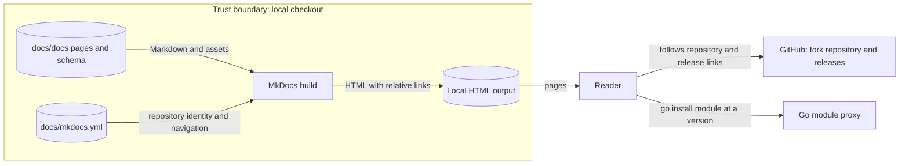

# Documentation destination boundaries for issue #126

> Current context (2026-11-24): This is a historical record of issue #126 at its reviewed revision.
> Current pages: [configuration](../docs/usage/configuration.md) and the [contributor guide](../CONTRIBUTING.md#documentation).
> The configuration page now links the schema with a relative path.

Issue #126 corrects maintained fork destinations and links in the built documentation.
This preflight inspected revision `bd52c783d808ac70a250016c25b68f783b42b31b`.
It changes no installation instructions, site configuration, application code, or workflow.
ADRs [0002](../adr/0002-binary-name-and-versions.md) and [0004](../adr/0004-architecture-model-checks.md) already establish the required boundaries.
No new ADR is needed.

## Ownership and decisions

| Concern | Canonical owner and guardrail |
| --- | --- |
| Supported distribution | `.goreleaser.yaml`, `.github/workflows/release-please.yml`, and [the release procedure](release.md). ADR 0002 permits fork GitHub release assets and source installation. It establishes no fork Docker, Homebrew, or hosted documentation channel. |
| Installation | `docs/docs/install.md`, `go.mod`, and `Makefile`. The install guide already selects the fork and locates the built binary at `dist/bin/gremlins`. Reuse it instead of creating another procedure. |
| Site identity and paths | `docs/mkdocs.yml` owns repository identity, source-link settings, navigation, and the optional deployment URL. Its default document root is `docs/docs`, relative to the configuration file. See [MkDocs configuration](https://www.mkdocs.org/user-guide/configuration/). |
| Contributor content | `docs/CONTRIBUTING.md` is the canonical guide. At the inspected revision, the site symlink `docs/docs/CONTRIBUTING.md` showed it in navigation. The change removes the symlink, and the site navigation links to the guide in the repository. |
| CI examples | `docs/docs/usage/ci/github-action.md` and `docker.md`. The existing `.github/workflows/gremlins.yml` demonstrates candidate-source execution, pinned actions, read-only permissions, and checkout without persisted credentials. |
| Historical context | [Upstream release](upstream-release.md), ADRs, license notices, and attributed references retain their upstream identity. The historical [documentation review](documentation-review.md) is evidence, not another installation authority. |

Fork instructions must select a fork release asset or the fork module at an explicit version.
Keep the executable name `gremlins`. Never invent an OpenRAE image, action, package tap, or Pages address by replacing an upstream owner name.
Preserve intended attribution, copyright, licenses, and clearly identified upstream comparisons.

Omit a public `site_url` until a documentation deployment has been approved and configured.
A GitHub repository URL is a source destination, not a substitute documentation-site origin.
The inherited `mike` selector and outdated-version override assume versioned publication; they must not advertise an unavailable fork version hierarchy.
See [Material versioning](https://squidfunk.github.io/mkdocs-material/setup/setting-up-versioning/) for their intended relationship.
Do not add deployment, redirect, or version-publication machinery to support them.

Use the existing MkDocs repository and source-link settings for ordinary pages.
If the contributor alias remains, its different physical source path needs attention: an exposed edit action must reach the canonical guide.
The current theme enables neither `content.action.edit` nor `content.action.view`.
Do not add code actions or a custom path-mapping plugin merely to repair destinations.
Native configuration can disable edit links if a correct source destination cannot be expressed simply.

## Data flow

The build reads only checkout files and writes only local output.
No workflow builds or publishes the site. Readers leave the boundary only through fork GitHub links and the Go module proxy.

## Contributor links and document boundaries

A source inspection found 25 distinct relative file targets in the canonical contributor guide.
Each exists relative to `docs/CONTRIBUTING.md`; none exists at the corresponding path relative to `docs/docs/CONTRIBUTING.md`.
These include development notes, ADRs, the Code of Conduct, policy files, scripts, and workflows.
Same-page fragments are a separate case and remain local.

Keep one canonical guide. The site can link directly to it or use a small pointer page.
Preserve the existing site URL where practical, without duplicating the guide's content.
Removing a navigation entry alone does not stop MkDocs from rendering the source page.
Remove or exclude an unused broken alias, or correct its links if it remains in the build.

If the full guide remains in the site, prefer explicit fork GitHub links for repository-only destinations.
These links work from both the canonical Markdown and its alias without publishing a second developer-documentation tree.
Use a consistent, existing source branch and preserve heading fragments.
Check actual target files and anchors; an HTTP success or GitHub login page alone does not establish a correct target.

Do not copy the contributor guide, recursively alias `docs/development` or `docs/adr`, or widen `docs_dir` to the repository root.
Those approaches expand the site's content boundary and expose further links, source files, and hidden-file handling to the build.
Do not add include, rewrite, staging, or symlink-generation logic when explicit source links suffice.

## CI examples and execution boundaries

The current Action example uses an upstream action and omits the required job mapping, `runs-on`, and `steps`.
The Docker guide presents an upstream image as a general distribution channel and interpolates fork release metadata into its tag.
Correct examples must execute the fork; label any retained upstream example explicitly and keep its version identity separate.
The Docker page can retain its URL while explaining the unsupported channel and linking to supported fork installation and CI instructions.

Use an explicit version placeholder for a consumer's fork installation. Explain that readers must select an available release.
Do not claim a particular release exists based only on release configuration, or use `latest` as a reproducible pin.
Distinguish the consumer's target module from the fork's source checkout.
Building `./cmd/gremlins` in an arbitrary consumer checkout does not install this fork.
Use the fork's Go requirements for installation; the consumer's `go.mod` may request an older toolchain.

Preserve command arguments and Gremlins exit status. A CI example must not swallow failures with pipelines or permissive shell handling.
Reuse current action pins and job security conventions; no publishing credential is needed.
Do not execute example workflows, Docker pulls, installations, or mutation runs merely to check their rendered links.
Even a Gremlins dry run performs coverage work and can execute target tests.

## Cross-cutting controls

| Layer | Required treatment |
| --- | --- |
| YAML and Markdown | Reuse `.pre-commit-config.yaml` syntax/hygiene checks and `scripts/doc-tools.sh` for explicit changed Markdown paths. The MkDocs file contains native `!ENV` and Python-name tags; a generic safe YAML loader does not validate its application shape. |
| Site parsing and rendering | Use MkDocs with its configured theme, plugins, and Markdown extensions. Its native configuration and link diagnostics own this validation. Syntax checks and STE checks do not prove rendered destinations. |
| Environment shapes | `GR_FULL_VERSION` and `GR_SHORT_VERSION` are non-secret site metadata, separate from Viper's `GREMLINS_*` settings. Check the default render without ambient release values. Do not load host Gremlins configuration or dump the environment. |
| Filesystem and OS | Keep inspection inside this checkout. Any retained symlink must resolve within the checkout; architecture scanning rejects broken or escaping symlinks. Build into ignored `docs/site` or private temporary output, never over source. Confirm Git preserved any retained symlink on the build host. |
| Authorization and secrets | Build locally without credentials, publication, external validators, uploads, or new services. Existing template/plugin execution needs no token-bearing CI job. Keep credentials out of URLs, examples, process arguments, logs, and rendered output. |
| Architecture admission | Reuse `.architecture/designs/126.json`, `.architecture/model.json`, `scripts/check-design.sh`, and `tools/architecture`. If the canonical contributor guide changes, declare the modeled `contributing` policy and repeat the design check. Site navigation alone does not change that policy. Do not widen rules or grow a baseline. |
| Runtime contracts and schemas | Configuration keys, Cobra/Viper binding, `configuration.Validate`, and `docs/docs/schema/configuration.json` retain ownership. In particular, the schema's upstream-looking `$id` is an identifier, not authorization to publish or rename it. No schema or runtime validation change is required. |
| Errors and observability | MkDocs and doc-tools diagnostics and nonzero statuses are the documentation evidence. Logger, ordinary wrapped Go errors, Exit errors, and the mutation JSON report remain unchanged. There is no HTTP error envelope or application authorization layer to extend. |
| Persistence and workflow | Git stores guidance and site sources; ignored local output holds the generated site. Reuse Makefile checks, the shared hook dispatcher, secret scanning, and existing CI. No database, DTO, service, second schema, link-validation framework, or workflow engine is needed. |

The architecture model's static-check trust declaration does not certify MkDocs plugins or runtime examples.
It checks declared ownership and boundaries, not link reachability, rendered HTML, release availability, or GitHub settings.
Do not add remote includes, analytics, hosted link checkers, or preview uploads.

The configuration page currently constructs its schema link from `config.site_url` through the macros plugin.
That link must select the existing local schema asset when the public site URL is removed.
The schema file's identity and contents need no change.
Removing macros or release metadata also requires removing their remaining template consumers in the Docker and configuration pages.
Do not replace these native relative links with another templating system.

## Evidence required and extension seam

Acceptance requires a local MkDocs build plus inspection of the affected rendered destinations and fragments.
Check contributor links, nested CI pages, navigation, repository/social links, canonical metadata, and any emitted source or version links.
Use the native strict build mode and inspect its diagnostics; default anchor diagnostics can remain informational.
Inspect fragments explicitly or use native anchor warnings when the selected MkDocs version supports them.

External GitHub URLs need target-path review because MkDocs does not establish external reachability.
Record the tool versions, build command, warnings, and affected-page results without uploading the output.
Keep unrelated baseline warnings visible; never suppress missing-link validation to obtain a passing build.

The current environment has no `mkdocs` Python module and the repository has no tracked site dependency lock or requirements file.
This preflight therefore establishes source evidence only; it does not claim a successful site build.
Provision the existing build stack through an approved local installation, and record its versions before claiming rendered-site acceptance.
Do not add a package-management system or hosted preview as a shortcut.

The extension seam is native MkDocs configuration: `repo_url`, `repo_name`, `edit_uri`, and an eventual approved `site_url`.
Keep release selection in the existing version placeholder and the canonical install guide, rather than copying release numbers across CI pages.
A future publication channel requires its own decision; it must not be inferred from the availability of MkDocs or a Dockerfile.

## Non-goals and guidance conflicts

No runtime change, Mutation type, Work directory copy change, release, merge, publication, new channel, or downstream-repository edit belongs here.
Preserve CLI flags, Configuration keys, schema identity, JSON report fields, exit codes, and byte-exact `testdata`.
README usage links may point to maintained fork guides. Any retained fork badges must represent existing configured checks.
Do not add integrations or absorb unrelated support promises and other #82 findings.

Supplied AGENTS guidance retains the upstream module path and targets `main`; current `go.mod`, ADR 0001, and contributor guidance differ.
This issue authorizes neither module migration nor branch-policy reconciliation. Leave both unchanged and follow explicit user delivery instructions.
Do not apply a repository-wide owner replacement to resolve that conflict or import upstream changes.

## Preflight verification

The issue design passed `make architecture-design ARCHITECTURE_BASE=HEAD` with mise-pinned Go 1.26.11 and Go network access disabled.
The evaluated rules were ARCH001–ARCH004. The model SHA256 was `22337dd5b0fb2bc612c0db132f9807dbbd53055daec6c7ee5ddfd2c60ccf31f1`.

The explicit-path documentation check passed with ste-cli 0.10.1. JSON syntax and whitespace checks passed.
`make policy` could not run its hooks because the sandbox makes the configured pre-commit cache lock read-only.
No application tests, mutation tests, site build, example execution, publication, or issue update was performed.
