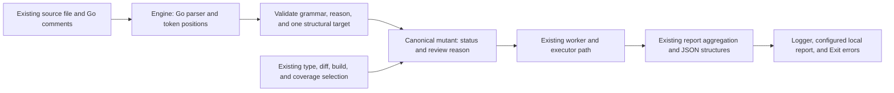

# Reviewed equivalent mutants: architecture preflight

Issue #201 requires one reviewed exception per mutant, an audit reason, distinct metrics, and a tagged release.
The supplied issue is the contract. This note defines design boundaries; it does not implement the feature or prescribe implementation steps.
The source review used revision `bd52c783d808ac70a250016c25b68f783b42b31b`.

Existing package boundaries suffice. No new package, dependency, service, or architecture policy is needed.
[ADR 0008](../adr/0008-equivalent-mutant-annotations.md) records the annotation decision.

## Identity and review meaning

A reviewed equivalent mutant is a consumer assertion about unchanged observable behavior.
Gremlins validates the annotation and its target; it does not prove equivalence or authenticate the reviewer.
Source review and the existing maintainer controls authorize the exception.
Do not describe the annotation as a killed mutant, uncovered code, a file exclusion, or proof of test effectiveness.

One target is the containing source file, an exact token position, and one canonical `mutator.Type`.
Line alone is insufficient. `TokenMutantType` can produce multiple Mutation types at one token, including boundary and negation mutations.
Separate operators on the same line also need separate identities.
Do not select by AST traversal order, worker completion order, partial text match, regular expression, or nearest matching operator.
No wildcard, statement, function, line, or file suppression belongs in this feature.

ADR 0008 owns the annotation spelling and placement rule.
Its documented grammar must express this exact identity and a non-empty reason without depending on enabled types or execution order.
Use canonical names from `mutator.Types` and `Type.String`; do not create another mutation-name inventory.
Use Go byte columns, including tabs and UTF-8, rather than display columns.

Bind against the original parsed file before mutation or `go/printer` changes its layout.
Source edits and formatting can invalidate coordinates; fail on stale targets rather than moving them to a guessed target.
A position is not a durable identity across revisions. Review must confirm the current code and reason still agree.

## Ownership and data flow

| Concern | Canonical incumbent and boundary |
| --- | --- |
| File scope and parsing | `internal/engine/engine.go`: `discover`, `parseFile`, `runOnFile`, and `findMutations`. Reuse `parser.ParseComments`, `go/ast`, and `go/token`. |
| Candidate identity | `internal/engine/node.go` and `mappings.go`: `NodeToken`, `TokenMutantType`, and `tokenMutations`. Match the actual supported operator and type. |
| Domain values and metadata | `internal/mutator/mutator.go` owns statuses, types, and `Mutator`. Expose the reason through this existing contract; store it once on the mutant. |
| Concrete mutant | `internal/engine/tokenmutator.go` owns the parsed source and concrete mutation. Do not make report import engine or downcast to `TokenMutator`. |
| Selection | `mutationStatus`, `fileCoverage`, `diff.Diff.IsChanged`, and `exclusion.Rules` retain their separate meanings. File exclusions remain path expressions. |
| Execution and isolation | `executor.go`, `workerpool`, `workdir`, and `internal/process` own execution, cancellation, resource admission, rollback, and cleanup. |
| Reporting and persistence | `internal/report/report.go` and `internal/report/internal/structure.go` own aggregation and JSON. Source comments and the configured local JSON file suffice. |
| Filters and configuration | `internal/report/logger.go`, Configuration keys, Cobra/Viper binding, `configuration.Validate`, and the existing configuration JSON schema own their respective contracts. |
| Errors and diagnostics | Ordinary wrapped Go errors, `errors.Join`, Logger, and `internal/execution.ExitError`. No new exception hierarchy or error envelope. |

Parse and validate all annotations in each discovered file before publishing that file's mutants to the stream.
Discovery already overlaps execution of earlier files. A later annotation error must fail the run through the existing discovery-error path.
`Engine.Run` returns partial results with an error; `runUnleash` must continue to withhold a successful report and threshold assessment.
Preserve worker draining and cancellation ownership; do not claim that the current discovery-error path immediately cancels earlier tests.

Do not require a second repository scan or claim that validation precedes the baseline coverage run.
Coverage runs before discovery and executes target tests, including in dry-run mode.

## Validation and selection invariants

- Recognize directives from actual Go comments, not strings or raw source searches. Read raw comment text without losing directives through comment normalization.
- Reject missing, empty, or whitespace-only reasons and malformed recognized directives. State the annotation location and expected form.
- Reject unknown mutation names, invalid coordinates, unsupported operator/type combinations, duplicate targets, ambiguous matches, and targets that no longer exist.
- Validate against structural candidates before enabled-type, diff, build, or coverage filtering. A disabled type is not a stale target.
- Do not emit a disabled Mutation type merely to report its annotation. Document that a report covers the invocation's discovery and enabled-type scope.
- Preserve existing ignored trees, nested-module boundaries, non-Go and test-file handling, and explicit file exclusions. No validation claim extends to files outside discovery.
- Keep `SKIPPED` precedence for candidates outside the diff or observable build scope. Retain their validated reason in JSON for audit.
- For an otherwise runnable or uncovered candidate with a valid annotation, use a distinct `EQUIVALENT` status. Its siblings retain their existing classification.
- Append the new status rather than renumbering existing status constants. Every equivalent status must carry a validated reason.
- Carry immutable annotation metadata through the existing channel and result path. Avoid global registries and parallel result lists keyed by execution order.

Go `//line` directives can remap filenames, lines, and columns returned by `FileSet.Position`.
Match physical source coordinates with `PositionFor(pos, false)`; annotations must never nominate another file through remapped names.
The report currently uses adjusted positions. Preserve that public behavior for existing mutants.

If an annotated target's adjusted position differs from its physical identity, reject it clearly in this initial feature.
Supporting remapped annotation identities later requires an explicit report-contract decision, not a guessed match.

The executor currently excludes only `NotCovered`, `Skipped`, and dry runs from mutation execution.
A new status alone would therefore execute annotated mutants.
The execution boundary must allow only `Runnable` mutants to apply mutations and run tests.

Equivalent mutants must produce reportable results without mutation, rollback, test execution, or resource reservation.
Retain the existing worker completion, cancellation, and result-delivery rules.

## Reports, thresholds, and compatibility

Extend the existing mutation JSON object with an optional `equivalent_reason`, omitted for unannotated mutants.
Keep its existing file, line, column, type, and status fields. Add a separate `mutants_equivalent` count for the new status.
A skipped mutant can retain its review reason while remaining counted as skipped.
All validated annotations on emitted mutants remain visible in the report, including dry runs and mutants outside the diff.

Show the equivalent count in both full-run and dry-run summaries when it is not zero, so other runs keep their output.
Console filters and silent mode must not remove JSON records, reasons, or aggregate statistics.
Do not fabricate mutation snippets for mutants that never ran.

Existing JSON fields and status strings retain their meanings. In particular, `mutants_total` currently counts killed, lived, and not-viable mutants.
It is not the number of discovered mutants. Do not silently redefine it to include equivalents or repair other historical totals here.
Mutator-type statistics currently count discovered mutants, including skipped ones; they are not threshold denominators.

An additive field and status still require release notes for consumers with strict decoders or exhaustive status switches.
This preflight does not inspect or change either downstream repository.

Let K, L, U, R, and E mean killed, lived, uncovered, runnable, and equivalent counts.
Preserve the existing calculations for ordinary mutants:

| Mode or gate | Calculation and empty-selection behavior |
| --- | --- |
| Full-run efficacy | `100 * K / (K + L)`; E contributes to neither numerator nor denominator. |
| Full-run mutant coverage | `100 * (K + L) / (K + L + U)`; E contributes to neither term. |
| Dry-run mutant coverage | `100 * R / (R + U)`; equivalent mutants are not runnable. Dry runs do not assess thresholds. |
| Empty eligible selection | When every reported mutant is skipped or equivalent, write the audit report and skip threshold assessment. |
| Other zero denominators | Keep finite zero percentages and existing gate behavior. Equivalents must not conceal uncovered, timed-out, memory-error, or not-viable outcomes. |

For example, K=1, L=1, U=2, E=3 gives 50% efficacy and 50% mutant coverage.
An all-equivalent selection reports its reasons and count; it does not claim 100% test effectiveness.
An equivalent mutant beside an uncovered mutant must not turn that uncovered selection into an empty successful gate.
Preserve comparison precision, threshold ordering, zero-disabled thresholds, and exit codes 10 and 11.
Malformed annotations use the ordinary error path and exit 1; no new exit code is needed.

Expose `e` through the existing `output-statuses` filter for `EQUIVALENT`.
Keep the existing letters and the invalid-filter warning behavior. Annotation errors must not inherit that warning-only behavior.
Update `ParseFilter`, its error text, CLI help, the schema pattern and description, and usage references together.

Before #201, the schema allowed only `^[lctmkvsr]*$`; runtime configuration type checks alone do not catch a mismatch.
Keep `output-diff-statuses` limited to executed lived and killed mutants.
No new flag, configuration key, environment binding, or runtime JSON-schema check is needed.

## Security and whole-repository controls

These controls apply to the proposed data flow, rather than asserting new security defects in existing code.

| Layer | Required treatment |
| --- | --- |
| Source parser and semantic gate | One engine-owned grammar and target check. Parse supplied comments as data. Fail closed before excluding any target in that file. |
| Authorization | Local source review and existing maintainer controls own acceptance. A reason is an assertion that reviewers can audit, not a signed approval or an equivalence proof. |
| Configuration shapes and environment | Reuse `configuration.Init`, typed `Get`, `Validate`, and existing binding precedence. Only the existing status-filter value set expands. The schema is editor guidance, not the annotation check. |
| Filesystem and OS | Read through the existing discovery filesystem. No annotation-provided path, external file, command, URL fetch, or parent-directory lookup. Preserve Work directory copy isolation and original source bytes. |
| Process and secret handling | Never place reasons in command arguments, environment variables, child process input, or shell commands. Preserve `internal/process`, memory admission, and the existing bounded CI runner. Temporary copies are not a hostile-code sandbox. |
| Error and console boundary | Use Logger with fixed format strings. Quote input-derived locations and reasons to escape control characters. Keep reasons out of parse-error diagnostics when location and expected syntax suffice. Errors remain visible under silent mode. |
| Report serialization and persistence | Use the canonical DTO and `encoding/json` escaping. Preserve existing create/write/close error propagation and report-before-threshold ordering. No sidecar, database, new artifact destination, or upload. |
| Development checks | Reuse `.architecture/model.json`, ARCH001–ARCH004, `scripts/check-design.sh`, and `.architecture/designs/201.json`. Preserve package direction, strict design decoding, contract declarations, and shrink-only baselines. |
| Quality and hosted execution | `.golangci.yml`, `mise.toml`, `Makefile`, `.pre-commit-config.yaml`, and `ci.yml` retain their roles. Keep secret scanning, shared hooks, platform checks, and credential-bearing jobs separate. |
| Release | ADR 0002, `release-please-config.json`, its manifest, `release-please.yml`, and `.goreleaser.yaml` remain the only release path. No manual version, tag, changelog, or publication workflow. |

Reasons become public wherever the consumer publishes its source or report. Documentation must tell consumers to omit secrets and confidential review details.
Do not log whole comments, environment contents, configuration dumps, or child process output to explain an invalid annotation.
No HTTP controller, application authentication service, remote error envelope, or credential integration exists in this feature's path.

## Extension seam and verification obligations

The seam is the exact source-position plus `mutator.Type` selector and reason carried by the existing mutant contract.
New mutation names must come from the canonical types and mappings without editing another list of allowed names in a parser.
If one future type produces multiple replacements at the same token, add an explicit variant discriminator before permitting ambiguous matching.
Do not introduce speculative hashes, a review registry, plugin interfaces, or a generic suppression-policy framework now.

Use Table-driven tests with the existing `WithDirFs`, `fstest.MapFS`, executor injection, report stubs, and temporary output files.
Assert exact token/type selection, the second type on that token, adjacent operators, another line, and another file independently.
Cover malformed and whitespace reasons, duplicates, stale targets, disabled types, skipped and uncovered targets, formatting, byte columns, and remapped positions.
Prove that equivalent mutants never call Apply, Rollback, or the test child process, and that neighboring runnable mutants still do.
Verify reason transport through real discovery and execution to JSON, not only a report stub.

Verify the new filter letter against the schema pattern; existing schema tests check types/defaults and do not compare filter patterns.
Check raw JSON omission for ordinary mutants, decoded reason values, counts, all-equivalent and mixed threshold cases, and ordinary report-write failures.
Preserve error propagation and worker shutdown when a later file contains an invalid annotation.

Follow `docs/development/test-standard.md` and the existing test classification and regression-proof rules.
This is new behavior: new tests normally use `TestFeature...`. Existing defect regressions require independent base-failing assertions.
Keep configuration and Logger isolation serial where process-global state is shared.
Run targeted race tests locally and existing hosted full and mutation checks; do not weaken thresholds through annotations to make this feature pass.
Keep fixture bytes unchanged except where the fixture itself exercises the feature.

## Delivery boundaries and non-goals

The tagged-release acceptance criterion remains outstanding until the implementation and user documentation exist in an actual fork release.
A merged feature PR or an untagged binary is insufficient. Existing release approval remains with the user.
User documentation must cover syntax, obtaining the exact selector, reason privacy, stale annotations, selection scope, JSON additions, and threshold arithmetic.
No release or downstream change is authorized by this preflight.

ADR 0002 and ADR 0004 bind release ownership and architecture verification. ADR 0003 applies only if upstream changes are imported.
ADR 0001 describes the tracked fork module identity, which differs from the supplied instruction to preserve the upstream module path.
The supplied `main` PR instruction also differs from tracked `dev` workflow guidance and ADR 0007.
This issue needs neither identity nor branch-policy changes. Leave those artifacts untouched and follow explicit user delivery instructions.

Non-goals include automatic equivalence detection, reviewer identity management, general ignore directives, new Mutation types, and whole-file exclusions.
No unrelated report-total correction, coverage rewrite, resource-policy change, workflow duplication, new service, baseline growth, hook bypass, commit, merge, or publication.

## Preflight evidence

`make architecture-design` passed with the mise-pinned Go 1.26.11 tools, module network access disabled, and a temporary build cache.
The model SHA-256 was `22337dd5b0fb2bc612c0db132f9807dbbd53055daec6c7ee5ddfd2c60ccf31f1`.
The evaluated rules were ARCH001 ownership, ARCH002 imports, ARCH003 contracts, and ARCH004 trust boundaries.
The checker validates declared relationships, not annotation correctness, downstream decoder compatibility, or the truth of prose assertions.

`make architecture ARCHITECTURE_BASE=origin/dev` passed with zero baseline findings against the reviewed source revision.
JSON syntax, whitespace checks, and the explicit-path documentation check passed.
This design-only preflight does not run implementation tests, full suites, or mutation testing.
