# Unary logical inversion: architecture preflight for issue 7

> Current context (2026-11-24): This is a historical record of issue 7 at its reviewed revision.
> Current design: [mutation registry](mutation-registry.md).
> The spec registry replaced `TokenMutator` and `tokenMutations`.
> `runOnFile` now collects the mutants of a file before it sends them, and the `!x` to `!!x` edit exists.

This note defines design boundaries for issue 7. It does not implement the mutation or prescribe an implementation sequence.
The issue requires `!` to become `!!` under the existing `INVERT_LOGICAL` type.
For `!x`, the mutant evaluates `!(!x)`. It evaluates `x` once and preserves its grouping.

## Existing design and required boundary

`internal/engine/node.go` already discovers `ast.UnaryExpr` and records its operator position.
`mappings.go` owns `TokenMutantType`, which both discovery and equivalent-annotation matching use.
`tokenMutations` separately describes single-token replacements. Go has no `!!` token.
`TestRegressionTokenMutationsChangeTheToken` also rejects mappings that replace a token with itself.
Keep the catalogue and replacement table distinct: a discoverable mutation need not be a token swap.

Keep this change inside `internal/engine`, with the existing `mutator.Mutator` contract.
The narrow extension belongs beside `NodeToken` and `TokenMutator.Apply`: retain the unary expression needed for a reversible structural edit.
Select that edit by mutation type and original operator. Keep ordinary replacements in the existing table.
Handle the structural case before replacement lookup; a missing map entry must not turn `!` into `token.ILLEGAL`.

A private operation with an exact restoration action is sufficient; no public strategy interface or new mutator hierarchy is justified.
This seam permits another structural operation later without changing configuration, reporting, execution, or discovery contracts.

```mermaid
flowchart LR
  src[Local Go source] --> parse[Parser, directives, build and coverage checks]
  parse --> collect[Construct all candidates for one file]
  collect --> dispatch[Dispatch original candidates]
  dispatch --> apply[Locked AST edit, print, immediate AST restoration]
  apply --> work[Worker module copy]
  work --> test[Existing bounded go test]
  test --> restore[Restore original bytes or discard copy]
  restore --> report[Existing console and JSON report]
```

### Shared AST and restoration

`Engine.Run` starts discovery and execution concurrently. `runOnFile` currently sends mutants from inside `ast.Inspect`.
The per-file lock in `TokenMutator.Apply` serializes writers; discovery does not acquire that lock.
Changing an operand while discovery traverses it risks a data race, discovering synthetic operators, and unstable counts.
Existing token swaps also expose mutable operators to discovery. A structural edit makes this boundary especially consequential.

Finish candidate construction, type selection, and status assignment for one file before sending its first mutant.
Dispatch must then consume completed candidates without reading mutable AST fields.
Keep cancellation checks during collection and dispatch. Buffer only one file's candidates, rather than the whole module.
Do not hold the file lock across channel sends: the bounded worker queue can otherwise deadlock with workers awaiting that lock.

Keep the file lock around edit, printing, and immediate AST restoration.
Preserve the original operand reference and operator metadata; restore their exact values on every return path.
The inserted unary expression must reference the original operand, never its own enclosing expression.
Do not leave the shared AST mutated while tests execute or wait until `Rollback` to restore it.
`Rollback` retains its separate responsibility: restoring original file bytes in the worker copy.
Retain `Apply` write-failure restoration, joined errors, and executor discard after an apply or rollback failure.

## Cross-cutting layers

| Layer and canonical owner | Required treatment |
| --- | --- |
| Source parsing: `engine.parseFile`, `go/parser`, `go/ast`, `go/token`, `go/printer` | Operate on parsed unary `token.NOT` expressions. Preserve operand precedence, comments, and original operator identity. Do not rewrite raw text. |
| Eligibility: `engine.go`, `clausecoverage.go`, `internal/exclusion`, `internal/diff` | Reuse enablement, exclusions, build tags, observability, coverage, diff filtering, and package routing. Do not schedule a separate unary path. |
| Annotation validation: `equivalent.go`, ADR 0008 | Add eligibility to the shared catalogue. Preserve exact-one matching, byte columns, physical positions, duplicate rejection, and moved-position rejection. |
| Configuration: `configuration.Get`, `Validate`, `MutantTypeEnabledKey`, `mutantenabled.go` | Use the existing boolean and false default. Cobra binding, Viper precedence, `GREMLINS` environment binding, and the JSON schema already cover this type. |
| Filesystem: `TokenMutator`, `workdir.CachedDealer`, `gomodule` | Use existing worker copies, relative filenames, package routing, writes, rollback, discard, and cleanup. A work directory isolates file changes; it is not a security sandbox. |
| OS processes: `executor.go`, `memory.go`, `internal/process` | Retain direct argument arrays, inherited environment, memory admission, process-group cleanup, and timeout/cancellation handling. No source text enters argv or a new environment value. |
| Hosted runner: `scripts/run-bounded.sh`, `.github/workflows/gremlins.yml`, ADR 0006 | Preserve budget validation, effective-controller checks, unprivileged execution, environment allowlists, credential-value filtering, and group cleanup. No unbounded fallback or new environment forwarding. |
| Errors: `ExecutorResult`, `Engine.Run`, `cmd.runUnleash`, `internal/execution` | Propagate infrastructure errors with causes through existing wrapping and joining. Preserve build-failure versus killed classification and current exit codes. |
| Output and persistence: `OrigSnippet`, `MutatedSnippet`, `internal/report`, `internal/log` | Retain current snippets, diff generation, status filters, JSON structures, statistics, and Logger silent mode. No new store, raw-source diagnostics, or output destination. |
| Development policy: `.architecture/model.json`, `.golangci.yml`, `.pre-commit-config.yaml`, `mise.toml`, `Makefile`, `scripts/` | Use existing design, lint, documentation, secret, and regression checks. No baseline growth, hook bypass, dependency, or new provider. |

There is no runtime authentication or authorization layer in this local CLI flow.
This change adds no credential handling; it must not inspect secret files or print inherited environment values.
Source compilation and tests retain their existing host privileges and potential Go tool network behavior.
Do not claim that temporary copies or process limits isolate hostile Go code.

## Compatibility and semantic gotchas

- `INVERT_LOGICAL` remains one Mutation type. Do not follow the new-type registration steps in `CLAUDE.md` for this extension.
- The existing `--invert-logical` flag and configuration key control `!`, `&&`, and `||` together. Their default remains false.
- Discover each original `!` once. In `!!x`, both original operators remain distinct candidates, even when their resulting source or behavior coincides.
- Never discover the inserted `!`. Never accumulate edits across mutants or repeated apply/rollback cycles.
- Cover parentheses, calls, selectors, indexing, dereferences, receive expressions, nested negations, multiline operands, and comments near the operator.
- `!=`, strings, and comments do not introduce unary-negation candidates. Preserve existing binary logical and conditional mutations.
- Preserve original `TokPos`, line, and byte column for coverage, diff checks, selectors, and reports. Synthetic positions must not shift original identities.
- A line with `!x && y` now has two `INVERT_LOGICAL` candidates. A formerly unique column-free equivalent annotation becomes ambiguous, even when this type is disabled.
- Preserve ADR 0008's rejection of ambiguity; document the existing `@COLUMN` remedy. Do not weaken matching or silently select the first candidate.
- The JSON shape and type name remain stable. When enabled, extra mutants can change counts, scores, runtime, and threshold outcomes as intended.
- Update the existing logical-mutation reference page with the unary case during implementation. Do not create another configuration schema or mutation catalogue.

## Evidence required of implementation

Use the existing table-driven tests, temporary writable inputs, and `go-cmp` assertions under the Go test standard.
Observe the new behavior assertion fail against base code before changing production behavior.
`TestFeature` names fit this addition; reserve `TestRegression` for a proved defect under the existing hosted regression checker.
Do not require a new production symbol merely to compile a test against the base revision.

Evidence must establish discovery, enablement, original position, exact added negation, valid printed Go, single operand evaluation, and byte-exact rollback.
Also establish AST restoration after success and failure, isolation of later mutants, and concurrent discovery/execution without synthetic candidates or races.
Cover nested and adjacent operators, cancellation during collection/dispatch, and unchanged binary replacements.
Verify equivalent selectors on `!`, ambiguity with other logical operators, disabled-type binding, and existing status precedence.
Reuse executor and report tests for integration contracts; do not copy their status or scoring algorithms into new expectations.

Run selected cases with `go test -race ./internal/engine -run '<selected tests>'`.
Use existing policy and lint checks. Full tests and mutation runs belong to CI.
The current `.gremlins.yaml` leaves `INVERT_LOGICAL` disabled, so default self-mutation does not exercise this new operator.
Require focused evidence for omitted wrapping and missing restoration; a generic green mutation job alone does not establish that evidence.
Keep focused mutation execution within existing CI and its resource limits; do not change global defaults for this issue.

## Non-goals and repository discrepancies

No new Mutation type, dependency, package, generic AST framework, execution lane, public flag, key, status, report field, or exit code is needed.
Do not replace the printer with textual insertion, introduce a second annotation parser, or broaden workdir/process security policy.
Preserve byte-exact fixtures except for deliberate new or changed test inputs.
The upstream prerequisite link in the issue supplies historical context; current unary discovery exists, but structural application is still absent.
Do not import an upstream branch merely to satisfy that historical reference. ADR 0003 governs any actual upstream import.

There are two existing guidance discrepancies. `AGENTS.md` says to preserve the upstream module path and target `main`.
Current `go.mod`, imports, the architecture model, and ADR 0001 use `github.com/OpenRAE/go-rae-gremlins`.
The contributor guide, `.ground-control.yaml`, and plan rules target `dev`.

This preflight changes neither module identity nor branch policy and performs no GitHub operation.
The explicit user instructions govern any later action; do not silently resolve these differences by rewriting module or workflow files.
The copied-issue triage disposition required by the contributor guide was not supplied; no upstream import or publication is authorized by this note.

The design declaration is [`.architecture/designs/7.json`](../../.architecture/designs/7.json).
It adds no package dependency or contract-file change and does not broaden any modeled trust boundary.
ADR 0004 governs design evidence, ADR 0006 governs the hosted resource boundary, and ADR 0008 governs equivalent selectors.
The existing decisions cover this extension; no new ADR is needed.

## Preflight verification

Sources were inspected at revision `96a6e0a`. The explicit design check passed rules `ARCH001`, `ARCH002`, `ARCH003`, and `ARCH004`.
The checked model SHA256 is `c28bab810f1497d79aea1fcac11781ad83abf8d2e7b36cb8c78a8e7225243f6b`.
This check validates declared package, contract, and trust boundaries. It does not prove runtime correctness or resolve the guidance discrepancies above.

The repository architecture scan also passed against local `HEAD`, with zero baseline findings.
`make policy` passed. No Go implementation tests or mutation runs were executed during this documentation-only preflight.
