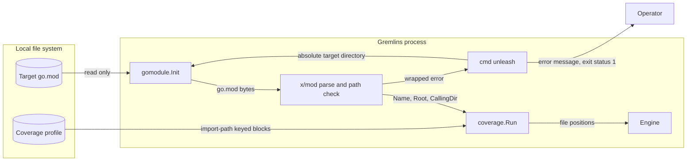

# Module declaration design — issue #35

Gremlins must read the module path from a valid `go.mod` file.
Comments, blank lines, quoted paths, and the block form can come before or around the `module` directive.
A malformed or missing declaration must cause a useful error.
Existing ADRs apply. This change needs no new ADR.

## Decision and ownership

[internal/gomodule](../../internal/gomodule/gomodule.go) keeps module detection behind `Init(path)` and the `GoModule` value.
`Name` is a Go import-path prefix. `Root` is a filesystem directory. `CallingDir` is relative to `Root`.

`gomodule` reads the nearest `go.mod` file as bytes and parses it with `golang.org/x/mod/modfile.ParseLax`.
It rejects a parser error, a missing `module` directive, and an empty path.
It validates the path with `golang.org/x/mod/module.CheckImportPath`, as the go command does for the main module.
A path does not need a domain name, so a short local module name stays valid.

`ParseLax` parses the `module` directive with the same rules as `Parse`.
`ParseLax` ignores directives that the pinned `x/mod` release does not know.
Gremlins needs only the module path from the file. A directive from a newer Go release must not stop a mutation run.
The go command validates the complete file when Gremlins runs the module tests.
`modfile.ModulePath` returns no error detail, so it cannot satisfy the error requirement.

`gomodule` returns an error when no `go.mod` file exists in the path or a parent directory.
The nearest module applies. An invalid nearest module causes an error and does not fall back to a parent module.

[configuration](../../internal/configuration/configuration.go) keeps its own root search.
That search finds only an optional configuration directory, and configuration initializes before module detection.
The [architecture model](../../.architecture/model.json) does not allow `configuration` to import `gomodule`.
This change keeps that boundary.

## Data flow

The trust boundary is between the local file system and the Gremlins process.
`coverage` removes the `Name` prefix from each profile file name.
A wrong `Name` causes no match, and the run reports each mutant as not covered.

## Security

| Asset or threat | Control | Verification |
| --- | --- | --- |
| Wrong module identity gives a false mutation result | Parse with `x/mod`; reject a missing, empty, or invalid path. | `gomodule` and `coverage` regression tests. |
| Malformed `go.mod` content at the file-system boundary | Parser errors stop the run before coverage and the work directory copy. | Malformed-input regression tests. |
| Source execution or network access during detection | Detection only reads bytes. It does not start a child process, a download, or a version fixer. | Code review; `go.mod` adds only `x/mod`. |
| Target file changes | Detection does not write `go.mod` or `go.sum`. | Code review. |
| Diagnostic content | Errors name `go.mod` and keep the parser cause. Errors do not show the file contents. Parser diagnostics can show the bad token. | Error tests check the `go.mod` path. |
| New dependency without review | `depguard` allows only `x/mod/modfile` and `x/mod/module`. `go.mod` requires `x/mod v0.38.0`, the version `x/tools v0.48.0` already selects. | `make lint`; `go.sum` checksums. |

Residual risk: the parser can accept a file that a newer go command rejects for other directives.
The go command then fails the coverage run with its own error.

## Compatibility

No CLI flag, configuration key, JSON report field, or exit code changes.
The `go_module` report value is now the declared module path.
A new `go.mod` syntax needs a reviewed `x/mod` update.

The cached-baseline timeout that the original report mentions is a different problem.
This change does not change it.

## References

- [Go modules reference](https://go.dev/ref/mod), Go 1.26, sections "Lexical elements", "`module` directive",
  and "Modules, packages, and versions": comment placement, path forms, and module root search.
- [`modfile` package](https://pkg.go.dev/golang.org/x/mod/modfile), v0.38.0, `Parse`, `ParseLax`, and `ModulePath`: parser choice.
- [`module` package](https://pkg.go.dev/golang.org/x/mod/module), v0.38.0, `CheckImportPath`: path validation.
- [Go main-module loader](https://github.com/golang/go/blob/go1.26.11/src/cmd/go/internal/modload/init.go),
  go1.26.11: the go command parses `go.mod` with `x/mod` and checks the module path with `CheckImportPath`.
