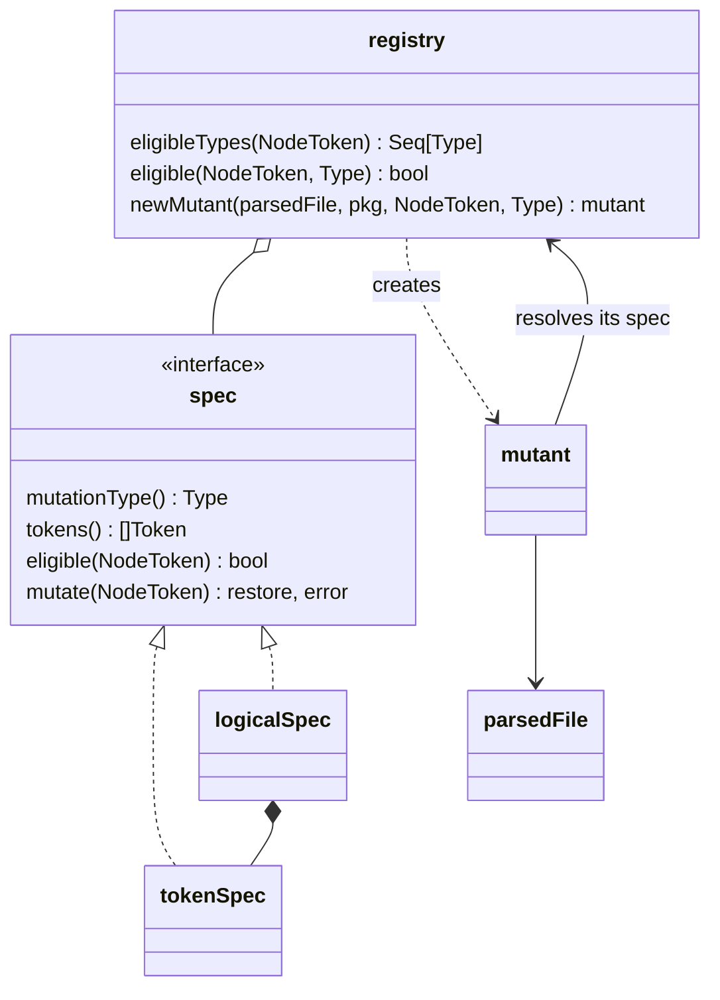
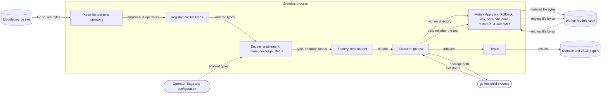
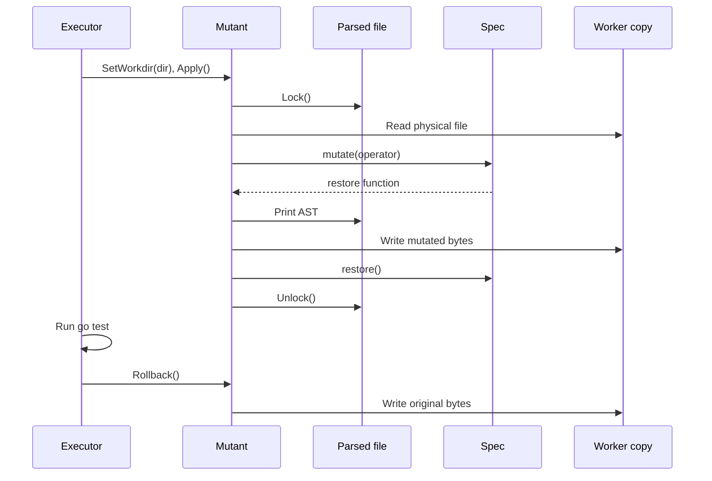

# Mutation registry

This explanation describes how the engine finds and applies mutations.
Issue 20 introduced this design. The [preflight](mutation-registry-preflight.md) records its boundaries and evidence obligations.

## Components

All components are private parts of `internal/engine`.
The `internal/mutator` package keeps the `Type`, `Status`, and `Mutator` contract.

| Component | File | Responsibility |
| --- | --- | --- |
| Spec | `spec.go` | The behavior of one mutation type: eligibility of an original operator, and one reversible AST edit. |
| Token spec | `spec.go` | A spec that replaces the operator token from a fixed table. |
| Expression spec | `spec_expression.go` | The `!x` to `!!x` edit. The `INVERT_LOGICAL` spec uses it with its token table. |
| Built-in specs | `specs.go` | The registration list of the 11 built-in types, in candidate order. |
| Registry | `registry.go` | Validates the registration once and indexes the specs by operator token. Gives the eligible types of an operator, in registration order. |
| Factory | `registry.go` | Binds a type, an operator, a package, and a parsed file into a `mutator.Mutator`. |
| Parsed file | `mutant.go` | The shared AST of one source file, its physical name, the lock for its AST edits, and the file access in a worker copy. |
| Mutant | `mutant.go` | The `mutator.Mutator` implementation: metadata, snippets, worker-file writes, and byte restoration. |

The engine keeps parsing, directives, build tags, coverage, diff filtering, enablement, status, dispatch, and cancellation.
The executor keeps the worker directory, the test run, result classification, rollback, and discard.

A spec has no configuration, filesystem, process, or output access.
A spec does not set a status. One spec value serves all mutants of its type.

## Registration rules

The registry rejects a nil spec, a type that `mutator.Types` does not contain, and a second spec of one type.
It also rejects a registration that does not cover each type of `mutator.Types`.
The built-in registry is built when the package starts. An invalid built-in list stops the program, as `database/sql.Register` does for a duplicate driver.

The registration order is the candidate order at one operator.
For example, `-` gives `INVERT_NEGATIVES` before `ARITHMETIC_BASE`.
Each position and type pair is one candidate.

Directive matching and discovery use the same registry.
An equivalent annotation selects an operator that its type can mutate, also when the type is disabled.

## Data flow

The process boundary separates the Gremlins process from the source tree, the worker copy, and the child process.
The source tree is read-only for the engine. Only the worker copy receives mutated bytes.

## Apply sequence

The lock belongs to the parsed file. It serializes the edits of the mutants that share one AST.
Mutants of different files run in parallel. Apply does not hold the lock during the test run.

## Positions

The physical position comes from `token.FileSet.PositionFor` with `adjusted` set to false.
It ignores `//line` directives.
The worker file path is the physical, module-relative name of the parsed file.
An `os.Root` at the worker copy opens the file. It refuses a name that resolves outside the copy.
The snippet line is the physical line.

The adjusted position stays display metadata for reports and logs.
A `//line` directive cannot change the worker file path.

## Security

| Asset | Threat | Control | Verification |
| --- | --- | --- | --- |
| Source tree and files outside the worker copy | A `//line` directive gives a file name, for example `../x.go`, that sends the write outside the worker copy. | The worker path is the physical module-relative name. Display positions never select a path. An `os.Root` confines each read and write to the worker copy. | `TestRegressionApplyWritesThePhysicalFileOfALineDirective`, `TestFeatureParsedFileConfinesWorkFilesToTheCopy`. |
| Shared AST | Two workers edit one AST at the same time. | One lock for each parsed file covers the edit, the print, and the restoration. | `TestFeatureMutantApplySharesTheLockOfItsFile` with the race detector. |
| Shared AST | An edit stays after Apply, so a later mutant or the discovery sees it. | The spec returns an exact restore function. Apply calls it before it releases the lock, also on failure. Discovery of a file ends before its first dispatch. | `TestRegressionTokenMutatorApplyWriteFailureRestoresAST`, `TestFeatureMutantApplyDoubleNegation`, `TestFeatureRunDiscoversOnlyOriginalNegations`. |
| Result integrity | A wrong registration adds, removes, or reorders candidates. | Registry validation at start. A characterization test compares the candidates with an independent list. | `TestFeatureRegistryRejectsInvalidRegistration`, `TestFeatureRunDiscoversEachOperatorInOrder`, `TestFeatureSpecMutatesEachOperator`. |

Gremlins runs operator-selected code with the permissions of the operator.
A worker copy is not a sandbox for hostile code. This design adds no credential, network, process, or output surface.

## Add a mutation to an existing type

1. Add the operator to the table of the type in `specs.go`. A token spec gives its table keys as its tokens.
2. Add a test of the discovery and of the edit.
3. Update the page of the type in `docs/docs/usage/mutations/`.

A new public type needs more than a registration. [CLAUDE.md](../../CLAUDE.md) gives the steps.

## References

- [go/ast](https://pkg.go.dev/go/ast): `Inspect`, `UnaryExpr`.
- [go/token](https://pkg.go.dev/go/token): `FileSet.PositionFor`.
- [go/printer](https://pkg.go.dev/go/printer): `Fprint`.
- [os](https://pkg.go.dev/os): `Root`.
- [cmd/compile](https://pkg.go.dev/cmd/compile): line directives.
- [database/sql](https://pkg.go.dev/database/sql): `Register`.
- [Google Go style decisions](https://google.github.io/styleguide/go/decisions): must functions and interfaces.
