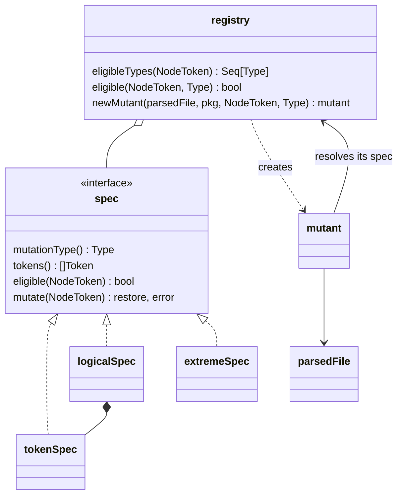
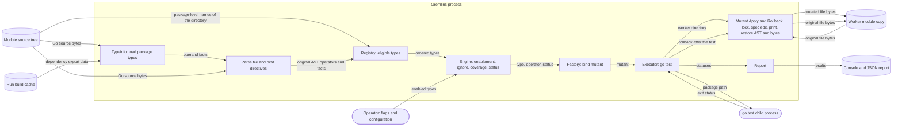
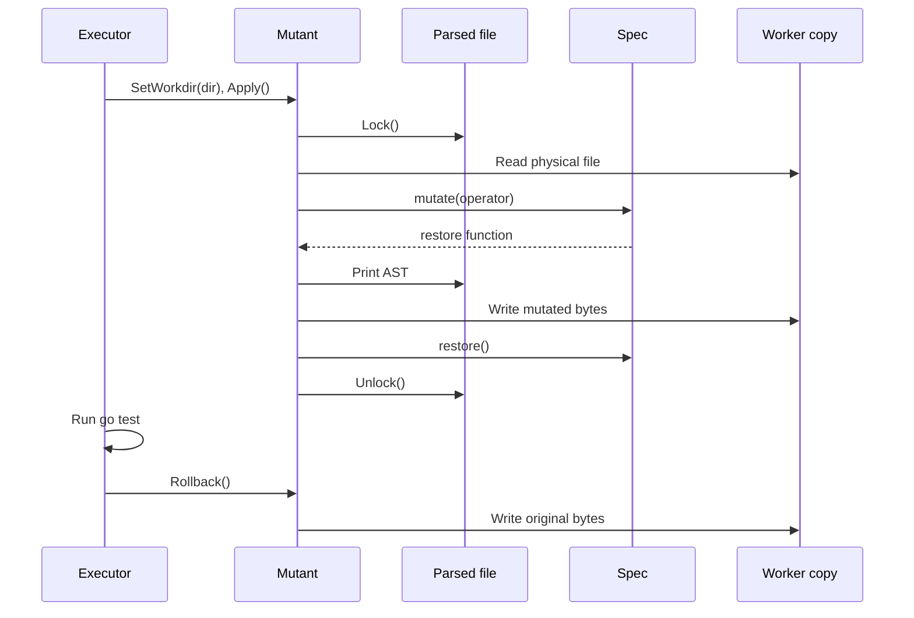

# Mutation registry

This explanation describes how the engine finds and applies mutations.

Issue 20 introduced this design. The [preflight](mutation-registry-preflight.md) records its boundaries and evidence obligations.
Issue 222 added the eligibility checks and the operand facts. [ADR 0011](../adr/0011-mutant-eligibility-type-information.md) records that decision.
Issue 2 added the function candidates of the Descartes types. [ADR 0012](../adr/0012-descartes-extreme-mutation.md) records that decision.

## Components

All components except the operand facts are private parts of `internal/engine`.
The `internal/mutator` package keeps the `Type`, `Status`, and `Mutator` contract.

| Component | File | Responsibility |
| --- | --- | --- |
| Spec | `spec.go` | The behavior of one mutation type: eligibility of an original operator, and one reversible AST edit. |
| Token spec | `spec.go` | A spec that replaces the operator token from a fixed table. An optional check limits the operators that it selects. |
| Logical spec | `spec.go` | The `INVERT_LOGICAL` spec: its token table and the `!x` to `!!x` edit. |
| Expression edit helpers | `spec_expression.go` | Find a `!x` negation and apply the `!!x` edit for the logical spec. |
| Operator context | `node.go` | The operator token, its unary or binary form, its operand facts, and the loop context of a `break`. |
| Operand facts | `internal/typeinfo` | Loads the types of the scanned packages once. Gives the `+` and `+=` operators whose `-` form does not type-check, and the shift assignments whose count cannot be assigned. |
| Built-in specs | `specs.go` | The registration list of the 14 built-in types, in candidate order. |
| Extreme spec | `spec_function.go` | A Descartes spec. It adds one `return` statement before the statements of a function body. |
| Function candidate | `function.go` | The function declaration of a candidate, the kinds of its results, and the names that the package and the function declare. |
| Registry | `registry.go` | Validates the registration once and indexes the specs by operator token. Gives the eligible types of an operator, in registration order. |
| Factory | `registry.go` | Binds a type, an operator, a package, and a parsed file into a `mutator.Mutator`. |
| Parsed file | `mutant.go` | The shared AST of one source file, its physical name, the lock for its AST edits, and the file access in a worker copy. |
| Mutant | `mutant.go` | The `mutator.Mutator` implementation: metadata, snippets, worker-file writes, and byte restoration. |

The engine keeps parsing, directives, build tags, coverage, diff filtering, enablement, status, dispatch, and cancellation.
The executor keeps the worker directory, the test run, result classification, rollback, and discard.

A spec has no configuration, filesystem, process, or output access.
A spec does not set a status. One spec value serves all mutants of its type.

## Eligibility

A spec selects an operator only when its mutant can build and no other type makes the same edit.

| Type | Check | Reason |
| --- | --- | --- |
| `INVERT_NEGATIVES` | Unary `-` only. | `ARITHMETIC_BASE` owns binary `-`. |
| `ARITHMETIC_BASE` | Binary operators and unary `+`. No `+` whose `-` form does not type-check. | `INVERT_NEGATIVES` owns unary `-`. For example, strings have no `-`. |
| `INVERT_BITWISE` | Binary operators only. | `\|x` is not Go syntax. `&x` from `^x` changes the type. |
| `INVERT_ASSIGNMENTS` | No `+=` whose `-` form does not type-check. | For example, strings have no `-=`. |
| `REMOVE_SELF_ASSIGNMENTS` | No `<<=` or `>>=` whose count cannot be assigned to the left operand. | `x = n` needs `n` to have a type that `x` can hold. |
| `INVERT_LOOPCTRL` | A `break` only where `continue` with the same label is valid. | `continue` needs a loop. A label must name a loop. |
| `EXTREME_VOID` | A function without results. The body is not empty and is not only `return`. | Such a body is already the mutation. |
| `EXTREME_ZERO` | Each result is nilable or basic, and the value names are predeclared. The body is not one `return` of the zero values. | Other types have no literal value. That body is already the mutation. |
| `EXTREME_CONSTANT` | The `EXTREME_ZERO` checks, with one or more basic results. The body is not one `return` of the same constants. | A function with only nilable results has the same mutant as `EXTREME_ZERO`. |

The syntax checks use the operator and its ancestors in the AST. They need no types.
The extreme checks use the function declaration and the names of its package and file. They need no types.
The type checks use the operand facts.

For a `+` or `+=`, `internal/typeinfo` asks the type checker if the `-` form type-checks at the operator position.
This includes type parameters, because the type checker uses the effective type set of the constraint.
A shift count that is an untyped constant gives no fact. A typed count must be assignable to the left operand.

An operator without a fact keeps the earlier behavior, so a package with type errors gives the same mutants as before.
When the `+` form alone does not type-check, for example with `iota`, the operator gets no fact.

The `internal/typeinfo` package runs `golang.org/x/tools/go/packages` once, after the coverage run.
It loads the scanned directory with the build tags, `-buildvcs=false`, and the Go build cache of the run.
It keys each fact by the module-relative file name and the byte offset of the operator.
The engine converts the offsets of a file to positions of its own parse.

A failure of the load stops the run with an error.
A package with type errors gives no facts, and Gremlins logs it.
A file that the host build does not include gives no facts. Coverage cannot show its mutants, so they are `SKIPPED`.

## Registration rules

The registry rejects a nil spec, a type that `mutator.Types` does not contain, and a second spec of one type.
It also rejects a registration that does not cover each type of `mutator.Types`.
The built-in registry is built when the package starts. An invalid built-in list stops the program, as `database/sql.Register` does for a duplicate driver.

The registration order is the candidate order at one operator.
For example, `<` gives `CONDITIONALS_BOUNDARY` before `CONDITIONALS_NEGATION`.
Each position and type pair is one candidate.

Directive matching and discovery use the same registry.
An equivalent annotation selects an operator that its type can mutate, also when the type is disabled.

## Function candidates

The Descartes types of [ADR 0012](../adr/0012-descartes-extreme-mutation.md) mutate a full function.
A function or method declaration with a body is one candidate. Its token for the registry is `func`.
The candidate has three source locations:

| Location | Use |
| --- | --- |
| The `func` keyword | The position of the mutant in reports, logs, and directives. |
| The first statement of the body | The coverage position. The coverage profile has a block from that statement. |
| The physical lines of the declaration | The diff range. A change on one of these lines selects the mutant. |
| The opening brace of the body | The center of the snippets, so they show the added statement. |

The engine gives the kind of each result from the syntax of its type: nilable, `bool`, numeric, `string`, or other.
A predeclared identifier counts only when the package, the imports of the file, and the function do not declare the name.
The engine reads the package-level names of the regular Go files of the directory once, by package clause.
When a Go file of the directory is not a regular file, or cannot be read or parsed, the names are not known.
Then no predeclared identifier counts. The scan reports no error and reads no symbolic link.

An extreme spec adds the `return` statement before the original statements and keeps them.
The restore function puts back the original statement list.
The added statement has no position, so it does not move the original positions.

## Data flow

The process boundary separates the Gremlins process from the source tree, the worker copy, and the child process.
The source tree is read-only for the engine. Only the worker copy receives mutated bytes.

## Apply sequence

The lock belongs to the parsed file. It serializes the edits of the mutants that share one AST.
Mutants of different files run in parallel. Apply does not hold the lock during the test run.

## Positions

The physical position comes from `token.FileSet.PositionFor` with `adjusted` set to false.
It ignores `//line` directives.
The worker file path is the physical, module-relative name of the parsed file.
An `os.Root` at the worker copy opens the file. It refuses a name that resolves outside the copy.
The snippet line is the physical line.

The adjusted position stays display metadata for reports and logs.
A `//line` directive cannot change the worker file path.

## Security

| Asset | Threat | Control | Verification |
| --- | --- | --- | --- |
| Source tree and files outside the worker copy | A `//line` directive gives a file name, for example `../x.go`, that sends the write outside the worker copy. | The worker path is the physical module-relative name. Display positions never select a path. An `os.Root` confines each read and write to the worker copy. | `TestRegressionApplyWritesThePhysicalFileOfALineDirective`, `TestFeatureParsedFileConfinesWorkFilesToTheCopy`. |
| Shared AST | Two workers edit one AST at the same time. | One lock for each parsed file covers the edit, the print, and the restoration. | `TestFeatureMutantApplySharesTheLockOfItsFile` with the race detector. |
| Shared AST | An edit stays after Apply, so a later mutant or the discovery sees it. | The spec returns an exact restore function. Apply calls it before it releases the lock, also on failure. Discovery of a file ends before its first dispatch. | `TestRegressionTokenMutatorApplyWriteFailureRestoresAST`, `TestFeatureMutantApplyDoubleNegation`, `TestFeatureRunDiscoversOnlyOriginalNegations`. |
| Result integrity | A spec selects an operator whose mutant cannot build, or two types make the same edit. | Syntax checks in each spec. Type facts for the `-` form of `+` and for shift counts. A missing fact keeps the earlier behavior. | `TestFeatureSpecEligibility`, `TestFeatureLoadFindsOperandFacts`, `TestRegressionUnleashCreatesOnlyMutantsThatBuild`. |
| Files outside the module | A symbolic link next to a source file makes the name scan read another file and print it in a parser error. | The scan opens only regular files and reports no parser error. | `TestFeaturePackageNamesOfSiblingFiles`. |
| Result integrity | A wrong result kind gives an extreme mutant that does not compile. | Unknown types are not eligible. A predeclared name counts only when the package, the file imports, and the function do not declare it. | `TestFeatureExtremeSpecEligibility`, `TestFeatureExtremeMutantsTypeCheck`. |
| Result integrity | A wrong registration adds, removes, or reorders candidates. | Registry validation at start. A characterization test compares the candidates with an independent list. | `TestFeatureRegistryRejectsInvalidRegistration`, `TestFeatureRunDiscoversEachOperatorInOrder`, `TestFeatureSpecMutatesEachOperator`. |

Gremlins runs operator-selected code with the permissions of the operator.
A worker copy is not a sandbox for hostile code. This design adds no credential, network, or output surface.
The type load runs `go list` in the module with the environment of the run, as the coverage step does.
It reads the source and the build cache. It does not run tests or write to the module.

## Add a mutation to an existing type

1. Add the operator to the table of the type in `specs.go`. A token spec gives its table keys as its tokens.
2. Add a test of the discovery and of the edit.
3. Update the page of the type in `docs/docs/usage/mutations/`.

A new public type needs more than a registration. [CLAUDE.md](../../CLAUDE.md) gives the steps.

## References

- [go/ast](https://pkg.go.dev/go/ast): `PreorderStack`, `UnaryExpr`.
- [go/types](https://pkg.go.dev/go/types): `Info.Types`, `AssignableTo`.
- [golang.org/x/tools/go/packages](https://pkg.go.dev/golang.org/x/tools/go/packages): `Load`, `Config`.
- [The Go Programming Language Specification](https://go.dev/ref/spec): arithmetic operators, shifts, break and continue statements.
- [go/token](https://pkg.go.dev/go/token): `FileSet.PositionFor`.
- [go/printer](https://pkg.go.dev/go/printer): `Fprint`.
- [os](https://pkg.go.dev/os): `Root`.
- [cmd/compile](https://pkg.go.dev/cmd/compile): line directives.
- [database/sql](https://pkg.go.dev/database/sql): `Register`.
- [Google Go style decisions](https://google.github.io/styleguide/go/decisions): must functions and interfaces.
