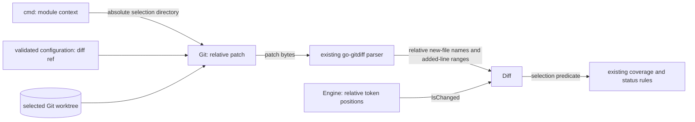

# Nested-module diff selection — issue #217

`unleash --diff` must select changed mutants in a Go module below the Git repository root.
Changes outside that module must not select its mutants.
The fix also needs a tagged release through the existing release procedure.
This note defines design guardrails, not implementation steps. Existing ADRs cover the change; no new ADR is needed.

## Decision and path identity

The path base is the directory that the engine analyzes: `filepath.Join(mod.Root, mod.CallingDir)`.
It can be the module root or a package directory below it.
The selected directory can also differ from the process working directory when `unleash [path]` supplies a target.

| Value | Canonical owner and meaning |
| --- | --- |
| Git repository root | Git discovers its worktree from the selected directory, including linked worktrees. |
| `GoModule.Root` | `internal/gomodule.Init` finds the nearest Go module root and validates its declared import path. |
| `GoModule.CallingDir` | A native filesystem path relative to that module root; it identifies the requested analysis subtree. |
| Engine filename | `fs.WalkDir` supplies a slash-separated path relative to the analysis subtree. The parser uses it in token positions. |
| Coverage filename | `coverage.removeModuleFromPath` already converts import-path names to that same engine path base. |
| Diff filename | `gitdiff.File.NewName`, relative to the analysis subtree, must match the engine filename exactly. |

`cmd` already has the module context and owns composition.
Pass the absolute selected directory into diff collection through one explicit parameter.
Keep `internal/diff.NewWithCmd` as the local command injection seam.
The [architecture model](../../.architecture/model.json) permits `diff` to import configuration and Logger, but not `gomodule` or `engine`.
A directory parameter avoids a model change and keeps module discovery with its existing owner.

Use Git's native `-C` and `diff --relative` behavior at collection time.
Git documents that `--relative` both excludes outside changes and makes paths relative to the selected directory.
Preserve the existing merge-base comparison against the working tree, including staged and unstaged tracked changes.
Do not replace it with an index-only comparison or a comparison between commit tips.

This conversion belongs at the Git boundary. Keep engine token positions, report filenames, and coverage identities unchanged.
Git patch paths and `fs.FS` paths use slashes, including on Windows.
Use native `filepath` operations only to compose the host directory passed to Git.
Do not use suffix matching, basename matching, case folding, or raw prefix trimming to join different path bases.
Do not discover the repository by searching for a `.git` directory or walking parent directories in new Go code.

## Cross-cutting boundaries

| Layer | Required behavior and existing control |
| --- | --- |
| CLI, configuration, and environment | Keep `--diff`, `UnleashDiffRef`, shared flag binding, Viper precedence, and `GREMLINS_UNLEASH_DIFF`. `configuration.Validate` owns the effective value's type check. No new key, environment shape, or schema entry. |
| Reference semantics | Git validates branch, commit, and revision syntax. At the command boundary, keep an option-like reference from becoming an option. A trailing `--` separates paths but does not alone protect the earlier reference. Do not add a restrictive branch-name grammar that rejects valid revision expressions. |
| Process arguments | Use separate arguments through the existing command factory, with a fixed Git executable name. Use `-C` rather than process-wide `os.Chdir`. No shell, credentials in arguments, remote fetch, or automatic recovery from missing history. |
| Git output and execution | Request native patch output with explicit relative paths, no color, and predictable source/destination prefixes. Disable external diff and textconv helpers. Follow fixed-argument practices in `tools/architecture/git.go`; do not import that development command into runtime code. |
| Parser and range validation | Reuse `go-gitdiff/gitdiff.Parse`, `newChanges`, and `changesInFragment`. Preserve new-file line coordinates and separated addition ranges. Do not parse patch headers or quoted filenames with another parser. |
| Filesystem scope | Let Git exclude paths outside the selection directory. Preserve the engine's exclusions for nested modules, vendor, testdata, ignored names, and excluded files. Diff selection does not redefine which files belong to the module. |
| Errors and diagnostics | Return command, directory-resolution, and parser failures with ordinary `%w` wrapping. Keep errors inspectable with `errors.Is` or `errors.As`. Use Logger, quote new input-derived diagnostics, and add no source, environment, or configuration dumps. |
| Results and exits | Preserve `Diff.IsChanged` and `engine.mutationStatus`. Ordinary failures reach `main` as exit 1. `internal/execution.ExitError` continues to own threshold exits 10 and 11. No new error hierarchy or HTTP envelope. |
| Persistence and isolation | Diff collection has no new store or output artifact. `internal/report` owns report serialization; `internal/engine/workdir` still copies the module root for execution. Do not copy the Git repository or rebase report paths. |
| Architecture and static checks | ADR 0004, the strict design decoder, and ARCH001–ARCH004 check ownership, imports, contracts, and trust declarations. `.golangci.yml` owns approved imports, error checks, and security lint. Add no dependency, policy exception, or baseline allowance. |
| Host and CI controls | Preserve `Makefile`, `scripts/lint.py`, `.pre-commit-config.yaml`, and the shared hook dispatcher. Existing CI owns platform tests, regression proof, mutation testing, vulnerability checks, and secret scans. |

The configuration JSON schema is editor guidance; it is not the runtime configuration validator.
No authorization controller, service, repository abstraction, DTO layer, database, or new validator is needed here.

The operator-selected repository and Git installation remain trusted inputs.
`-C` does not neutralize inherited `GIT_DIR` or `GIT_WORK_TREE`; tests must control those variables.
Disabling diff and textconv helpers does not create a sandbox for every Git filter or hook-related host setting.
Preserve the existing diff subprocess lifecycle; cancellation and general Git environment isolation are separate concerns.
The work-directory copy also does not sandbox the Go tests that the normal run executes.

## Behavioral invariants and evidence boundaries

- An empty diff reference returns `nil` without running Git, including outside a Git repository.
- An enabled diff with no selected additions returns a non-nil empty selection. It must not select all mutants.
- Missing Git, invalid references, missing merge bases, and malformed patches remain errors, not empty successful selections.
- Outside-only changes cannot select a module file with the same name or line number.
- Sibling paths such as `tools/verifier-extra` cannot match `tools/verifier`.
- Renames and copies use the new path. Deleted files contribute no added-line mutants.
- Existing behavior for binary patches and untracked files stays unchanged. This issue does not add untracked-file selection.
- A changed mutant still needs enabled mutation types and observable coverage to run. Equivalent annotations retain ADR 0008 precedence.
- A legitimate empty selection still bypasses threshold assessment. Do not change exit codes to hide the path defect.

Use named table-driven cases and the existing local doubles for command errors and argument checks.
Real temporary Git repositories must establish actual nested-module selection; canned patches alone cannot prove `--relative` behavior.
Relevant cases include repository-root modules, nested modules, package subdirectories, and explicit targets from another working directory.
Include outside-only changes, duplicate basenames, unchanged lines, spaces, quoted filenames, and new-path rename behavior.
Hosted Linux, macOS, and Windows tests must retain the same slash-separated matching contract.

At least one consumer-level regression must assert the changed mutant's filename, line, and runnable or executed status.
A successful command or a nonempty mutant list does not prove selection; every mutant could still be `SKIPPED`.
If using the reported `&&` example, explicitly enable its mutation type; it is disabled by default.
Reuse `cmd`'s temporary module patterns and `diff`'s configuration cleanup. Keep process-state tests serial and child environments controlled.

New `TestRegression...` leaves must independently fail an assertion on base production code and pass with the fix.
Keep regression calls compatible with base signatures; a new required constructor argument can otherwise defeat regression proof.
Stable `cmd.run` or `runUnleash` consumer entry points avoid a production compatibility shim solely for tests.
Use `TestFeature...` for additional guard cases that already pass on base.
Run targeted race tests locally. Existing hosted mutation testing and regression proof supply broader evidence; do not run full suites locally.

## Scope and release boundary

The intended production scope is `cmd` composition and `internal/diff` collection, with focused tests in those packages.
The explicit directory parameter is the extension seam for another analysis subtree without ambient directory changes.
No workspace-wide or multi-module coordinator, general path service, Git wrapper package, or new mutation type is needed.
Engine discovery, coverage, exclusions, equivalent directives, worker scheduling, and work-directory copying keep their existing responsibilities.

ADRs 0001, 0002, 0004, and the relevant status rules of ADR 0008 apply.
ADR 0003 applies only if implementation imports upstream commits.
Downstream CLI flags, configuration keys and schema, report fields and filenames, and exit codes remain compatible.
No downstream checkout, new service, manual changelog edit, workflow rewrite, or release publication belongs to this preflight.

Acceptance remains incomplete until a release tag contains the fix.
Use a `fix` Conventional Commit through the existing `dev` to `main`, release-please, GoReleaser, and back-merge procedure.
The user owns merges and release approval. A PR merged into `dev` alone does not satisfy the tagged-release criterion.

## Preflight evidence

Inspected checkout: `f5a9bff06ffc73fa0f156347112b49eec9578cc4`, before implementation.
The initial working tree was clean. This preflight changes only its design record and this note.
Concurrent runtime, test, and usage-page edits appeared during review; this preflight left them untouched and did not test them.

A temporary Git-only probe passed with Git 2.43.0 on Linux.
It verified root, nested-module, package-subdirectory, and outside-only selection.
Explicit relative, color, and source/destination prefix options overrode conflicting Git configuration.
This verifies Git behavior, not the unimplemented fix, parser integration, or other operating systems.

`make architecture-design` passed ARCH001–ARCH004 with mise-selected Go 1.26.11 and module downloads disabled.
Model SHA-256: `c28bab810f1497d79aea1fcac11781ad83abf8d2e7b36cb8c78a8e7225243f6b`.
The explicit-path documentation check passed with zero findings. No Go suite or mutation run was executed during preflight.

References: [Git diff options](https://git-scm.com/docs/git-diff) and [Git `-C`](https://git-scm.com/docs/git#Documentation/git.txt--Cltpathgt).
The existing [test standard](test-standard.md), [architecture check](architecture.md), and [release procedure](release.md) remain authoritative.
