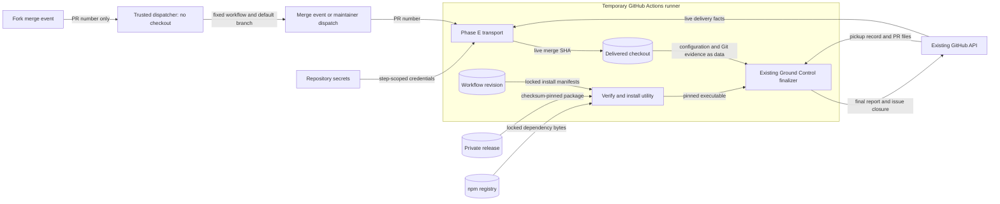

# Automatic delivery finalization design

Issue #97 adds a repository trigger for Ground Control's existing merged-PR finalizer.
Issue #182 upgrades the finalizer to Ground Control v1.12.0, because v1.9.0 could not find the delivered issue.
The user confirmed ownership of both repositories and directed this integration to proceed.
No additional activation flag or transfer-approval gate is required.

## Components and contracts

| Component | Responsibility |
| --- | --- |
| `.github/workflows/ground-control-phase-e.yml` | Receive a merged-PR event or repair dispatch, resolve the immutable delivery, install the pinned utility, and invoke its finalizer. |
| `.github/ground-control/package.json` and lockfile | Freeze the utility dependency graph and integrity values for `npm ci`. |
| `.github/workflows/ground-control-fork-finalization.yml` | Validate a merged fork PR without checking out source, then dispatch the fixed Phase E workflow on the default branch. |
| Existing Ground Control finalizer | Find the issue from the head branch and its trusted pickup record, verify the merge, post one final report, and close the delivered issue idempotently. |
| Existing GitHub API and repository secrets | Supply delivery facts, issue-write access, and separate read-only release access. |

The workflow adds no marker parser, completion schema, issue-discovery algorithm, or closure implementation.
Both delivery lanes and repair use the same finalizer.
The Go packages, CLI, Configuration keys/schema, JSON report, and Exit errors remain unchanged.
Existing Logger, Work directory copy, runtime diagrams, and ADRs 0001–0005 need no implementation changes.

ADR 0004 governs the model and design declarations.
The existing static development-check boundary stays unchanged; finalization has a separate network boundary.
No baseline allowance, new service, queue, storage, or hosting is added.

## Release and event choices

The release is Ground Control v1.12.0, asset `grndctl-1.12.0.tgz`.
Its SHA256 is `67ab2945bd35ef107b2d4c4cbd60d1f66307e57199615bfdabf7f5c6dcbb31e5`.
The release metadata and the downloaded bytes agree with that digest.
A temporary install with lifecycle scripts disabled reports CLI version 1.12.0.
The workflow commits the digest. It does not download a checksum as runtime authority.

Dependencies use a standard npm lockfile, not fresh floating resolution in each job.
The lockfile starts from the release's own lockfile, and the manifest copies the release's `overrides`.

The manifest pins `hono` 4.13.16 and `@hono/node-server` 2.1.6, which fix three moderate npm advisories in the release pins.
Ground Control `dev` uses the same two pins. `npm audit --omit=dev` reports no findings.
Node and external actions are pinned. Private packages are neither committed nor uploaded as artifacts.

Ground Control v1.9.0 found the issue from a delivery pointer comment that readiness wrote on the PR.
Ground Control v1.11.0 and later do not write that comment, so each v1.9.0 run ended with `delivery_pointer_missing`.
Ground Control v1.12.0 finds the issue from the `<issue>-<slug>` head branch and a pickup record from a repository writer.

Use `pull_request: closed`, filtered to `dev` and `main`, with a merged-state guard.
Use `workflow_dispatch` with one positive decimal PR number for repair.
The release's workflow inspector requires the ordinary PR event.
Its provenance helper accepts `pull_request` and `workflow_dispatch` run-name binding.

The preflight suggestion for `pull_request_target` conflicts with those incumbents and is not used.
The workflow name includes the PR number on both paths, as the provenance helper requires.
Before invoking the CLI, the transport uses the same release's provenance verifier to validate its own Actions run.
A mismatched run is refused before any report or closure.

Both paths read live merge metadata from the current repository and reject unmerged or wrong-base PRs.
The workflow does not read the required checks of the PR. The `dev` merge queue and the branch rules merge nothing whose required checks failed.
`main` has no required checks, so a check gate in the workflow failed each `dev` to `main` promotion.

Checkout uses the API's immutable merge SHA; dispatch's `GITHUB_SHA` is not delivery evidence.
A separate transport checkout uses the exact workflow revision for installation data.
Repair dispatches must use the default branch.
This separation lets current transport manifests repair an older delivery without executing its files.

Ordinary fork PR events lack the secrets and write token needed by the finalizer.
A separate trusted, merge-only dispatcher invokes the fixed finalization workflow on the default branch for fork deliveries.
It has only PR-read and Actions-write access, checks out no source, reads no private secret, and posts no issue report.
The finalizer therefore still runs through the supported `workflow_dispatch` event with its original permissions.

No Ground Control source, release, or event-trust change is required.
Manual and automatic dispatch require the finalization workflow on the default branch.
The installation PR can still require local reentry because its readiness used the earlier base.

## Data flow

## Security and failure boundaries

| Boundary or threat | Control | Verification |
| --- | --- | --- |
| Untrusted PR input | Validate positive decimal input; pass arguments through quoted variables. Resolve live merged state and permitted base in the current repository. | Execute transport scripts with synthetic invalid, unmerged, and wrong-base cases. |
| Untrusted delivery code | Install outside the checkout. Read manifests from the workflow revision. Execute no delivered action, Go file, hook, generator, or configured command. Keep checkout credentials disabled. | Actionlint and review of executable steps and checkout refs. |
| Release or dependency replacement | Verify committed SHA256 before installation; use `npm ci` with locked integrity values and disabled lifecycle scripts. | Tampered-download rejection and clean locked installation. |
| Credential overreach | Restrict release token to reading Ground Control. Scope it to download only. The finalizer token has evidence reads and `issues: write`, with no content/PR write or merge grant. A separate dispatcher token has only PR-read and Actions-write access. | Permission and step-environment review; actual API access remains a hosted integration check. |
| Credential disclosure | No tokens in argv, URLs, tracing, outputs, Git config, caches, or artifacts. Disable audit submission. Isolate npm configuration/cache from delivery data. | Script review and synthetic credential/setup checks. |
| False or duplicate closure | Reuse the finalizer's branch, trusted pickup author, merged-state, and provenance checks. Serialize per PR without cancellation. | Skip cases for a missing, wrong-branch, and untrusted pickup record. The finalizer owns durable idempotency. |
| Partial failure | Preserve nonzero exit status and existing bounded failure records. Never close from a cleanup step. | Failed-finalizer transport check and documented rerun paths. |

The job has a finite timeout. It waits for no unrelated post-merge build, test, release, or scan job.
A PR without a delivery branch and a trusted pickup record is the finalizer's successful no-op.
Concurrency limits overlapping runs; it is not a substitute for durable idempotency.

The finalizer reads `.ground-control.yaml` through its own loader and executes none of its workflow commands.
The finalizer reads no Sonar settings, so the job writes no settings file and reads no Sonar secret.
No new HTTP controller, application auth layer, error hierarchy, or persistent state is introduced.
The workflow uses no self-hosted runner.

## Verification and maintenance

The design input declares the affected model, contributor guide, workflow, manifest, and lockfile policies.
`make architecture-design` passed before implementation with ARCH001–ARCH004 and model SHA256
`f50ccf387b1870da4a12fa781ffc2ba38db3dad4ed6d0ced9b70e19f3e1c41f0`.
The completed architecture scan also passes with no baseline findings.
A native release workflow-recognition assertion failed before the workflow existed, then passed for both bases.
Native provenance checks accept both supported events and reject a different PR number.

Use actionlint, targeted transport checks, and a clean locked install for this integration.
CI owns full Go, policy, and mutation runs; Phase E itself runs none of them.
Do not duplicate the external finalizer's behavior or mutation suite here.

The local integration test executes the actual workflow shell steps and installed CLI with a stateful GitHub stand-in.
It substitutes no native finalizer, repository authorization, evidence-discovery, or provenance function.

For issue #182, `make architecture-design` passed with ARCH001–ARCH004 and model SHA256
`22337dd5b0fb2bc612c0db132f9807dbbd53055daec6c7ee5ddfd2c60ccf31f1`.
For issue #182, 16 cases passed against v1.12.0. [Setup and recovery](phase-e.md#verify-an-upgrade-locally) lists them.
Finalization runs against a fresh checksum-verified locked installation, not the separately supplied reference executable.
The fixture enforces the workflow permission map and returns installation-token denial for user-identity access.
Actual Actions credential access, API permissions, and report/close behavior need the first configured post-merge run.

The reviewed release/version/asset/digest tuple, manifest, and lockfile form the upgrade seam.
The validated PR number is the repair seam; dispatch cannot select arbitrary code, repository, or completion evidence.
The contributor guide and process-review record link to [setup and recovery](phase-e.md).
Keep those documents and model declarations current when changing the transport or release.

## References

- Ground Control v1.12.0: packaged CLI, Phase E automation, pickup-record reader, and automation-provenance helper inspected locally.
- Ground Control ADR-102/#1804: consumer workflows are no longer installed by default; this repository adds its own integration.
- [GitHub workflow events](https://docs.github.com/en/actions/reference/workflows-and-actions/events-that-trigger-workflows): PR events, fork restrictions, and dispatch availability.
- [GitHub workflow syntax](https://docs.github.com/en/actions/reference/workflows-and-actions/workflow-syntax): permissions, concurrency, conditions, run names, and inputs.
- [GitHub script injection guidance](https://docs.github.com/en/actions/concepts/security/script-injections): pass data through environment variables.
- [Workflow triggering](https://docs.github.com/en/actions/how-tos/write-workflows/choose-when-workflows-run/trigger-a-workflow): `workflow_dispatch` can be triggered by `GITHUB_TOKEN`.
- [npm clean installation](https://docs.npmjs.com/cli/v11/commands/npm-ci/) and [lockfile integrity](https://docs.npmjs.com/cli/v11/configuring-npm/package-lock-json/): fixed dependency graph with integrity verification.

Verification evidence: [TAP results](evidence/phase-e-v1.12.0.tap) and [release and file hashes](evidence/phase-e-v1.12.0.json).
