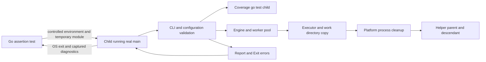
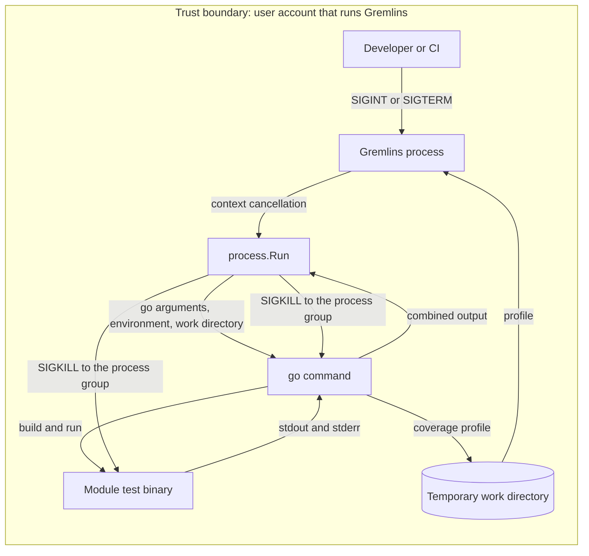

# Process test boundaries for issue #116

This note defines guardrails for [#116](https://github.com/OpenRAE/go-rae-gremlins/issues/116), including test-assessment gaps G07 and G11.
It specifies test boundaries and evidence, not implementation steps.
Source review used revision `23274c65f7c175e55c76d0ff8732c29463ef5dce` and the existing local process-test edits.
Those edits are inputs to this review, not verified results.

## Decision and existing owners

Use controlled Go helper children and small local modules within the existing Go tests.
Reuse fixtures from the related process and shutdown repairs (#59, #109, and #128).
No new test framework, dependency, or ADR is needed.

Reuse the engine's existing runner rather than create a second process supervisor for coverage.
This change moves that runner into `internal/process` for both callers.
The move keeps the existing lifecycle and platform semantics, with one shared owner.
Test controls belong in tests, not new production options or a generalized process framework.
The [Go test standard](test-standard.md), particularly T05–T10, already establishes the required behavior.

| Boundary | Canonical owner and reuse |
| --- | --- |
| Binary exit and signals | `cmd/gremlins/main.go`: call the real entry point in an isolated child, so `os.Exit` cannot terminate the test runner. |
| CLI composition | `cmd/gremlins.go` and `cmd/unleash.go`: use real configuration, coverage, mutation, reporting, and error propagation for CLI cases. |
| Mutant execution | `internal/engine/executor.go`: use `WithExecContext` to supply a controlled child through the real executor lifecycle. Reuse `getCmd`, `mutantStub`, and `newWdDealerStub` where suitable. |
| Process cleanup | `internal/process` owns `Run` and the platform files `process_unix.go` and `process_windows.go`. Its tests stay with the package. |
| Coverage subprocesses | `internal/coverage/coverage.go`: `NewWithCmd` is its existing injection seam. It runs each command through `process.Run`. |
| Source restoration and isolation | `internal/engine/workdir/workdir.go` owns module copies and discard. `executor.execute` owns apply, rollback, and status changes; `workerpool` owns worker shutdown. |
| Errors and diagnostics | `internal/execution/execution.go` owns threshold Exit errors. Reuse `%w`, `errors.Join`, `errors.Is`/`As`, and the Logger in `internal/log/log.go`. |

Helper control messages, coverage profiles, copied source, and optional reports remain in temporary directories or local pipes.
There is no database or new persistent report format.

## Observable contracts

| Case | Required observation |
| --- | --- |
| Normal run | Real entry point exits 0 after processing a local module. A version case alone does not exercise run completion. |
| Ordinary error | Real entry point exits 1 and emits the relevant diagnostic. Do not accept any nonzero exit as sufficient. |
| Threshold errors | Exercise efficacy and mutant coverage independently: exit 10 and exit 11 respectively. Fixtures must contain the relevant surviving or uncovered mutants; empty selections bypass thresholds. |
| Mutant deadline | The child and any asserted descendant have started before expiry. The executor reports exactly one `TimedOut` result, restores the mutation, and finishes within the test bound. |
| In-flight cancellation | Cancel after readiness. The executor restores the mutation, leaves its status unchanged, emits no mutant result, and completes its wait-group obligation. |
| CLI signal | Deliver SIGINT or SIGTERM to the isolated CLI after work starts. Assert exit 1 and cancellation diagnostics, rather than OS termination by the signal. |
| Child cleanup | Observe termination of each promised process, including descendants in Unix process-group cases. Cover cleanup on ordinary parent completion where a descendant remains. |

An executor test and a CLI signal test establish different contracts.
A CLI signal during coverage does not prove shutdown during mutant execution, or conversely.
Name the exercised phase explicitly and establish readiness in that phase.
Before #116, coverage did not use the process-group runner. Its interrupt test proves the cleanup for the coverage phase.
A failure here can expose a related repair, but does not authorize a process subsystem rewrite under this test issue.

## Security and validation boundaries

| Layer | Required control |
| --- | --- |
| CLI parsing and configuration shapes | Retain Cobra parsing, `cmd/internal/flags`, Viper bindings, and `configuration.Validate`. Use existing keys with valid typed fixture values. `docs/docs/schema/configuration.json` remains editor guidance, not a runtime validator. |
| Configuration discovery and environment | Pass an explicit temporary config file through `--config`; clearing HOME alone cannot exclude `/etc/gremlins`. Exclude inherited `GREMLINS_*` overrides and use distinct helper controls. Restore global configuration and Logger state before failure can escape. |
| Module parsing and Go execution | Let `gomodule.Init` validate a real temporary `go.mod`. Use standard-library-only fixtures and the repository Go toolchain. Control `GOENV`, `GOFLAGS`, `GOWORK`, toolchain switching, proxy access, and cache/temp paths so fixtures cannot use host workspace or network settings. |
| OS invocation and secrets | Use explicit argument slices and a known executable, without shell evaluation or credentials in arguments. Give children a controlled environment, retaining required platform values such as Windows `SystemRoot` and the selected Go executable path. Never inspect credential files or dump the host environment. |
| Filesystem and helper inputs | Use `t.TempDir`, private writable files, and fixed local paths. Validate helper roles and positive PID data before using them. Publish readiness records completely; reject malformed data and unexpected filesystem errors. Do not signal arbitrary parsed PIDs or a shared process group. |
| Errors and output | Preserve ordinary errors versus `execution.ExitError`; do not duplicate their mapping in production. Check OS status and relevant diagnostics without freezing complete colored output. Bound captured output and read buffers only after their writer goroutines finish. |
| Authorization and hosted execution | There is no application auth layer, HTTP error envelope, or service credential requirement. Execute synthetic source only locally or in existing secret-free test jobs. Keep read-only CI permissions, unpersisted checkout credentials, secret scanning, and the separate Sonar credential boundary. |
| Architecture and policy inputs | ADR 0004 requires `.architecture/designs/116.json` through the existing strict decoder and ARCH001–ARCH004 checks. Do not add a second schema, relax imports, or enlarge architecture/lint baselines. |

The architecture model's `development_checks` boundary describes the static checker, which must not execute scanned source.
Normal Go tests already execute source in their separate test jobs; this design does not broaden the checker boundary.
Temporary module copies protect source files, but do not sandbox subprocess permissions, inherited secrets, or network access.

## Lifetime and platform guardrails

Use readiness and completion channels, pipes, or bounded file polling; never use a sleep as evidence that work started.
Keep startup allowance separate from the expected shutdown bound, with enough allowance for race instrumentation and loaded runners.
The executor applies a one-second minimum baseline and a timeout coefficient; do not assume millisecond deadlines through its public constructor.

Each helper needs a finite self-expiry and cleanup registered immediately after creation.
The assertion bound must expire before helper self-expiry; natural expiry cannot prove production cleanup.
The outer watchdog must report a test failure, not an expected exit or mutant timeout.
Cleanup must independently terminate remaining owned children, close descriptors, cancel contexts, and join goroutines on assertion failures too.
Give every started direct child exactly one `Wait` owner, including asynchronous setup failures.
Cancel alone does not prove cleanup; avoid relying exclusively on the production function whose failure the test must detect.

`CommandContext` kills its direct process by default; `WaitDelay` can bound inherited output-pipe waits but cannot prove descendant termination.
See the [Go exec contract](https://pkg.go.dev/os/exec#Cmd).

Any shared runner must preserve context-aware launch, exactly one wait owner, and group cleanup before waiting for descendant-held pipes.
Test cancellation racing with parent exit and cleanup after normal completion; an added `WaitDelay` must not hide surviving descendants.
Descendants retaining stdout, stderr, or readiness descriptors can keep waits blocked after their parent exits.
Pipe EOF proves termination only when the controlled helper retains the descriptor throughout its lifetime.
PID probes must distinguish permission errors, PID reuse, and zombie state; process existence alone does not establish live work or successful reaping.

Unix tests may assert process-group cleanup for descendants that remain in the owned group.
They must not claim cleanup of detached sessions or groups.
Windows currently requests a new process group but kills only the direct process.
Do not assert Unix descendant guarantees on Windows or add job objects as incidental test infrastructure.

Use portable cases on every existing CI platform and build-tagged cleanup/signal cases on the platform they describe.
Unsupported signal delivery needs a specific skip reason; a skip or successful cross-compilation supplies no runtime evidence.
Keep signal tests isolated from the main test runner and release signal registrations after shutdown.
The [Go signal contract](https://pkg.go.dev/os/signal#NotifyContext) keeps default interrupt behavior diverted until registration stops.

## Extension seam and verification boundaries

Keep helper role, child lifetime, readiness endpoint, selected phase, and expected outcome as explicit test parameters.
Use named table rows where setup is shared, with platform-specific operations in build-tagged test files.
This permits another signal or exit case without a production option, public API, or general process framework.
Share fixtures within their owning package; minor duplication is preferable to a new cross-package harness with broader dependencies.

New assertion tests and helper test entry points must satisfy `.github/scripts/regression_proof.py` classification.
Use `TestFeature...` for added coverage of existing behavior, and `TestRegression...` for a repaired defect with genuine base-failing assertions.
A timeout, compile failure, or helper-only exit is not regression proof.
Use exact helper selection and an explicit child marker; ordinary discovery must not start a blocking helper or recursively run assertions.

Reuse `.github/workflows/ci.yml` for Linux, macOS, and Windows race execution.
Use targeted local race checks; CI owns full suites, coverage, and mutation runs.
The outer race detector does not automatically instrument separately built fixtures or nested `go test` commands.
`.github/workflows/gremlins.yml`, `.gremlins.yaml`, and `scripts/run-bounded.sh` retain mutation execution and resource-budget ownership.

A test-only diff may have no mutation candidates; inspect relevant production mutants where practical rather than claim that the changed-line gate proves assertion strength.
Keep `Makefile`, `.pre-commit-config.yaml`, `.golangci.yml`, `scripts/lint.py`, and the shared hook dispatcher as the existing verification paths.
Use the pinned tools in `mise.toml`; the ambient Go version can differ.

## Non-goals and compatibility

No mutation type, configuration key, CLI flag, JSON report field, or exit code change is proposed.
The only potential runtime boundary change is extraction of the existing process runner for the related coverage/shutdown repair.
No second configuration validator, exception hierarchy, process supervisor, workflow, service, upload destination, or new dependency is needed.
Preserve fixture bytes and existing local work; do not reformat unrelated `testdata` files.
Do not refactor configuration discovery, Logger, worker scheduling, or Windows cleanup to make tests convenient.
Record any observed production defect against its actual owning boundary and related issue before expanding this test-only scope.

The supplied repository guidance and current tracked files disagree on module identity and integration branch.
Current `go.mod` and imports use the fork path; ADR 0001 records that path.
This issue requires no identity, branch-policy, release, or upstream-import change; preserve those files and follow the user's explicit delivery instructions.
ADR 0002 preserves the `gremlins` binary contract; ADR 0004 governs the design check.

## Process runner design

`internal/process` owns one function, `Run`. The engine executor and the coverage runner call it for each `go` command.
`Run` keeps the existing engine lifecycle. It does not add a process supervisor, a configuration key, or a test switch.

| Step | Unix | Windows |
| --- | --- | --- |
| Start | Start the command in a new process group (`Setpgid`). | Start the command in a new process group (`CREATE_NEW_PROCESS_GROUP`). |
| Context done | `Cmd.Cancel` sends `SIGKILL` to the complete group. | `Cmd.Cancel` kills the direct process only (#128). |
| Open output pipes | `Cmd.WaitDelay` bounds the wait for pipes that a descendant holds. | Same. |
| After exit | Send `SIGKILL` to the group to stop remaining descendants. | No action. Windows cannot address the descendants (#128). |

A group kill that finds no process returns `os.ErrProcessDone`, so `Wait` does not report a false error.
The coverage runner previously killed only the `go` process. Its test binary then continued after a cancelled run.

| Asset and threat | Control | Verification |
| --- | --- | --- |
| Host CPU and memory: an orphaned test binary continues after a cancelled run. | Group kill on cancellation and after exit. | `TestRegressionMainInterruptDuringCoverage`, `TestFeatureExecutorStopsProcessTree`, and the `internal/process` tests. |
| Gremlins progress: a descendant holds an output pipe, and `Wait` blocks. | `Cmd.WaitDelay` and the group kill. | `internal/process` tests with a descendant that holds the output pipe. |
| Unrelated processes: a kill reaches a process that Gremlins does not own. | Kill only the group that `Run` created, with the process ID of its leader. | Code review. The group ID stays reserved while a group member lives. |

Residual risks:

- On Windows, descendants of a cancelled command can continue. Issue #128 owns that repair.
- When no group member remains, the operating system can reuse the group ID before the kill after exit.
  The existing engine runner has the same exposure.

## Preflight verification

`GOCACHE=/tmp/gremlins-116-go-cache mise exec -- make architecture-design` passed ARCH001–ARCH004 on the concurrently updated design and model.
The checker reported model digest `22337dd5b0fb2bc612c0db132f9807dbbd53055daec6c7ee5ddfd2c60ccf31f1`.
That check validates declarations, not the future shared runner implementation or its runtime guarantees.
The configured Markdown check could not download doc-tools because `github.com` did not resolve.
Prose, source references, and the diff received manual review; automated writing validation remains incomplete.
No process tests, full suites, or mutation runs were executed during this preflight.
