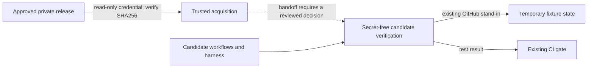

# Transport regression boundaries for issue #124

> Current context (2026-11-24): This is a historical record of issue #124 at its reviewed revision.
> Current design: [pre-merge transport verification](phase-e-design.md#pre-merge-transport-verification).
> The model now lets the `transport_verification` boundary execute source.

This is architecture guidance, not implementation or evidence that the check runs.
The review used revision `bd52c783d808ac70a250016c25b68f783b42b31b`.
Issue #124 requires affected transport and utility changes to run the existing harness, with visible results and failure propagation.
Its acceptance criteria are proportionate. A manual Make target alone does not establish automatic execution for affected changes.

## Resolution

The maintainer kept the ADR 0004 rule: candidate code runs only in jobs without secrets.
An Actions cache entry with a PR or merge group scope moves the tarball between jobs.
Fork and Dependabot PRs skip the check at PR time, and the merge queue runs it.
The model adds a separate `transport_verification` boundary.
[Pre-merge transport verification](phase-e-design.md#pre-merge-transport-verification) records the design.

## Decision and existing owners

Keep one verification entry point for local and hosted use, called through the Makefile.
Reuse the existing harness and installation contract. Do not introduce a second harness, package manifest, release tuple, or finalizer.
The check tests candidate transport files. Testing only default-branch files cannot verify a proposed change.

| Concern | Canonical owner and boundary |
| --- | --- |
| Transport behavior | `.github/workflows/ground-control-phase-e.yml` and `.github/workflows/ground-control-fork-finalization.yml`. Preserve their event, permission, checkout, provenance, and finalization contracts. |
| Integration assertions | `.github/ground-control/phase-e.integration.test.mjs`, using Node's existing `node:test` runner. It executes workflow shell steps and the installed CLI. |
| GitHub substitute | `.github/ground-control/fixtures/github.cjs`. Reuse its state, permission checks, and unexpected-endpoint failure. No live issue writes belong in regression verification. |
| Release installation | The Phase E workflow's `GC_RELEASE`, `GC_ASSET`, and `GC_SHA256`; `.github/ground-control/package.json` and `package-lock.json`. The reviewed tuple and dependency graph stay together. |
| Check orchestration | `Makefile` and `.github/workflows/ci.yml`, including its always-running `PR Gate`, event comparison inputs, and disabled checkout credentials. |
| Queue compatibility | ADR 0007 and `.github/scripts/merge_queue_policy.py`. Any required producer must cover `merge_group`, including the actual merge-group candidate. |
| Architecture approval | ADR 0004, `.architecture/model.json`, `tools/architecture`, and `scripts/check-design.sh`. Syntax checks do not establish trust-boundary approval. |
| Operator guidance | [Phase E setup](phase-e.md) and [the existing finalization design](phase-e-design.md). Preserve their private-package and credential restrictions. |

The Go Logger, Exit errors, Configuration keys, and Work directory copy do not own this Node/shell check.
Use Node test diagnostics and ordinary shell success/failure. Do not add Go runtime dependencies to report CI failures.
Ground Control remains optional for ordinary Go contributors.

## Security decisions required before implementation

The repository has a private post-merge downloader and a documented local verification command.
Inspection found no existing credential-isolated pre-merge acquisition and execution path.
The post-merge job's step-scoped release token is not approval to execute candidate tests in that credential-bearing job.
ADR 0004 requires candidate tooling to run in a secret-free job.

The harness inherits `process.env`, loads the reference package's YAML parser, executes candidate shell, and invokes npm and the CLI.
Removing `GH_TOKEN` from one command does not establish runner isolation or remove other inherited credentials.
A separate required maintainer check does not serialize other jobs or authorize their secret use.
Keep acquisition trusted and candidate execution secret-free. Document the exact artifact handoff and trust decision before coding.

Private tarballs and installed dependencies must not enter Actions artifacts, commits, public logs, or cache entries that fork PRs can restore.
The existing finalization design explicitly excludes private package uploads. A split-job design cannot silently use artifacts to bridge that restriction.
No new hosting, service, runner infrastructure, package redistribution, or credential grant is authorized by this note.
An alternative that changes these boundaries needs an explicit reviewed decision; it must not masquerade as ordinary test wiring.

Affected foreign PRs and Dependabot PRs also need an explicit acquisition policy because ordinary PR runs lack the release secret.
Preserve that restriction. Do not report unavailable verification as success.
Do not use `pull_request_target` or `workflow_run` to execute candidate files with credentials.
The existing fork dispatcher handles merged deliveries only; it is not a pre-merge test runner.
These constraints follow [GitHub's security guidance](https://docs.github.com/en/actions/reference/security/secure-use).

The model currently declares `execute_source: false` for every trust boundary.
Executing candidate workflow shell as the test subject cannot truthfully reuse the static-check declaration unchanged.
ADR 0004 requires an explicit, narrowly scoped model decision for regression execution, separate from static checks and live finalization.
Do not broaden `development_checks` or `delivery_finalization` to hide the new execution boundary.
The implementation design must name affected policies and pass `make architecture-design` after that decision.

The decoder and design checks reject unknown fields, duplicate keys, unknown policies, missing boundary declarations, and unresolved conflicts.
Each changed design must declare every modeled boundary; a new boundary can affect other designs in the same diff.
Model approval does not enforce runtime isolation.
No passing design record is claimed or added by this preflight while these decisions remain unresolved.

## Cross-cutting controls

| Layer | Required behavior |
| --- | --- |
| Authorization | Acquisition reads only the fixed, approved private release repository. Candidate verification gets no release, issue-write, Actions-write, Sonar, or publishing credential. Retain pinned actions and `persist-credentials: false`. |
| Input and configuration shape | Reuse workflow YAML, npm's manifest/lockfile validation, and the architecture decoder. Validate required job/step/env fields before use. Treat release identifiers and the asset as bounded values, not shell code, globs, or arbitrary paths. Match version, asset, digest, manifest, and lockfile. No new generic schema or Viper binding is needed. |
| Installation | Verify the committed SHA256 before loading private package code. Preserve `npm ci --ignore-scripts --omit=dev --no-audit --no-fund`, isolated npm config/cache, and disabled automatic package-manager caching. Lockfile URLs must use approved destinations; the local utility dependency must identify the expected archive. Integrity alone does not approve a new download destination. Do not run candidate manifest scripts during acquisition. |
| Environment and OS | Use temporary installation and fixture directories with cleanup and finite timeouts. Exclude real credentials and ambient Node, npm, Git, and shell startup settings from test children. Pass arguments separately or through quoted variables. No token belongs in argv, URLs, tracing, Git config, or output files. |
| Network and persistence | Acquisition and locked dependency installation use existing GitHub/npm destinations. Fixture state and any tarball cache entry are temporary. The GitHub stand-in is not an OS or network sandbox; do not claim offline or hermetic execution. No private archive, dependency tree, host configuration, or secret enters retained output. |
| Errors and observability | Preserve Node's nonzero result through shell, Make, and CI. Keep test names and counts visible. Setup, checksum, install, parser, signal, and timeout failures must fail the check. Avoid `continue-on-error`, `|| true`, and pipelines that discard test status. Do not dump environments or package contents. |
| Public contracts | CI status is not a Gremlins exit-code category or mutation report. Preserve CLI flags, configuration keys/schema, JSON reports, and runtime exit codes. Add no HTTP error envelope, exception hierarchy, application service, or durable store. |

## Selection, gating, and extension seams

The affected-path set must cover both transport workflows, all of `.github/ground-control/`, and the verification wiring itself.
The latter includes the CI workflow, Make target, and any shared verification helper that implementation introduces.
Changes to the harness, fixture, manifest, lockfile, release tuple, Node pin, or installation steps must therefore trigger verification.
Keep selection in one place; local invocation and hosted execution must not acquire separate release or installation implementations.

Reuse CI's pinned PR base, merge-group base, and preceding-push comparison conventions.
Test the same immutable candidate revision whose check result is reported. Manual execution must have defined selection behavior.
Handle deletions, renames, shallow or unavailable history, and an all-zero initial-push base explicitly.
Use repository-scoped, fixed-argument Git reads and NUL-delimited paths, as existing tooling does.
A failed comparison must never become an empty successful change set.

Keep the required CI workflow running for unrelated changes; perform targeted selection inside it.
Workflow-level path filters can leave required checks pending, as [GitHub documents](https://docs.github.com/en/actions/how-tos/manage-workflow-runs/skip-workflow-runs).
The existing `PR Gate` must distinguish a successful explicit no-change decision from an affected check that skipped, failed, or was cancelled.
A missing credential or missing utility is not an unaffected result.
Preserve PR, push, manual, and merge-group coverage without changing branch rules or post-merge finalizer permissions.

Use the existing path parameters: `GROUND_CONTROL_TEST_ROOT` identifies the installed `node_modules/grndctl` package directory.
`GROUND_CONTROL_RELEASE_ASSET` identifies the verified tarball. Without it, the harness infers the archive two directories above the package.

The reference package supplies `js-yaml`; the harness creates a fresh locked installation before finalizer assertions.
Use the approved reference package, not an arbitrary global CLI installation or another checkout.
Reuse the transport's Node pin. Linux execution also needs Bash, Git, npm, jq, and SHA256 tooling.

The harness selects `jobs.finalize`, `jobs.dispatch.steps[0]`, named shell steps, and the release env fields.
Renaming or extracting those steps requires a corresponding harness adjustment; do not copy their shell into a second test implementation.
The release tuple and manifest/lockfile remain the upgrade seam. The affected-path set and two existing path parameters are the verification seams.
A later utility version must not require hard-coded version changes in CI, Make, and a new installer independently.

## Evidence boundaries and non-goals

The [existing evidence](evidence/phase-e-v1.12.0.json) records 16 passing cases against v1.12.0 for issue #182.
It is historical evidence, not a run of the proposed check or proof of this issue's scheduling and failure propagation.

Verification must show affected-path selection, an explicit unrelated-change result, and a harness failure that fails the required check.
Include missing-prerequisite and restricted-event behavior. A live release credential is unnecessary for synthetic fixture assertions.
Use targeted checks and actionlint for changed workflows. Keep full Go tests and mutation runs in existing CI.
The existing tampered-download and refusal cases provide fault evidence; a new JavaScript mutation framework is outside this issue.

This work does not upgrade the utility, change finalizer behavior, execute live closure tests, or modify Ground Control source.
It does not change Go packages, module identity, runtime contracts, branch administration, or the shared hook dispatcher.
Do not add this private integration to ordinary `make test`, fast commit hooks, or every platform's Go test matrix.
Do not change byte-exact fixtures, weaken existing gates, or treat maintainer approval as proof that a test ran.
