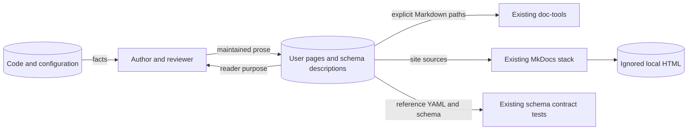

# User documentation boundaries for issue #222

This explanation reviews source revision `59baad1c460ac0170a11270faa68e232b230067e` against the supplied issue #222 contract.
It adds guardrails to the [Diataxis adoption design](diataxis-adoption.md), not an implementation plan or a documentation rewrite.
The existing documentation design suffices. No documentation tool is needed.

## Maintainer scope change

After this preflight, the maintainer added runtime repairs to #222. The issue comment of 2026-11-24 records them.
They supersede the runtime-repair non-goals of this note:

- Configuration discovery uses the documented paths and order.
- Integration mode halves a test CPU value greater than 1.
- Specs select only operators whose mutants can build, and no two types make the same edit.

[ADR 0011](../adr/0011-mutant-eligibility-type-information.md) records the mutant decision.
The [mutation registry](mutation-registry.md#eligibility) describes the design.
`.architecture/designs/222.json` declares the new `internal/typeinfo` package and the compatible contract changes.
These repairs need regression tests, because they change executable behavior.

## Reader purpose and scope

Keep `docs/docs/quick-start.md`, `docs/docs/install.md`, and every current page under `docs/docs/usage/` in scope.
Include schema descriptions, related CLI help, and maintained examples in the accuracy review.
An accuracy review does not require changes to every source it inspects.

| Surface | Reader purpose and boundary |
| --- | --- |
| Quick start | Tutorial: a small, controlled Go exercise with prerequisites, baseline tests, a mutation run, and observable results. |
| Installation and CI pages | How-to guides: complete an installation or integration task with explicit conditions. |
| Commands, configuration, mutation definitions, statuses, and directive syntax | Reference: exact facts, defaults, accepted values, errors, and conditions. |
| Worker tuning and directive application | Task sections can link to canonical reference. Separate only material that serves a different reader need. |
| Mutation concepts and reasons for coverage limits | Explanation where necessary. Keep exact coverage selection and status rules in reference. Preserve qualifications when moving them. |

Use the [Diataxis compass](https://diataxis.fr/compass/) to distinguish learning, operating, lookup, and understanding.
The extension seam is a page's reader purpose, canonical location, and ordinary links in existing MkDocs navigation.
Add a page only when that seam needs another reader purpose.
Do not introduce four mandatory directory trees, a classification schema, generated inventories, or copied procedures.
Issue #224 owns the final entry-point and navigation reconciliation; #222 must still preserve its affected links.

The tutorial must use harmless, self-contained example code and a small test set. Prefer standard-library-only dependencies.
State its working directory, required Go and Gremlins versions, installation prerequisite, and configuration assumptions.
Do not use this repository's full mutation run as the learning exercise.

Choose stable observations, such as a changed test outcome or a mutant status.
Do not promise exact timings, ordering, machine-specific paths, or unexplained mutant counts.
Keep exhaustive facts in reference and link to them from the exercise.

## Canonical sources and accuracy risks

| Concern | Canonical incumbent and guardrail |
| --- | --- |
| CLI and help | `cmd/gremlins.go`, `cmd/unleash.go`, and `cmd/internal/flags/flags.go` own registration, aliases, usage, normalization, and binding. Review help alongside prose. Prefer canonical hyphenated flags; underscore and dot normalization does not create YAML aliases. |
| Configuration keys and shapes | `internal/configuration/configuration.go` owns `Init`, `Get`, `Validate`, `ParseSize`, and key constants. `mutantenabled.go` owns mutation defaults. Flags override environment values, which override file values and bound defaults. |
| Configuration schema | `docs/docs/schema/configuration.json` is the single editor schema. Preserve Draft-07, `$id`, keys, types, defaults, patterns, bounds, optional settings, and unknown-property behavior. Description corrections must preserve those contracts. |
| Execution defaults | `internal/engine/workerpool/workerpool.go`, `executor.go`, `timeout.go`, and `memory.go` own effective worker, CPU, timeout, and memory behavior. Configured zero or empty values are sentinels, not always the effective values. |
| Mutation definitions | `internal/mutator/mutator.go`, `internal/engine/specs.go`, `spec.go`, `spec_expression.go`, and `node.go` own names, replacements, eligibility, and status strings. The registry replaced older token-mutator organization; do not infer behavior from a stale example path. |
| Coverage and diff selection | `internal/coverage/`, `internal/engine/clausecoverage.go`, `engine.go`, and `internal/diff/` own coverage inference, host-build selection, and merge-base comparison. Preserve package-initializer, switch, select, build-tag, and scanned-directory qualifications. |
| Directives | `internal/engine/directive.go`, `equivalent.go`, and `ignore.go` own parsing and binding. Keep reviewed equivalence distinct from omission through ignore directives. |
| Results and errors | `internal/report/report.go`, `logger.go`, and `internal/structure.go` own counts, filters, JSON fields, and file writes. `internal/log/log.go`, `internal/execution/execution.go`, and `cmd/gremlins/main.go` own console streams and exit codes. |
| Installation and releases | `go.mod`, `Makefile`, `.goreleaser.yaml`, release configuration, and `.github/workflows/release-please.yml` own the toolchain, binary path, targets, tags, and release assets. |

The current code exposes these specific traps:

- Configuration discovery differs from the published location list.
  `defaultConfigPaths` registers global paths first, repeats `gremlins` in the XDG path, and treats `$HOME/.gremlins` as a directory.
  `TestConfigPaths` checks that registration list, not selection between competing files.
  Establish actual selection with isolated inputs before claiming a search order. The maintainer scope change repairs the order.
- The schema describes native file types. Viper also converts environment and scalar values.
  JSON Schema defaults do not populate runtime settings, and Gremlins does not load this schema at runtime.
  Do not add a runtime schema validator, coercion schema, or second settings registry.
  `--config` selects the source; it is not a bound configuration key or a schema property.
  `configuration.Init` treats an override with a filename extension as a file, and an extensionless override as a discovery directory.
- Integration mode halves a worker count greater than one, including an explicit count.
  The executor currently changes any nonzero test CPU value to one. It does not halve that value. The maintainer scope change repairs it.
  Go test `-cpu` is not an OS CPU quota. The proposed sum of workers and test CPU counts is not a resource guarantee.
- The fallback timeout uses coefficient 5 by default and a minimum base of one second.
  Adaptive timeouts use margin 2 by default, the longest passing package sample, and the fallback cap.
  Integration mode uses the fallback. Distinguish the two controls instead of copying tuning advice between them.
- `--memory-budget` admits mutant test runs and uses a process watchdog.
  It is distinct from the whole-invocation cgroup limit in ADR 0006 and does not bound the coverage step.
  The watchdog samples every 50 milliseconds and can overshoot. Do not describe it as a hard kernel memory cap.
  Verify platform claims against `internal/process/`; worker count alone does not determine test concurrency.
- Status filters affect console mutant lines and diffs, not execution, JSON contents, or aggregate metrics.
  Invalid filters currently warn and fall back. Type validation does not make them early fatal errors.
  Exclusions are Go regular expressions, not globs. Git references go through `internal/diff/parse.go`, not a shell command.
- `TIMED OUT` means that the execution exceeded its time limit; it does not prove assertion detection.
  `SKIPPED`, `NOT COVERED`, `EQUIVALENT`, and an ignored mutant have different meanings.
  Ignored mutants are not created. An equivalent annotation can retain its reason with `SKIPPED` status.
- Directive selection uses physical positions and report type names. Equivalent columns count bytes.
  Invalid equivalent directives remain errors inside ignored scopes. Preserve required reasons, scope rules, and binding order.
- Mutation definitions describe syntax transformations, not guaranteed numeric outcomes.
  Unary `-x` becoming `+x` does not necessarily produce a positive number.
  Logical NOT becomes double negation, with its operand evaluated once. Type-constraint unions are not bitwise operations.
  Preserve the distinct report type names, flag names, configuration keys, and JSON statistics keys; do not standardize them through prose edits.
- Percentage metrics multiply their ratios by 100 and exclude statuses according to `report.go`.
  `mutants_total` is killed plus lived plus not viable; it is not every discovered mutant.
  Check the CLI help's phrase "total mutants" against the actual coverage denominator; do not substitute `mutants_total`.
  Equality satisfies a positive threshold in the current code. Zero disables only that threshold check.
  Dry runs and results containing only skipped or equivalent mutants bypass threshold assessment.
- The command page's JSON example contains comments and inconsistent totals and percentages.
  Reconcile illustrative examples with `internal/report/internal/structure.go` and the calculation code.
  Use valid copyable JSON, or clearly separate display annotations. Do not invent a second JSON-report schema.
- No results means no JSON write; an old report can remain. Cancellation returns an error without writing a report.
  A report write failure precedes threshold assessment. Ordinary failures use exit code 1; threshold failures use 10 or 11.
- Silent mode suppresses Logger information. The binary initializes a separate error writer through `color.Error`.
  Do not promise errors on stdout or complete suppression of child-process output.
- The command page's result-consistency note gives an unsupported typical variation of two to four mutants.
  Do not treat that range as a guarantee, or describe race conditions as harmless without evidence.
- Discovery excludes test files, `testdata`, `vendor`, nested modules, and names that start with a dot or underscore.
  Those exclusions do not define the coverage test set or the files copied into a worker directory.
  `--exclude-files` and ignore directives do not prevent target tests or their side effects.
- `go.mod` declares Go 1.25.0 and toolchain go1.26.11; minimum language version and selected build toolchain are different facts.
  Preserve the fork module path, `gremlins` binary name, and version placeholders.
  Do not infer available release versions from configuration or invent fork Docker, Action, Homebrew, or site publication channels.

The older [documentation review](documentation-review.md) identifies useful risk areas, but records an earlier revision.
Some defects it describes are already corrected. Its threshold-equality claim differs from the current comparison.
Recheck code rather than copying historical findings or rewriting their evidence.
Record uncertain behavior as a limit until verified; do not present a suspected defect as a new design guarantee.

Maintained source comments and help can also drift. For example, the `MemoryError` comment names the Go runtime,
while `internal/process/process.go` implements the watchdog that stops the process tree.
Use executable behavior and its tests to resolve such differences. Review does not authorize an unrelated runtime repair.
Logger diagnostics and JSON escaping do not redact confidential data. Use synthetic paths, module names, reasons, and output in examples.

## Validation and trust boundaries



These flows remain local or use existing repository CI. They introduce no external processing or publishing destination.

| Layer | Required treatment |
| --- | --- |
| Authorization and secrets | No application authentication layer changes. Use synthetic examples and no credentials in URLs, argv, environment dumps, logs, directive reasons, or reports. Keep existing secret scanning and hook dispatch. |
| Tool provisioning | Reuse `scripts/doc-tools.sh`: doc-tools v0.1.0 and its SHA-256, with the package's pinned ste-cli v0.10.1. Keep checksum failure fatal. Add no custom tool, skill, hosted validator, or new service. |
| Configuration parsing | Reuse Cobra/pflag, Viper binding, `configuration.Validate`, and `ParseSize`. Preserve environment prefix and dot/dash replacement. Isolate host files and inherited `GREMLINS_*` values when checking examples. |
| Consumer validation | Reuse status parsers, exclusion regex compilation, Git argument handling, directive binding, memory admission, and output-file errors. Editor schema validation cannot prove these checks succeed. |
| OS execution | A dry run still downloads modules, compiles dependencies, and runs coverage tests. Work directory copies isolate mutation writes, not arbitrary test side effects. Inspect examples before execution; use a controlled scratch module. |
| Filesystem and cache | Keep temporary directories outside the target module, as `cmd.checkWorkDir` requires. Preserve `GOCACHE` override behavior and cleanup limits. Never build a site over source or copy host secrets into an exercise. |
| Diagnostics and error handling | Reuse tool diagnostics and nonzero statuses. Preserve ordinary wrapped Go errors, Logger streams, and Exit errors. No HTTP envelope, exception hierarchy, or documentation findings in the mutation report is needed. |
| Persistence and delivery | Git owns maintained prose; ignored `docs/site/` or private temporary output holds HTML. No database, preview host, publication job, new telemetry, or credential-bearing workflow is needed. |
| Architecture admission | Use `.architecture/designs/222.json`, the existing strict decoder, and ARCH001–ARCH004. Preserve the model and shrink-only baselines. Declare any later Go package or modeled policy edit before making it. |

CI examples must reuse `.github/workflows/gremlins.yml` security conventions: pinned actions, read-only permissions,
and checkout without persisted credentials. Target tests execute candidate code; they need no publishing token.
Keep event-derived references in environment variables and quote them as arguments. Do not interpolate them into shell source.
Diff examples require fetched base history. Preserve Gremlins failures instead of hiding them through a pipeline or `continue-on-error`.

Container examples use the existing official Go image and fork installation path.
A writable source bind mount permits test code to change host files. It is not a hostile-code sandbox.
Do not add privileged mode, a Docker socket, credential mounts, or a new image publication channel.
Installation instructions can use the release's existing `checksums.txt`; do not claim signatures or provenance that the release does not supply.

`cmd/schema_regression_test.go` reads the configuration page after the exact `### Reference` heading.
It selects the first fenced `yaml` block after that heading.
Preserve that extraction boundary and the complete defaults example; do not insert a different YAML example before it.
If changing the boundary, update its existing test and incoming links together.
Use the existing isolated Viper setup rather than another example parser or a copied settings table.
Run the targeted schema tests for example, schema, or extraction changes:

```shell
go test -race ./cmd -run '^(TestRegressionConfiguration|TestFeatureConfigurationSchema|TestFeatureSchemaOutputStatuses)'
```

Run doc-tools with explicit changed Markdown paths, including any new explanation pages.
Its installed configuration checks three writing rules and disables dictionary and analyzer checks.
Manually review purpose, terminology, sentence rules, conditions, and technical meaning, including help and schema descriptions.
Do not copy non-Markdown prose into a second maintained artifact merely to make the checker cover it.
Preserve legal text, literal syntax, quotations, historical evidence, binding instructions, and byte-exact fixtures.

For the later site rewrite, use `mkdocs build --strict --config-file docs/mkdocs.yml` with the configured Material theme and extensions.
Record MkDocs, Material, Python Markdown, and PyMdown Extensions versions.
Strict mode fails on warnings, but MkDocs 1.6 reports missing anchors at informational severity by default.
Inspect affected rendered fragments explicitly; a successful strict build alone does not prove anchor preservation.
See the [native validation settings](https://www.mkdocs.org/user-guide/configuration/#validation).

Preserve paths, useful headings, tabbed examples, annotations, assets, and the relative schema link.
Check repeated headings, such as the command page's two filter-letter sections, before moving them.
Keep repository-only guides outside the site's `docs/docs` root. Do not add symlink trees or remote includes.

The implementation PR must record its source revision, source paths, corrected differences, commands, results, versions, and remaining limits.
Refresh this evidence if relevant source changes before review.
Use the existing PR template and one PR to `dev`; the user owns merges.
Full Go suites, mutation runs, and broad CI checks remain with existing CI.
Editorial changes do not need new Go tests or mutation runs; extraction changes need the targeted contract checks above.
The runtime repairs of the maintainer scope change need targeted Go regression tests.

## Preflight evidence and limits

`make architecture-design ARCHITECTURE_BASE=HEAD` passed ARCH001–ARCH004 with mise-pinned Go and Go network access disabled.
The repeat check used a private `/tmp` Go build cache because the default cache was read-only.
The model SHA-256 was `c28bab810f1497d79aea1fcac11781ad83abf8d2e7b36cb8c78a8e7225243f6b`.
The explicit-path doc-tools check, `make policy`, and explicit-file pre-commit checks passed.
JSON syntax and whitespace checks passed. No Go implementation test or mutation test was needed for these guidance-only additions.

Source inspection covered the owners above, existing test assertions, release configuration, and the documentation validation workflow.
The local Go toolchain reports go1.26.11 on Linux/amd64.
The environment has the pinned doc-tools package, but no installed MkDocs, Material, Python Markdown, or PyMdown Extensions packages.
No tracked site dependency lock was found. Local site validation remains required for the later user-page rewrite.

The official [ASD-STE100 site](https://www.asd-ste100.org/) returned HTTP 403 during this preflight.
Full dictionary verification is not claimed. Use an authorized copy for the terminology review and record any access limit.
No examples, Docker commands, mutation runs, site builds, external writes, or publication were performed by this preflight.

## Non-goals

No user-page rewrite by this preflight. No new mutation type, flag, key, schema semantics, report field, or exit-code change.
No blanket moves, contributor-documentation rewrite, historical-record correction, new schema, generator, or workflow engine.
No tool upgrades, baseline growth, hook bypass, fixture formatting, upstream import, commit, PR creation, publication, or merge.

The maintainer scope change above defines the runtime repairs of #222.
Its only lint policy change adds `golang.org/x/tools/go/packages` to the approved imports.
ADRs 0001–0004, 0006, 0008, and both 0009 records remain binding within their respective subjects.
Identify both 0009 records by path: [ignore directives](../adr/0009-ignore-mutant-directives.md) and [temporary build cache](../adr/0009-temporary-build-cache.md).
